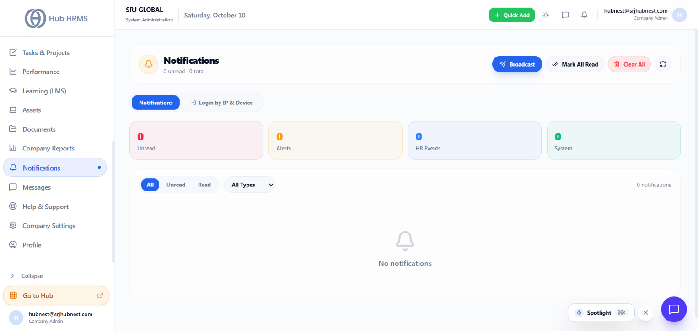
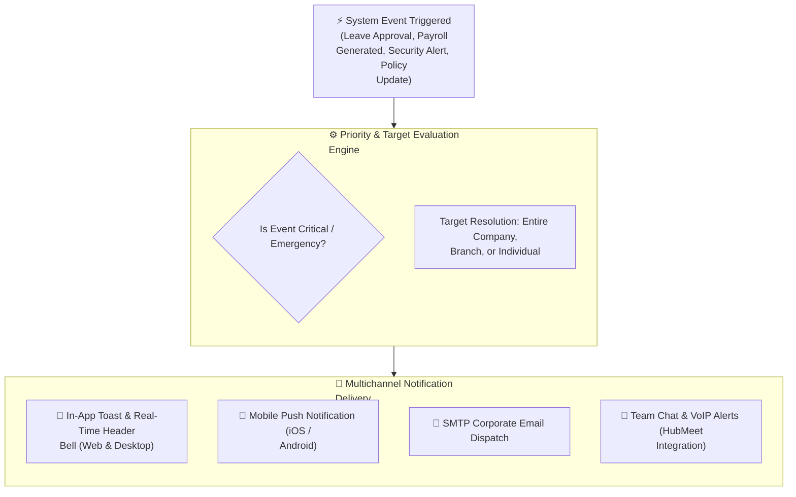
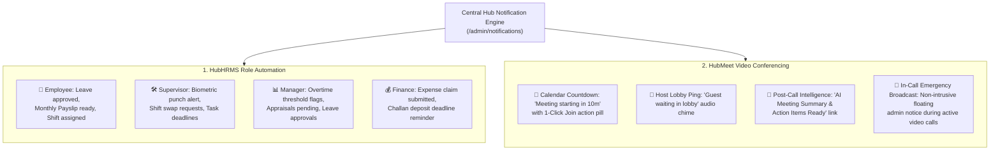

# Notifications, Broadcasts & Security Auditing

Timely communication keeps an enterprise synchronized and secure. The **Notifications** module (`/admin/notifications`) in **Hub HRMS** delivers an enterprise messaging hub—handling real-time workflow alerts, company-wide administrative **Broadcasts**, and detailed **IP & Device Security Access Logs**.

---

## 🔔 Live Interface Overview

Below is the live production console of the **Notifications & Security Audit** dashboard:

{ width="100%" }

---

## 🧭 System Architecture & Multichannel Dispatch Engine

Notifications are dispatched dynamically across multiple channels based on urgency and role:

---

## 📊 Dashboard Metric Cards Explained

At the top of the `/admin/notifications` workspace, four operational cards summarize current alerts:

| Metric Card | Definition & Logic | Operational Significance |
| :--- | :--- | :--- |
| **🔴 Unread** | Total pending notifications requiring user acknowledgment or action. | Informs users of unread operational updates. |
| **⚠️ Alerts** | High-priority warnings (e.g., failed punches, shift conflicts, policy infractions). | Flags urgent items requiring immediate managerial attention. |
| **🎉 HR Events** | Celebratory and milestone notices (birthdays, work anniversaries, new hire welcomes). | Promotes positive corporate culture and team bonding. |
| **⚙️ System** | Technical infrastructure alerts (software updates, maintenance windows, backups). | Keeps administrators informed of platform health. |

---

## 🗂️ Core Functional Tabs

The module features two specialized operational views:

### 1. `Notifications` (Inbox & Broadcast Center)
* **Live Feed**: Filter notifications by **All**, **Unread**, **Read**, or specific **Types** (*Alerts*, *HR Events*, *System*).
* **Mark All Read**: Instantly acknowledges all pending notices.
* **Clear All**: Cleans historical archived notices.

### 2. `Login by IP & Device` (Cybersecurity Access Logs)
Enterprise security administrators can monitor every authentication event across the organization:
* **Timestamp**: Exact date, hour, minute, and second of login attempt.
* **Employee Identity**: Name, corporate email, and role.
* **Client IP Address**: Public IP address used during login.
* **Device & Browser Details**: Operating system (Windows, macOS, Android, iOS) and browser user-agent.
* **Authentication Status**: `SUCCESS` or `FAILED` (flags potential brute-force attempts).

---

## 🛠️ Step-by-Step: Sending a Company Broadcast (`📢 Broadcast`)

When leadership needs to communicate emergency weather closures, holiday wishes, or mandatory policy updates:

1. Click the blue **📢 Broadcast** button in the upper-right corner.
2. Complete the broadcast dispatch form:
   * **Broadcast Title**: Punchy, clear headline (e.g., *Office Closure Notice - Severe Weather Alert*).
   * **Message Body**: Rich text message with instructions.
   * **Priority Level**: Select `NORMAL`, `URGENT`, or `CRITICAL` (which displays a persistent modal on all active screens).
   * **Target Audience**:
     * `Entire Company`: Reaches every registered user.
     * `Specific Branches`: Reaches staff in affected cities (e.g., *Mumbai & Pune Branches*).
     * `Specific Departments`: Reaches functional teams (e.g., *Sales Team Only*).
   * **Channels**: Toggle in-app alert, mobile push, and email dispatch.
3. Click **Send Broadcast**. Delivery occurs across all active sessions within seconds.

---

## 🔗 Cross-Module Integration: How Hub Notifications Connects HubMeet & HRMS

The Hub Notification Engine serves as the central nervous system connecting every role and application across the HubNest ecosystem:

* **Interactive Action Pills (`Join Now`, `Approve`, `View Payslip`)**: Notifications are not just passive text—they render actionable buttons directly inside the notification flyout (`🔔`), allowing managers to approve leaves or join HubMeet rooms in a single click without navigating menus.
* **Unified Notification Bell (`🔔`) Across All Layouts**: Whether you are inside `/employee/dashboard`, `/supervisor/attendance`, `/manager/team`, or `/admin/company`, the top header features the synchronized bell with live red counter badges.
* **Smart Notification Grouping**: Repeated system events (e.g., 5 shift check-ins in 2 minutes) are intelligently grouped into a single digest card to prevent alert fatigue.

---

## 💡 Best Practices & Common FAQs

> [!TIP]
> **Audit Failed Logins Weekly:** Check the **Login by IP & Device** tab periodically. If an employee account shows multiple failed logins from unrecognized foreign IP addresses, immediately trigger an administrative password reset and session invalidation.

### Frequently Asked Questions

#### Q1: Can employees configure their own notification preferences?
Yes. Employees can visit their personal account settings to toggle email digests or mobile push sounds for non-critical alerts.

#### Q2: How long are security audit logs retained?
Login access logs are securely preserved for 365 days to satisfy standard enterprise cybersecurity and SOC-2 compliance requirements.
