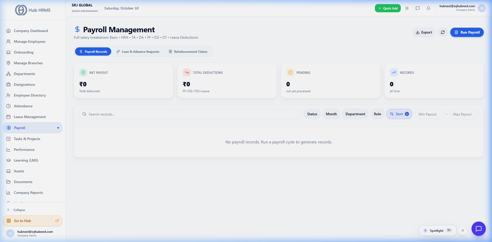
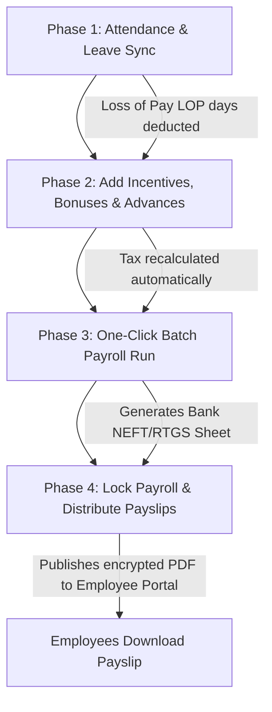

# Payroll Processing, Tax Engine & Payslips

The **Payroll Engine** (`/admin/payroll` and `/finance/payroll`) automates monthly compensation processing, synchronizing attendance punch records, approved leaves, overtime hours, and statutory tax obligations into a seamless one-click payroll disbursement run.

---

## 💰 Live Payroll Processing Interface

Below is the live production screen of the **Payroll Management Console**:

{ width="100%" }

---

## 📊 Salary Structure Breakdown (Earnings vs Deductions)

Hub HRMS computes salaries based on transparent earnings components and legal compliance deductions:

```
┌────────────────────────────────────────────────────────┐
│                   TOTAL GROSS SALARY                   │
├──────────────────────────┬─────────────────────────────┤
│  EARNINGS                │  STATUTORY DEDUCTIONS       │
│  • Basic Salary (50%)    │  • Provident Fund (PF 12%)  │
│  • HRA (20%)             │  • ESI (0.75% / 3.25%)      │
│  • Special Allowance     │  • Professional Tax (PT)    │
│  • Conveyance Allowance  │  • Tax Deducted at Source   │
│  • Performance Bonus     │  • Salary Advances / Loans  │
└──────────────────────────┴─────────────────────────────┘
                             │
                             ▼
                    NET TAKE-HOME SALARY
```

### Statutory Compliance Formulas
1. **Employee Provident Fund (EPF)**: 12% deducted from Basic Pay (capped at statutory wage ceiling or actual basic).
2. **Employee State Insurance (ESI)**: 0.75% employee contribution + 3.25% employer contribution for qualifying income brackets.
3. **Professional Tax (PT)**: State-specific slabs (e.g. ₹200/month).
4. **Income Tax (TDS)**: Calculated based on chosen tax regime (Old vs New Regime) and submitted investment proofs.

---

## ⚙️ Monthly Payroll Execution Workflow

Finance Officers and Company Administrators execute payroll in four structured phases:



1. **Phase 1: Attendance Sync**: Pulls total present days, approved leaves, and unauthorized absences (LOP).
2. **Phase 2: Variable Adjustments**: Add performance bonuses, sales commissions, overtime hours, or deduct outstanding loan EMIs.
3. **Phase 3: Batch Run Execution**: Clicking **Run Payroll** processes all active employees in seconds, validating math and computing exact tax deductions.
4. **Phase 4: Lock & Distribute**: Once verified, locking the payroll cycle publishes PDF payslips directly to employee self-service portals and exports the bank transfer payout file (NEFT/RTGS CSV).

---

## 📄 Automated Digital Payslip Generation

Employees can instantly view and download their branded, password-protected PDF payslips directly from their **Salary** portal (`/employee/salary`):
* **Complete Transparency**: Shows exact working days, LOP deductions, itemized gross earnings, and net take-home salary.
* **Company Verification**: Includes company registration number, office address, and authorized digital stamp.
