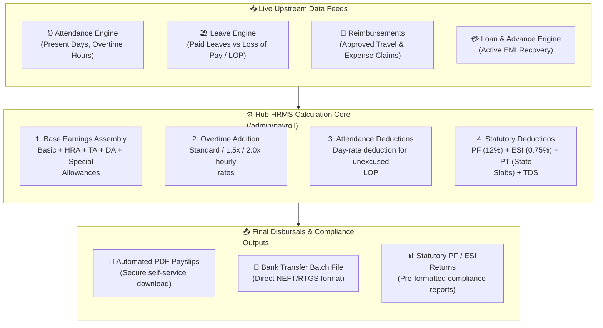

# Payroll Management & Compensation Engine

Processing monthly compensation accurately and on time is essential for employee trust and legal compliance. The **Payroll** module (`/admin/payroll`) in **Hub HRMS** is an enterprise-grade financial engine that automates salary computations, tax deductions, overtime disbursements, and statutory reporting.

By directly syncing attendance logs, approved leaves, and expense reimbursements, Hub HRMS calculates exact gross-to-net pay with zero manual spreadsheet entry.

---

## 💰 Live Interface Overview

Below is the live production console of the **Payroll Management** dashboard:

{ width="100%" }

---

## 🧭 System Architecture & Monthly Payroll Pipeline

The Hub HRMS compensation engine processes compensation through a unified four-stage calculation pipeline:

---

## 📊 Dashboard KPI Cards Explained

At the top of the `/admin/payroll` workspace, four financial metric cards summarize current pay-cycle liabilities:

| Metric Card | Definition & Logic | Financial Significance |
| :--- | :--- | :--- |
| **🟢 Net Payout** | Total cumulative net compensation disbursed to employee bank accounts after all deductions. | Direct liquidity required for monthly banking disbursements. |
| **🔻 Total Deductions** | Aggregate statutory and operational withholdings ($\text{PF} + \text{ESI} + \text{TDS} + \text{PT} + \text{LOP}$). | Remittances owed to statutory government bodies (EPFO, ESIC, Tax Authorities). |
| **⚠️ Pending** | Count of generated payroll draft records awaiting HR audit, verification, or final sign-off. | Flags unprocessed salaries requiring managerial authorization. |
| **📈 Records** | Cumulative count of total historical salary slips processed all-time across the company. | High-level indicator of payroll archive depth and multi-year auditing history. |

---

## 🗂️ Core Functional Tabs

The module organizes payroll operations into three distinct workspaces:

### 1. `Payroll Records` (Default Tab)
Displays all generated employee payslips for the selected month. Includes searchable filters for **Status** (`DRAFT`, `PROCESSED`, `PAID`), **Month/Year**, **Department**, and **Minimum to Maximum Payout** sliders.

### 2. `Loan & Advance Requests`
Employees facing financial emergencies can request salary advances or corporate loans through their self-service portal.
* Administrators review loan amounts, approve disbursement, and configure monthly EMI deductions.
* When active, the payroll engine automatically withholds the scheduled EMI amount from the employee's monthly pay until repaid.

### 3. `Reimbursement Claims`
Employees submit business expense receipts (client dinners, travel fuel, project software licenses).
* Once approved by the department manager and finance auditor, reimbursement totals are appended tax-free to the employee's upcoming salary slip.

---

## 📐 Salary Structure & Mathematical Formulas

Hub HRMS evaluates compensation using transparent standard formulas:

$$\text{Gross Earnings} = \text{Basic} + \text{HRA} + \text{TA} + \text{DA} + \text{Special Allowances} + \text{Overtime Pay}$$

$$\text{Total Deductions} = \text{PF (Employee)} + \text{ESI (Employee)} + \text{Professional Tax (PT)} + \text{TDS} + \text{LOP} + \text{Loan EMI}$$

$$\mathbf{Net\ Take-Home\ Pay} = \mathbf{Gross\ Earnings} - \mathbf{Total\ Deductions}$$

### Statutory Breakdown
* **Provident Fund (PF)**: $12\%$ of Basic salary (up to statutory cap of ₹1,800/month for basic wages up to ₹15,000, or actual 12% on full basic as configured).
* **Employee State Insurance (ESI)**: $0.75\%$ employee contribution on gross salary for employees earning under the statutory threshold (₹21,000/month).
* **Professional Tax (PT)**: State-specific graded slabs based on office branch location (e.g., ₹200/month in Maharashtra and Karnataka).
* **Loss of Pay (LOP)**:
  $$\text{Per-Day Salary} = \frac{\text{Monthly Gross Salary}}{\text{Total Days in Month}}$$
  $$\text{LOP Deduction} = \text{Per-Day Salary} \times \text{Unpaid Absent Days}$$

---

## 🛠️ Step-by-Step: Running a Monthly Payroll Cycle (`▶ Run Payroll`)

Executing an end-of-month payroll cycle takes less than two minutes:

1. Navigate to **Payroll Management** (`/admin/payroll`).
2. Verify that all leaves for the month are approved and attendance regularization requests are resolved.
3. Click the blue **▶ Run Payroll** button in the top right.
4. Select the target **Pay Period / Month** and **Office Branch** (or select *All Branches*).
5. The system performs batch calculations, locking attendance data and populating draft records.
6. **Audit & Verification**: Inspect individual employee rows. Click **View Details** to review itemized earnings and deductions.
7. Click **Lock & Finalize**. The system marks records as `PAID`, triggers automated notifications, and makes digital PDF payslips accessible in employee self-service portals.
8. Click **Export → Bank Transfer File** to download the pre-formatted NEFT/RTGS batch file ready for upload to your corporate banking portal (HDFC, ICICI, SBI, Axis, etc.).

---

## 💡 Best Practices & Common FAQs

> [!TIP]
> **Set a Monthly Payroll Cutoff Date:** Establish a fixed monthly cutoff (e.g., the 25th of every month). All leave submissions, expense claims, and attendance regularizations must be submitted before this date to be included in the current month's disbursement.

### Frequently Asked Questions

#### Q1: Can an individual employee's salary slip be edited after running payroll?
Yes, as long as the payroll batch is in `DRAFT` status. Once marked as `FINALIZED / PAID`, records are locked to prevent compliance discrepancies. Adjustments must then be handled via arrears in the subsequent pay cycle.

#### Q2: Where do employees find their digital payslips?
Employees can view and download encrypted, password-protected PDF payslips directly from their self-service dashboard under `/employee/payroll/payslips`.

#### Q3: Does Hub HRMS support both New and Old Indian Tax Regimes?
Yes. During onboarding or annual tax declaration, employees select their tax regime (`IN_NEW_REGIME` or `IN_OLD_REGIME`), and TDS calculations adapt accordingly.
