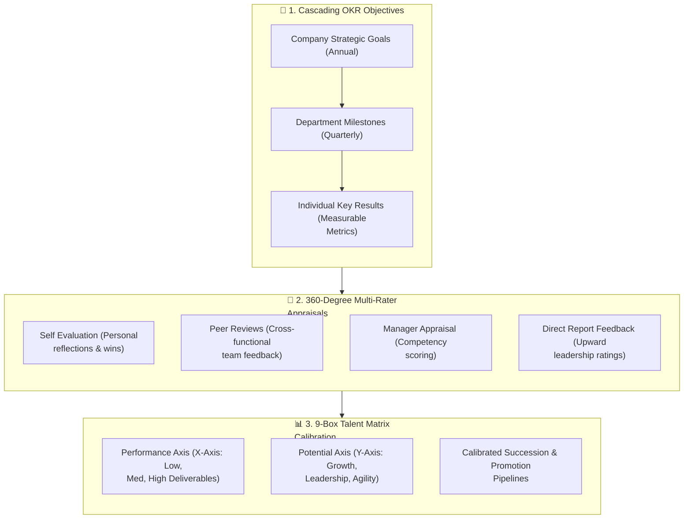

# 360° Performance Reviews & 9-Box Talent Matrix

Modern high-performance enterprises require objective, data-backed talent evaluation. The **Performance** module (`/admin/performance`) in **Hub HRMS** replaces subjective annual appraisals with continuous **360-degree feedback**, cascading **OKRs (Objectives & Key Results)**, and an interactive **9-Box Talent Grid** for executive succession planning.

---

## 🎯 Live Interface Overview

Below is the live production console of the **Performance & 9-Box Talent Matrix** workspace:

{ width="100%" }

---

## 🧭 System Architecture & Continuous Performance Cycle

Performance management in Hub HRMS operates as an ongoing closed-loop development cycle:

---

## 🗂️ Core Functional Workspaces

The module is divided into three interconnected evaluation tabs:

### 1. `9-Box Talent Matrix` (Default View)
The industry standard framework for leadership talent calibration and succession planning. It plots employees on two axes:
* **Horizontal Axis (Performance)**: Historical delivery of goals, task completion, and KPI scores.
* **Vertical Axis (Potential)**: Growth capacity, leadership capabilities, and agility to take on complex organizational challenges.

The matrix groups employees into nine actionable talent cohorts:

| 9-Box Grid Cohort | Performance & Potential Profile | Recommended Talent Action |
| :--- | :--- | :--- |
| **⭐ Star Performer** | High Performance / High Potential | Fast-track promotion, leadership development, equity retention grants. |
| **High Potential** | Medium Performance / High Potential | Coaching, high-visibility cross-functional projects, mentorship. |
| **High Performer** | High Performance / Medium Potential | Core functional anchor, specialist technical career track, performance bonuses. |
| **Core Player** | Medium Performance / Medium Potential | Steady operational contributor, skill refinement, sustained enablement. |
| **Dilemma / Enigma** | Low Performance / High Potential | Role mismatch investigation, skill training, reassignment to suitable project. |
| **Underperformer** | Low Performance / Low Potential | Formal Performance Improvement Plan (PIP) or mutually agreed transition. |

---

### 2. `Cascading OKRs & KPIs`
Enables agile alignment across teams:
* **Objective Setting (`+ Create OKR Objective`)**: Formulate ambitious qualitative targets (e.g., *Achieve 99.99% Cloud Infrastructure Uptime*).
* **Key Results**: Define 3–5 quantitative, measurable milestones (e.g., *Reduce mean time to recover (MTTR) below 15 minutes*).
* **Progress Tracking**: Employees update slider percentages, which roll up automatically into departmental dashboards.

---

### 3. `360 Multi-Rater Reviews`
Facilitates balanced, multi-perspective feedback:
* **Self Review**: Employees document achievements, challenges, and self-ratings against company core competencies.
* **Peer Reviews**: 2–3 nominated colleagues provide structured feedback on collaboration, communication, and technical teamwork.
* **Manager Evaluation**: Supervisory assessment with weighted ratings across functional skill categories.
* **Anonymous Upward Feedback**: Direct reports rate manager leadership, transparency, and support.

---

## 🛠️ Step-by-Step Performance Workflows

### 1. Launching an Appraisal Cycle (`Submit 360 Review`)
1. Company Admins configure cycle dates (e.g., *Q3 Annual Performance Cycle*).
2. Select target departments and choose the evaluation template.
3. System dispatches automated notifications and sets task deadlines on employee dashboards.

### 2. Conducting Calibration Sessions
Department Heads and HR leaders view the aggregated **9-Box Grid** to eliminate evaluator bias (e.g., strict managers vs lenient raters) and calibrate bell-curve ratings across business units.

---

## 💡 Best Practices & Common FAQs

> [!TIP]
> **Keep OKRs Focused:** Never assign more than 3–4 Objectives and 3–5 Key Results per employee per quarter. Measurable, bite-sized goals drive focus and clear accountability.

### Frequently Asked Questions

#### Q1: Are peer reviews completely anonymous?
Yes, peer feedback is aggregated and anonymized in the final report to encourage honest, constructive insights.

#### Q2: How does performance connect to annual compensation revisions?
Calibrated scores and 9-box classifications integrate with the **Payroll** compensation engine to calculate performance bonus payouts and annual salary increment bands.
