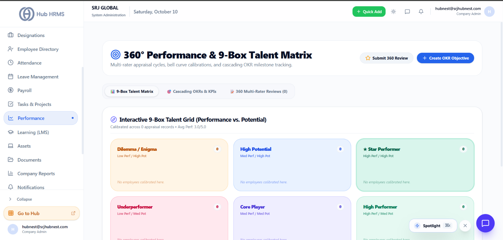

# Performance Reviews, OKRs & Appraisals

The **Performance** module (`/admin/performance`) automates corporate appraisal cycles, captures 360-degree multi-rater feedback, and aligns individual contributions with organizational **Objectives and Key Results (OKRs)**.

{ width="100%" }

---

## 📈 Key Features
* **Appraisal Review Cycles**: Launch automated review windows with customized questionnaires.
* **360° Multi-Rater Feedback**: Combine self-evaluations, manager assessments, peer feedback, and executive reviews.
* **OKR Goal Tracking**: Set quarterly objectives and track quantifiable key results in real time.
* **Rating Matrix & Compensation Alignment**: Convert appraisal scores into structured rating bands (1-5 stars) to support annual merit increases and bonuses.
