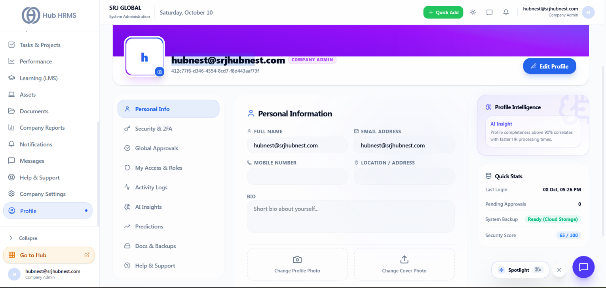
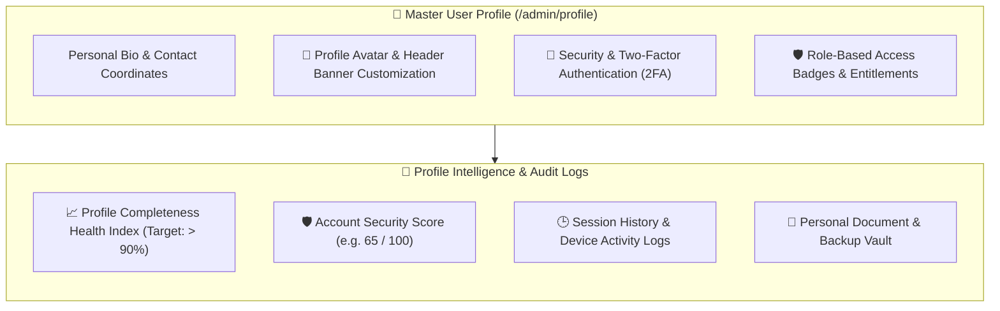

# User Profile, Security & Account Preferences

Your digital identity in the Hub HRMS workplace ecosystem is anchored to your **User Profile** (`/admin/profile`). This centralized self-service console allows employees, managers, and administrators to maintain accurate personal contact records, configure two-factor authentication (2FA), review account activity logs, and monitor personal security health scores.

---

## 👤 Live Interface Overview

Below is the live production console of the **User Profile & Security** workspace:

{ width="100%" }

---

## 🧭 System Architecture & Profile Ecosystem

The user profile connects personal identity data with security credentials and operational roles:

---

## 🗂️ Core Functional Workspaces

The profile management center is organized into nine dedicated settings views in the left navigation menu:

### 1. `Personal Info` (Default View)
* **Identity Banner**: Displays customized header cover image, profile picture avatar, legal name, corporate email address, and official organizational role badge (e.g., `COMPANY ADMIN`).
* **Editable Fields (`Edit Profile`)**:
  * **Full Name**: Legal name used on contracts, payslips, and compliance reports.
  * **Email Address**: Corporate email used for single sign-on (SSO) authentication.
  * **Mobile Number**: Direct phone contact used for urgent operational alerts and SMS 2FA.
  * **Location / Address**: Residential mailing address and city.
  * **Professional Bio**: Short summary of skills, specialties, and background.
* **Photo Uploaders**:
  * **Change Profile Photo**: Upload standard avatar images (`JPG`, `PNG`, `WebP`).
  * **Change Cover Photo**: Personalize profile headers with custom corporate banners.

---

### 2. `Security & 2FA`
* **Two-Factor Authentication**: Connect standard authenticator apps (Google Authenticator, Microsoft Authenticator, Authy) via QR code scanning.
* **Password Management**: Update account passwords with real-time complexity strength evaluation.
* **Active Sessions**: Inspect all devices currently signed in to your account with a one-click **Sign Out All Other Devices** security safeguard.

---

### 3. `Global Approvals & Delegation`
When taking an extended vacation or medical leave:
* Nominate a temporary **Delegate Approver** from your department.
* Pending leave applications, expense claims, and timesheet approvals route to your delegate during the scheduled out-of-office window.

---

### 4. `My Access & Roles`
Review assigned enterprise roles (e.g., *Company Admin*, *HR Specialist*, *Employee*) and inspect the specific read/write permissions granted across system modules.

---

### 5. `Activity Logs`
A personal audit trail logging key account interactions—including profile edits, password updates, leave submissions, and document downloads with timestamps and IP addresses.

---

### 6. `Docs & Backups`
Quick-access personal vault storing copies of your signed employment contract, past payslips, annual Form 16 certificates, and tax investment declarations.

---

## 📊 Profile Intelligence & Security Score

The right-side summary rail provides real-time account telemetry:

* **Profile Completeness Index**: Analyzes profile completeness (avatar, emergency contacts, bio). Profiles completed above 90% correlate with faster HR query processing.
* **Security Score (e.g., `65 / 100`)**: Evaluates password age, 2FA activation, and session health, providing actionable recommendations to strengthen account security.
* **Quick Stats**: Displays **Last Login Timestamp**, count of **Pending Approvals** awaiting your signature, and **System Cloud Backup Status**.

---

## 💡 Best Practices & Common FAQs

> [!TIP]
> **Maintain Emergency Contact Details:** Always keep your mobile number and emergency contact coordinates up to date under **Personal Info**. HR operations rely on these verified lines during unexpected facility emergencies or travel incidents.

### Frequently Asked Questions

#### Q1: Can an employee edit their work email or assigned role from this screen?
No. Security-critical attributes—such as corporate email domain, assigned office branch, and role permissions—are governed by Company Administrators under `/admin/employees` to preserve organizational governance.

#### Q2: What should I do if my Security Score is low?
Enable Two-Factor Authentication (2FA) under the **Security & 2FA** tab and update your password to a strong phrase with special characters. This immediately raises your security score to 90+.
