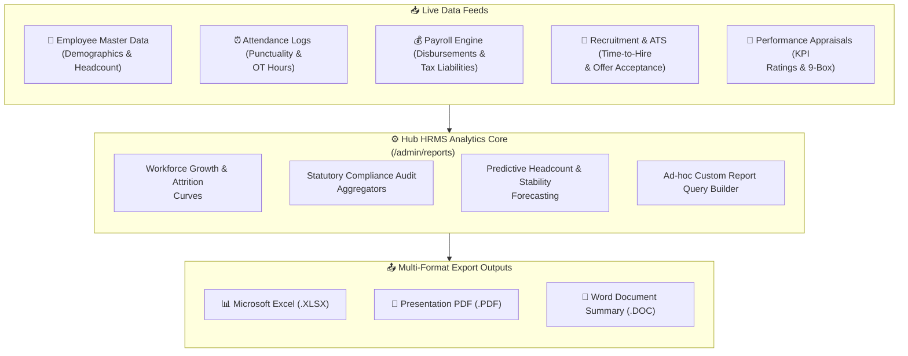

# Company Reports & Executive Analytics

Data-driven leadership requires instant access to accurate workforce metrics. The **Company Reports** module (`/admin/reports`) in **Hub HRMS** serves as your executive business intelligence center—aggregating cross-functional operational data into presentation-ready reports, predictive trends, and compliance audits.

---

## 📊 Live Interface Overview

Below is the live production console of the **Company Reports** analytics dashboard:

{ width="100%" }

---

## 🧭 System Architecture & Analytics Engine

The reporting engine continuously aggregates live data from every functional sub-module across the enterprise:

---

## 📊 Executive KPI Metric Cards Explained

At the top of the `/admin/reports` screen, four high-level executive cards summarize organizational health:

| Metric Card | Definition & Logic | Executive Significance |
| :--- | :--- | :--- |
| **👥 Total Employees** | Total active headcount across all branches with net percentage growth over prior period. | Primary indicator of workforce scale and organizational growth. |
| **💰 Total Payroll Cost** | Total cumulative monthly compensation liability (Gross Pay + Employer PF/ESI contributions). | Informs CFO and financial planners on human capital burn rate. |
| **⏰ Avg Attendance Rate** | Average percentage of active work hours logged versus scheduled shift hours. | Identifies workforce operational discipline and productivity health. |
| **🎯 Hiring Success Rate** | Percentage of extended job offers accepted by candidates who successfully join. | Measures talent acquisition efficiency and employer brand competitiveness. |

---

## 🗂️ Dedicated Specialized Report Suites

The left navigation menu provides immediate access to nine deep-dive audit modules:

1. **Dashboard Overview**: Executive bird's-eye view with net headcount trends and predictive health scorecards.
2. **Employee Reports**: Demographic breakdowns, tenure distributions, gender diversity ratios, and department headcount matrices.
3. **Attendance Reports**: Daily punch logs, chronic latecomer summaries, overtime hour audits, and shift-by-shift coverage.
4. **Payroll Reports**: Monthly salary disbursement registers, bank transfer logs, tax deduction (TDS) summaries, and statutory PF/ESI contribution schedules.
5. **Recruitment Reports**: Candidate funnel metrics, cost-per-hire, source effectiveness (LinkedIn vs Job Portals vs Referrals), and time-to-fill averages.
6. **Expense & Finance**: Departmental expense claims, travel reimbursement totals, and budget-vs-actual variance.
7. **Performance Reports**: 9-box talent distributions, OKR completion percentages, and bell-curve rating distributions.
8. **Compliance Reports**: Equal opportunity audits, minimum wage adherence, safety incident logs, and statutory audit registers.
9. **Custom Report Builder**: Drag-and-drop query engine allowing administrators to select custom columns, date ranges, and export filters.

---

## 📈 Visual Growth Trends & Predictive Analytics

* **Workforce Growth Trend**: Multi-colored area chart plotting historical headcount (Hired vs. Attrition vs. Net Active Employees).
* **Predictive Analytics Panel**:
  * **Workforce Stability**: Analyzes retention rates and flags flight-risk departments.
  * **Hiring Pipeline**: Real-time count of active candidates undergoing background verification.
  * **Expense Summary**: Outstanding unapproved claims requiring financial audit.
  * **Attendance Health**: Evaluates whether daily clock-in compliance meets company SLA benchmarks.

---

## 💡 Best Practices & Common FAQs

> [!TIP]
> **Schedule Automated Monthly Report Exports:** Save time during board meetings by using the **Custom Report Builder** to schedule automated monthly PDF/Excel delivery directly to executive inboxes.

### Frequently Asked Questions

#### Q1: Can reports be filtered by specific branches or departments?
Yes. Every report screen includes universal branch, department, and custom date range filters at the top of the page.

#### Q2: Are payroll and salary reports restricted from unauthorized HR personnel?
Yes. Granular RBAC permissions ensure only users with the `Finance Admin` or `Company Admin` role can generate compensation and tax reports.
