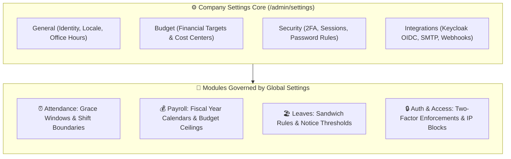

# Company Settings & System Configuration

The **Company Settings** module (`/admin/settings`) in **Hub HRMS** serves as the master control room for your corporate instance. Here, Company Administrators configure legal branding, standard work hours, fiscal year calendars, corporate expense budgets, cybersecurity policies, and external software integrations.

---

## ⚙️ Live Interface Overview

Below is the live production console of the **Company Settings** workspace:

{ width="100%" }

---

## 🧭 System Architecture & Configuration Hierarchy

Settings configured in this module propagate dynamically across every active module and employee portal:

---

## 🗂️ Core Configuration Tabs

The settings panel is structured into five dedicated operational tabs:

### 1. `⚙️ General` (Core Corporate Profile & Office Hours)
* **Company Identity**:
  * **Company Name**: Legal corporate business entity name displayed across all official payslips and contracts (e.g., `SRJ GLOBAL`).
  * **System Email**: Default reply-to corporate email address used by the notification engine (e.g., `hubnest@srjhubnest.com`).
* **Locale & Display Formats**:
  * **Language**: Primary user interface language (`English`).
  * **Date Format**: Standardize date formatting across tables and PDF exports (`DD/MM/YYYY`, `MM/DD/YYYY`, or `YYYY-MM-DD`).
* **Time & Calendar**:
  * **Timezone**: Default regional timezone (`Asia/Kolkata (IST, UTC+5:30)`). Governs attendance timestamps and meeting invites.
  * **Fiscal Year Start**: Beginning of the company's annual financial cycle (e.g., `April` for India/UK, `January` for US/EU).
* **Office Hours & Attendance Rules**:
  * **Office Start Time**: Standard morning check-in expectation (e.g., `09:00 AM`).
  * **Office End Time**: Standard evening departure expectation (e.g., `06:00 PM`).
  * **Late Threshold (Minutes)**: Configurable grace window (e.g., `5` to `15` minutes) before check-ins are tagged with a late penalty.

---

### 2. `💵 Budget` (Corporate Expense & Revenue Caps)
Enables finance controllers to establish concrete budget ceilings rather than relying on guesswork:
* **Revenue Targets**: Monthly and annual enterprise revenue goals.
* **Functional Cost Center Budgets**: Specific financial allocations for **Marketing Budget**, **IT & Cloud Infrastructure Budget**, **Corporate Travel Budget**, **Office Facilities Budget**, and **Payroll Budget**.

---

### 3. `🛡️ Security` (Cybersecurity & Access Governance)
* **Two-Factor Authentication (2FA)**: Enforce mandatory TOTP authenticator app verification across all administrator and employee accounts.
* **Session Invalidation**: Set automated timeout thresholds (e.g., auto-logout after 30 minutes of idle inactivity).
* **Password Complexity Rules**: Minimum character length (8–16 characters), requiring mixed case, numeric digits, and special symbols.

---

### 4. `🧩 Integrations` (Enterprise Ecosystem Connectivity)
* **Identity Provider (OIDC / SSO)**: Seamless Keycloak integration for enterprise single sign-on.
* **SMTP Gateway**: Configure dedicated corporate email servers (AWS SES, SendGrid, Microsoft 365, Google Workspace) for invitation dispatches.
* **Third-Party Webhooks**: Push real-time attendance alerts to corporate Slack or Microsoft Teams channels.

---

### 5. `🔔 Notifications` (Global Delivery Preferences)
Configure quiet hours, batch digest frequency, and default notification channels (Push, Email, In-App).

---

## 💡 Best Practices & Common FAQs

> [!TIP]
> **Align Fiscal Calendar with Tax Regimes:** Ensure your **Fiscal Year Start** matches your local statutory tax calendar (e.g., set to *April* in India to synchronize seamlessly with Form 16 and annual tax declaration cycles).

### Frequently Asked Questions

#### Q1: Does changing the office start time update past attendance records?
No. Adjusting work hours only applies to future attendance punches from that moment onward, preserving historical timesheet accuracy.

#### Q2: Who has permission to modify Company Settings?
Settings access is restricted strictly to users assigned the `Company Admin` role. Department Heads and HR Specialists can view relevant sections in read-only mode.
