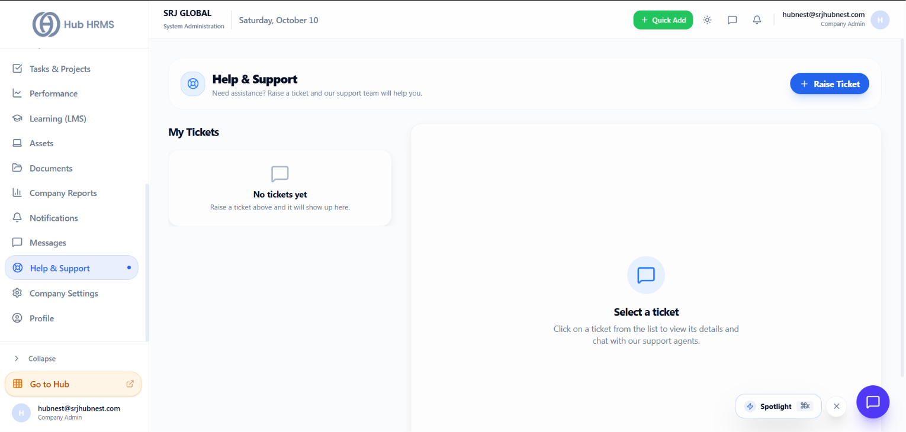
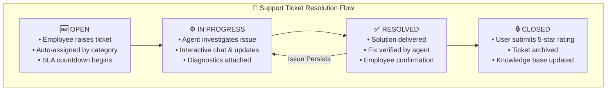

# Help & Support Ticketing System

Prompt issue resolution builds high employee morale and operational productivity. The **Help & Support** module (`/admin/support`) in **Hub HRMS** provides an internal enterprise helpdesk where employees can submit inquiries, report hardware failures, resolve payroll queries, and communicate directly with dedicated support agents.

---

## 🎧 Live Interface Overview

Below is the live production console of the **Help & Support** workspace:

{ width="100%" }

---

## 🧭 System Architecture & Ticket Lifecycle

Every support inquiry follows an automated service-level agreement (SLA) lifecycle:

---

## 🗂️ Core Functional Layout

The workspace is organized into a streamlined two-column service console:

### 1. Left Ticket Queue (`My Tickets`)
* **Queue List**: Displays all active and historical support tickets raised by or assigned to you.
* **Status Badges**:
  * 🔵 **OPEN**: Newly submitted request awaiting support agent assignment.
  * 🟡 **IN PROGRESS**: Assigned agent is actively investigating the issue.
  * 🟢 **RESOLVED**: Resolution delivered; awaiting employee confirmation.
  * ⚪ **CLOSED**: Finalized and archived ticket.
* **Category Tags**: Identifies the functional support desk (*IT & Hardware*, *Payroll & Compensation*, *HR Operations*, *Facility & Admin*).

### 2. Right Conversation & Resolution Canvas
* **Live Chat with Support Agents**: Real-time message exchange between the employee and the assigned specialist.
* **Attachment Previews**: Inspect uploaded error screenshots, system logs, or diagnostic reports.
* **Action Header**: Close ticket, re-open ticket, or escalate priority.

---

## 🛠️ Step-by-Step: Raising a Support Ticket (`+ Raise Ticket`)

When encountering an issue with company equipment, access permissions, or payroll questions:

1. Click the blue **+ Raise Ticket** button in the upper-right corner.
2. Complete the support requisition form:
   * **Subject**: Concise description of the problem (e.g., *VPN Connection Failure on MacBook Pro*).
   * **Category**: Choose the appropriate department desk:
     * `IT & Hardware`: Laptop repairs, Wi-Fi issues, software licenses, email logins.
     * `Payroll & Salary`: Payslip clarification, bank account update, tax declaration queries.
     * `HR & Policies`: Leave balance discrepancies, insurance card requests, employment letters.
     * `Facility & Workplace`: Desk ergonomics, parking pass, building access cards.
   * **Priority Level**:
     * `Low`: General inquiry with flexible turnaround.
     * `Medium`: Operational inconvenience with workaround available.
     * `High`: Work-stopping issue impacting individual productivity.
     * `Urgent`: Critical outage affecting multiple team members or urgent client deadlines.
   * **Detailed Description**: Detailed steps to reproduce the issue.
   * **Attachments**: Upload screenshots or error log files.
3. Click **Submit Ticket**. The ticket is dispatched to the helpdesk queue, and an automated tracking ID is issued.

---

## 💡 Best Practices & Common FAQs

> [!TIP]
> **Include Error Screenshots:** When reporting software bugs or access errors, always capture a screenshot showing the full browser window and URL. Detailed visuals reduce support back-and-forth by 70%.

### Frequently Asked Questions

#### Q1: What is the typical SLA response time?
Standard enterprise SLAs target response within **2 business hours** for `Urgent` issues and within **24 business hours** for `Low` inquiries.

#### Q2: Can a ticket be re-opened if an issue recurs?
Yes. If a problem returns after being marked as `RESOLVED`, the employee can click **Reopen Ticket** within 7 days to resume the conversation.
