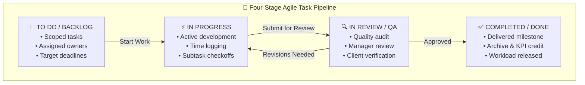

# Tasks & Projects Management

Bridging HR operations with daily execution, the **Tasks & Projects** module (`/admin/tasks`) in **Hub HRMS** provides an agile collaboration hub. It enables team leaders to delegate assignments, monitor progress through Interactive Task Pipeline Boards, and balance team bandwidth using the real-time **Workload Capacity Map**.

Unlike standalone project management tools disconnected from employee profiles, Hub HRMS ties every task directly to departmental structures, active leave calendars, and performance OKRs.

---

## 📋 Live Interface Overview

Below is the live production console of the **Tasks & Projects** workspace:

{ width="100%" }

---

## 🧭 System Architecture & Task Lifecycle

Every task transitions through four standardized operational stages, supporting agile sprints, client deliverables, and internal operational milestones:

---

## 🗂️ Core Functional Workspaces

The module provides three distinct views to accommodate different management styles:

### 1. `Task Board` (Agile Pipeline View)
* Visual column lanes: **TO DO / BACKLOG**, **IN PROGRESS**, **IN REVIEW / QA**, and **COMPLETED / DONE**.
* Interactive card interface displaying task title, assignee avatar, due date badges (color-coded red for overdue items), and priority tags.
* Supports intuitive drag-and-drop movement across lanes to update status in real time.

### 2. `Task Audit List` (Tabular Audit View)
* High-density table designed for executive audits and batch management.
* Displays Task ID, Title, Project Name, Assigned Department, Primary Assignee, Due Date, Completion Percentage, and Priority.
* Multi-select controls allow bulk reassignment or status changes.

### 3. `Workload Capacity Map` (Bandwidth & Resource Allocation)
* Visualizes bandwidth and allocated hours across every employee in the company.
* Color-coded indicators warn managers when an employee is:
  * **Under-allocated ($< 60\%$)**: Available for urgent project assignments.
  * **Balanced ($60\% - 90\%$)**: Operating at optimal sustainable pace.
  * **Overburdened ($> 100\%$)**: Risk of missed deadlines or burnout; alerts managers to redistribute tasks.
* Automatically integrates with the **Leave Management** module to flag assignees with upcoming scheduled leaves.

---

## 🛠️ Step-by-Step Task Operations

### 1. Creating & Assigning a Task (`+ Quick Add` / Task Modal)
1. Click **+ Quick Add** in the top navigation or click the **+** icon at the top of any pipeline stage.
2. Complete the task creation form:
   * **Task Title**: Clear, actionable summary (e.g., *Migrate Payroll Database to High-Availability Cluster*).
   * **Project / Department**: Select the functional business unit.
   * **Primary Assignee**: Assign an employee from the company directory.
   * **Collaborators / Watchers**: Tag additional team members for notification updates.
   * **Priority Level**: Choose from `LOW`, `MEDIUM`, `HIGH`, or `URGENT`.
   * **Due Date & Time**: Set the target completion milestone.
   * **Detailed Description**: Markdown-supported rich text instructions and deliverables.
3. Click **Create Task**. The assignee receives an immediate in-app notification and email alert.

### 2. Updating Progress & Moving Tasks
* **Drag-and-Drop**: Click and hold a task card, then drag it across to the next stage (e.g., from *In Progress* to *In Review*).
* **Detailed Task Drawer**: Click on any card to open the slide-out inspector to log spent hours, post comment threads, attach specification documents, or check off subtask checklists.

### 3. Multi-Vector Filtering
Refine your task board using the header filter bar:
* **All Departments**: Filter by functional unit (Engineering, Design, Marketing).
* **All Assignees**: Focus on an individual team member's active commitments during 1-on-1 reviews.
* **All Priorities**: Isolate `URGENT` blockers requiring immediate managerial intervention.
* **All Statuses**: Toggle between active stages or include completed archives.

---

## 🔗 How Tasks Connect Across Hub HRMS

* **Performance & OKRs**: Milestone completion feeds directly into employee quarterly performance reviews and 360-degree talent appraisals.
* **Timesheet Tracking**: Time logged on specific tasks can be verified against daily attendance clock-in durations.
* **Workforce Directory**: Direct links allow team members to click an assignee’s avatar to inspect their department, branch, and contact channels.

---

## 💡 Best Practices & Common FAQs

> [!TIP]
> **Check Capacity Before Assigning:** Before delegating urgent assignments, open the **Workload Capacity Map** tab to verify that the target assignee has sufficient bandwidth and is not scheduled on leave during the sprint window.

### Frequently Asked Questions

#### Q1: Can an employee assign tasks to their peers?
Yes, team members can collaborate by assigning tasks to peers within their department or cross-functional projects, subject to departmental permissions.

#### Q2: What happens when a task exceeds its due date?
Overdue tasks display an amber/red warning badge on the pipeline board, and automated daily digest notifications remind both the assignee and their supervisor.
