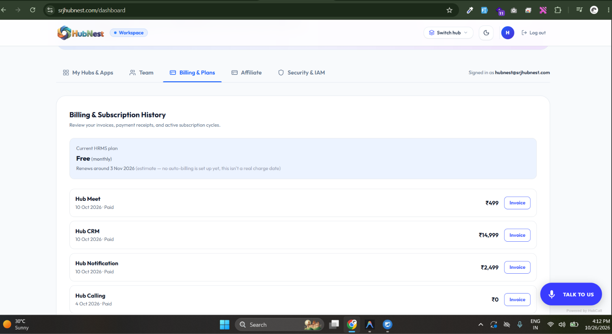
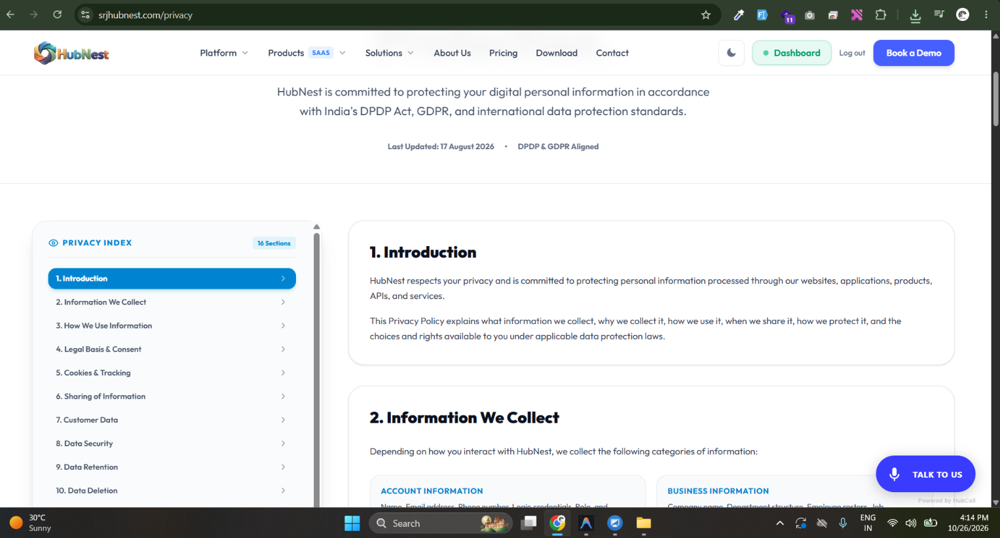
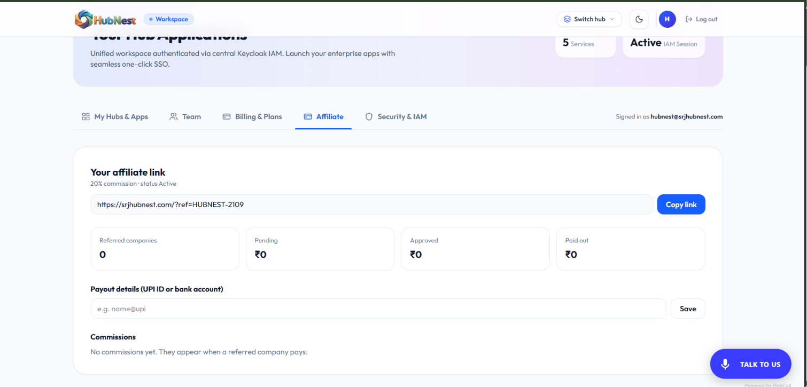
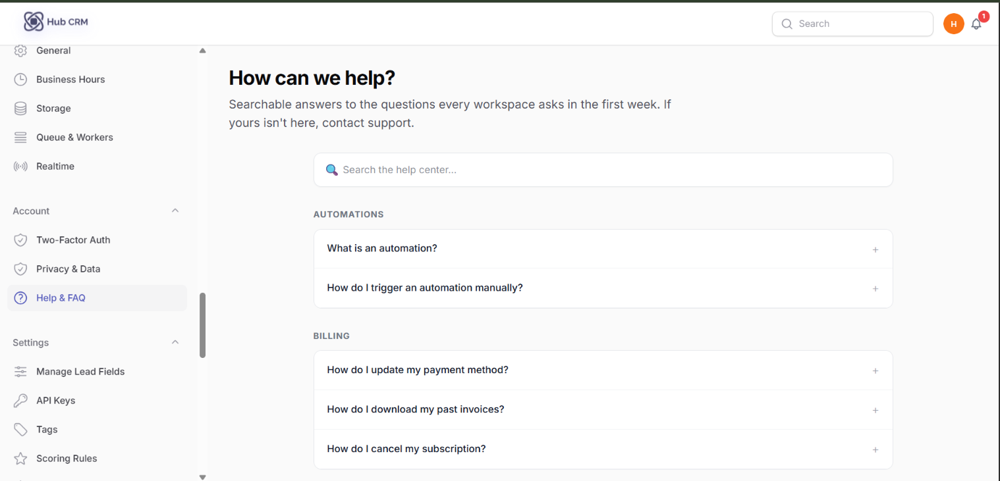
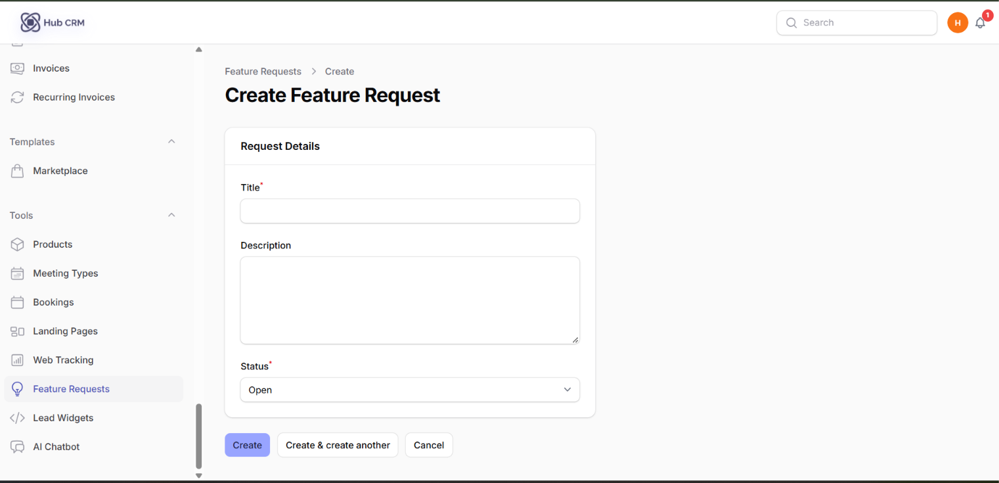

# Account, Billing, Privacy and Referrals

## Billing & Subscription

**Account → Billing**: your current plan, seats, renewal date, payment method and past invoices. Plan changes and renewals are handled through HubNest billing. If a subscription lapses the workspace shows a **Subscription Required** page until it is renewed - your data is kept.

**Cancel subscription**: the cancel screen asks for a reason and confirms the end date. Your workspace stays usable until the paid period ends.

!!! info "The cancel screen"
    A confirmation dialog opens with a dropdown asking **why you are cancelling** (too expensive, missing a feature, switching tools, other - with a free-text box for "other"), a line stating the exact date access ends (*"Your workspace stays active until 30 Nov 2026"*), and two buttons: a quiet **Keep my subscription** and a red **Cancel subscription**. After confirming, a banner stays on every page reminding you of the end date until you either renew or the period runs out.

## Privacy & Data

**Account → Privacy & Data** lets the workspace admin:

- **Export** all workspace data.
- **Request erasure** of the workspace or of a person's data (GDPR-style). Erasure runs after a waiting period; a banner shows the scheduled date.

## Referrals

**Settings → Referrals** gives you a personal link. When someone signs up through it you earn the reward shown on the page.

## Help Center and Feature Requests

- **Account → Help Center**: short articles for each feature.
- **Tools → Feature Requests**: suggest an idea; **Upvote** others'.

