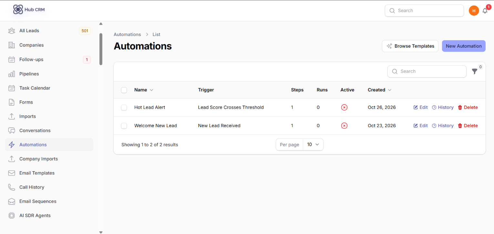
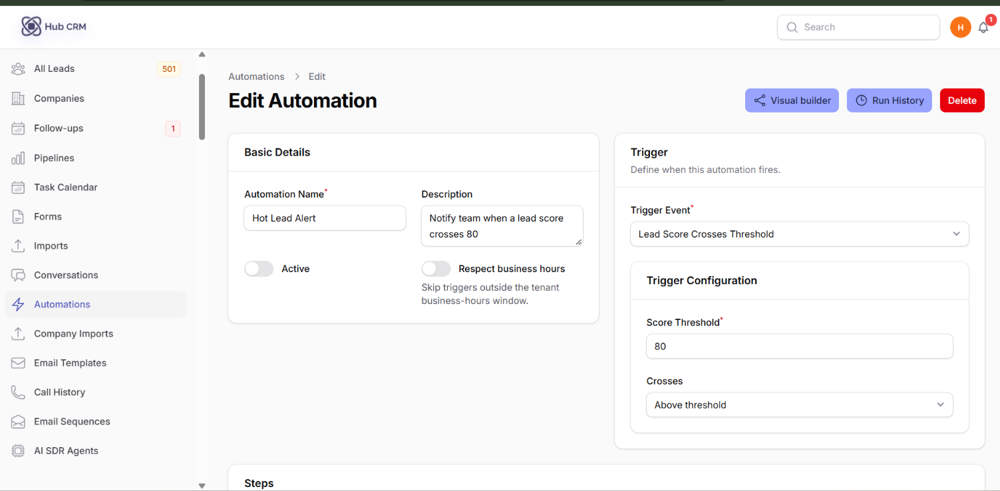
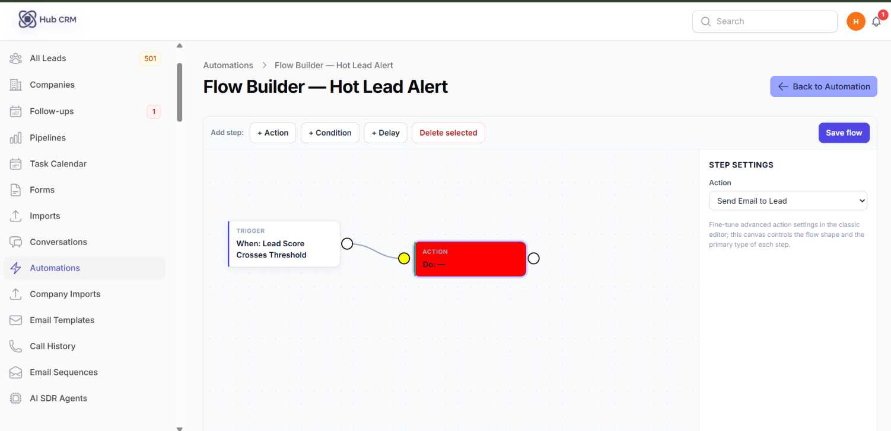
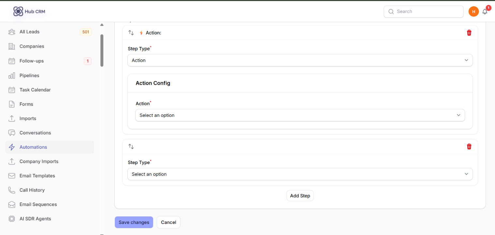
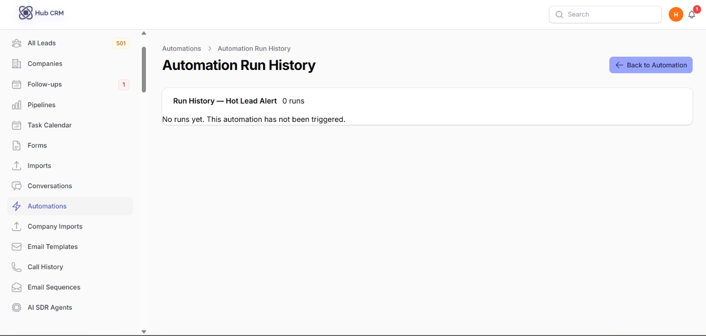

# Automations

An **automation** does work for you when something happens - for example, assign a new web lead to the next agent, create a task, and send a welcome WhatsApp.

## Start from a template

1. Open **Leads → Automations** and click **Browse templates** (or **Tools → Automation Templates**).
2. Pick a template, preview its steps and click **Use template**.
3. Review and adjust the steps, then switch the automation **Active**.

## Build your own

1. Click **New Automation**, enter a **Name** and **Description**.
2. Choose the **Trigger Event** - when should it fire?
3. Add **steps**. They run top to bottom; drag to reorder.
4. Turn on **Respect business hours** if it should skip triggers outside your business-hours window.
5. Turn on **Active** and save.

### Triggers

New lead, lead updated, status changed, moved from stage / to stage, tag added, score crosses a threshold, no activity for a period, a date field approaching (birthday, anniversary - repeats yearly), form submitted, and more. Filters such as *Source(s)* or *Form* narrow when it fires.

### Step types

| Step | What you configure |
| :--- | :--- |
| **Condition** | Filter by source, field value, score, user, time range (e.g. 09:00-17:00) or days of the week |
| **Delay** | Wait a number of minutes, hours or days |
| **Send email** | Choose an email template |
| **Send SMS / WhatsApp** | Message text with merge fields like `{{first_name}}`; WhatsApp can use a free-form message or an approved template |
| **Assign lead** | One user or a round-robin pool |
| **Change status / Move pipeline stage** | Target status or stage |
| **Add / remove tag** | Tag name |
| **Create task** | Title (supports `{first_name}`), due in hours, priority, assignee |
| **Notify users** | Pick users, optionally the assigned agent, custom message |
| **Slack message / Webhook** | Slack webhook URL; or any URL with optional HMAC secret, headers and custom JSON payload |
| **Enroll in email sequence / AI SDR agent** | Choose the sequence or agent |

## Monitor runs

- Click **Run history** on an automation to see each run, its steps and any error.
- The **Automations** sidebar item shows a badge when runs failed in the last 24 hours.
- **Reports → Automation Stats** summarises runs, success rate and top automations.

!!! warning
    Disable (**Disable** action) an automation before editing a live one that sends messages, so a half-edited flow does not message customers.
