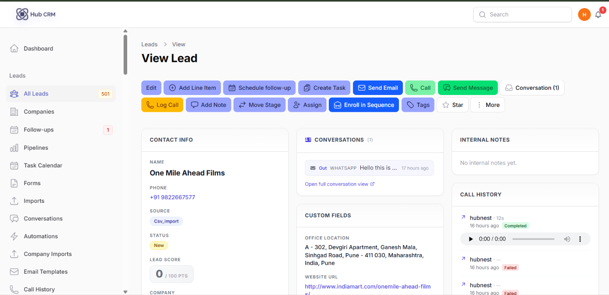
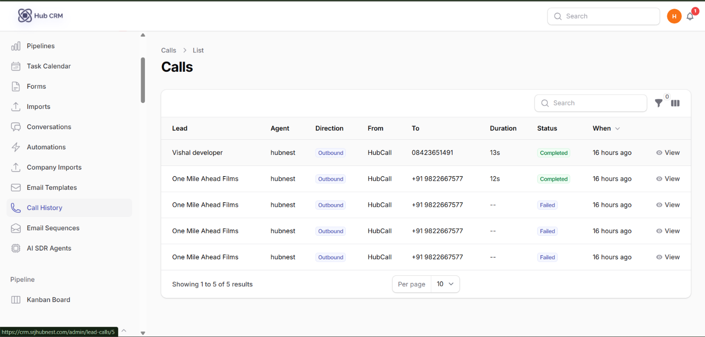
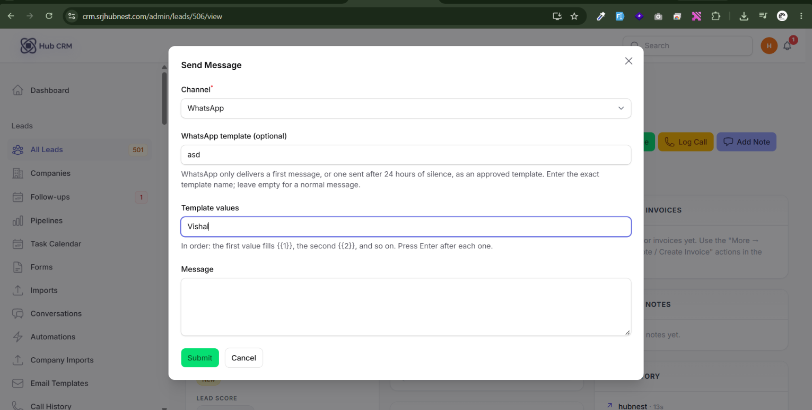
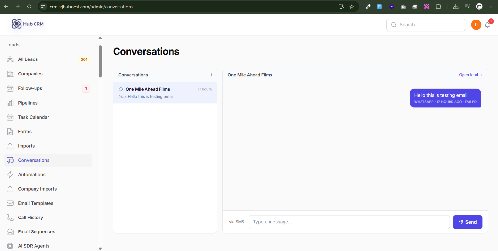

# Calls, WhatsApp and SMS

## Click-to-call

If your workspace is connected to **HubCall** (see [Integrations & API](integrations-api.md)), you can call a lead without leaving the lead page.

1. Make sure your own phone number is saved in **Settings → My Profile → Phone**. HubCall first rings **your** phone, then connects the lead.
2. Open a lead and click **Call**.
3. Answer your phone. The lead's phone rings next and the call is bridged.
4. When you finish, HubCRM asks for the **call outcome** and **notes**; you can also schedule the next follow-up.

!!! note "Which number do leads see?"
    Leads see the number your admin enabled for **HubCRM Calling** in HubCall. If no number is enabled, the call button explains what to configure.

## Call History

**Leads → Call History** lists every call: lead, agent, direction, status, duration, time and notes. For completed calls with recording enabled, click **Play** to listen in the browser. Calls with a transcript show it on the call.

## WhatsApp and SMS

From a lead, click **WhatsApp** or **SMS**, write the message and send. Messages are sent through your connected provider (HubNotification or your own WhatsApp Business / SMS provider - configured in **Communications → Messaging Providers**).

- **WhatsApp free-form messages** only deliver within 24 hours of the lead messaging you. To start a conversation use an **approved template** (enter the template name exactly as in WhatsApp Manager).
- Replies from leads arrive in **Conversations** and on the lead's timeline.

## Conversations inbox

**Leads → Conversations** is a unified inbox of leads' messages (WhatsApp, SMS and email replies). Pick a conversation on the left, read the thread and reply. The **Waiting On** filter on the leads list tells you who owes the next reply.

