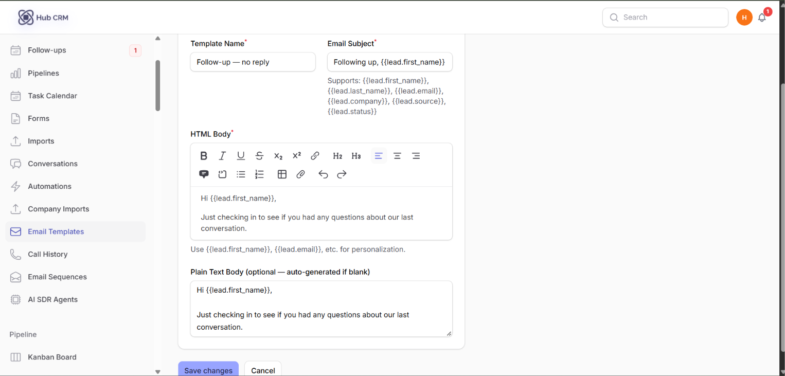
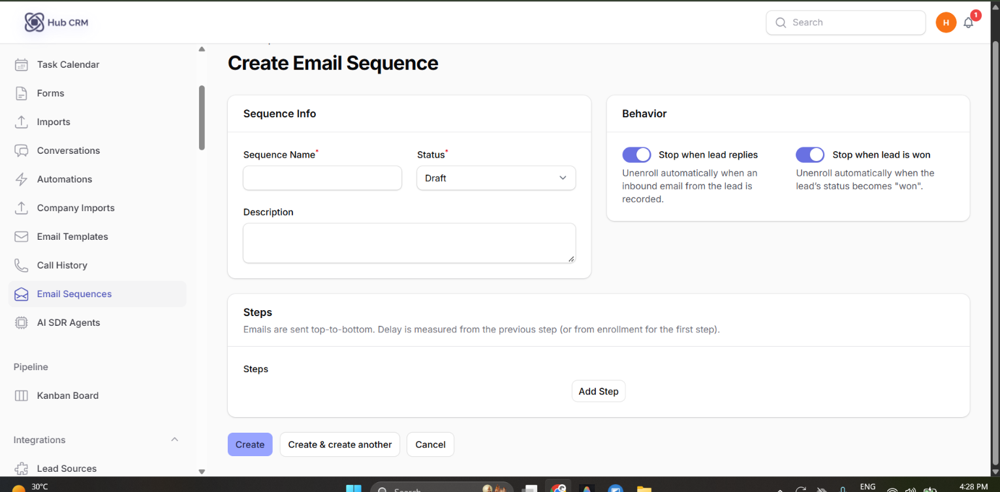
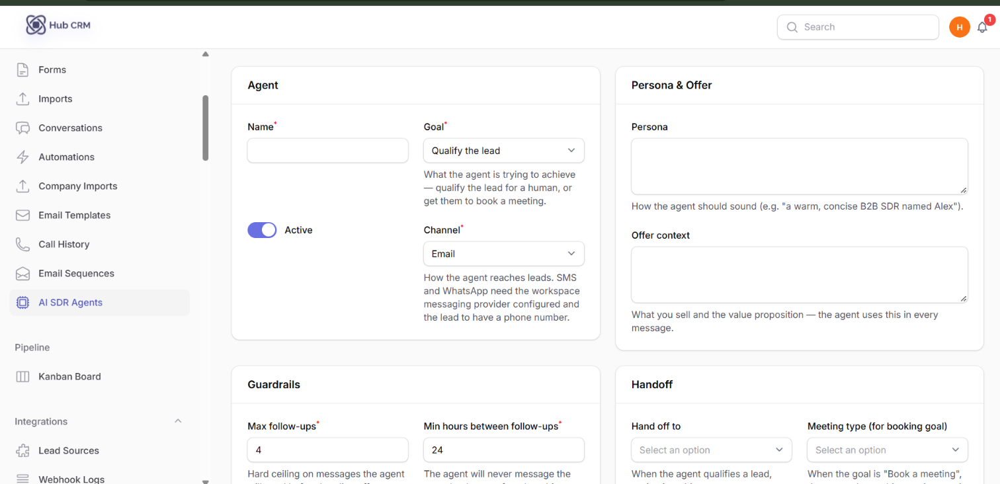

# Email Templates, Sequences and AI SDR

Set up your sending address first in **Communications → Email** (see [Settings](settings.md)).

## Email templates

**Leads → Email Templates → New**: enter a **Name**, **Subject** and body. Use merge fields such as `{{first_name}}` and `{{company}}`. Templates are used when you email a lead, in automations and in sequences.

## Email sequences

A **sequence** is a series of emails sent automatically over days, stopping when the lead replies.

1. **Leads → Email Sequences → New Sequence**, give it a name.
2. Add **steps**: choose the template and the **delay** after the previous step.
3. Use **Preview** to see an email and **Test send** to send it to yourself.
4. **Enroll** leads - from a lead, a bulk action, or an automation step.
5. Use **Duplicate** to copy a sequence.

Track results in **Reports → Email Sequences**.

## AI SDR Agents

An **AI SDR agent** writes and sends personalised outreach and decides the next step for each enrolled lead.

1. Make sure AI is configured in **Integrations → AI Settings**.
2. **Leads → AI SDR Agents → New**: name the agent, describe your offer and tone, set limits.
3. Enroll leads (bulk action or automation step).
4. Review the messages and decisions the agent made on each lead's timeline.

