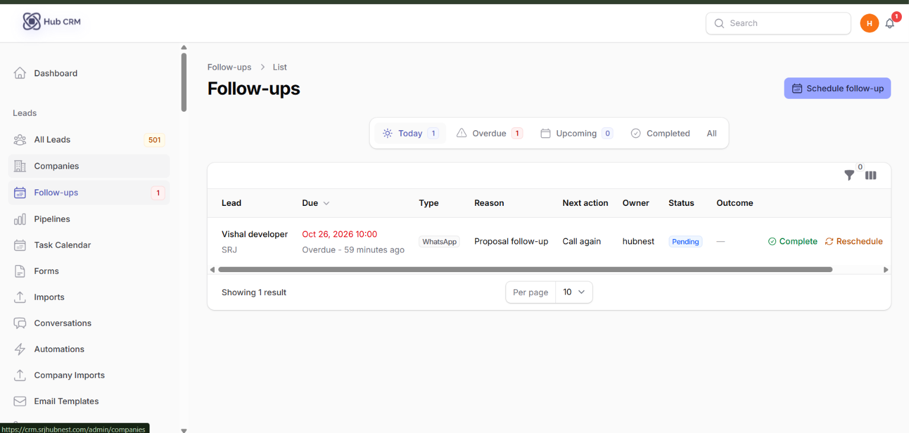
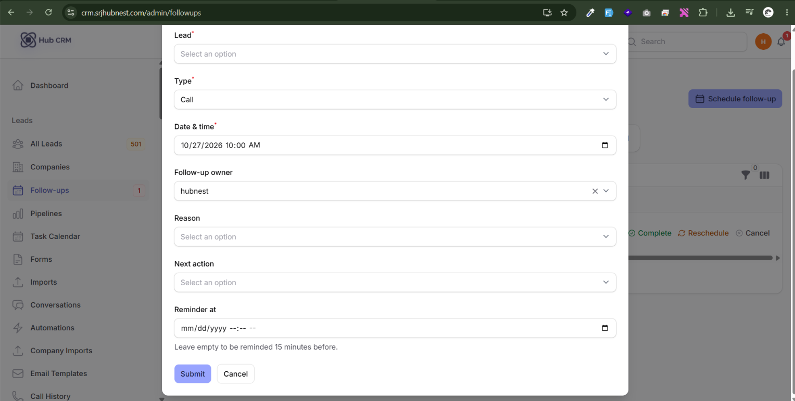
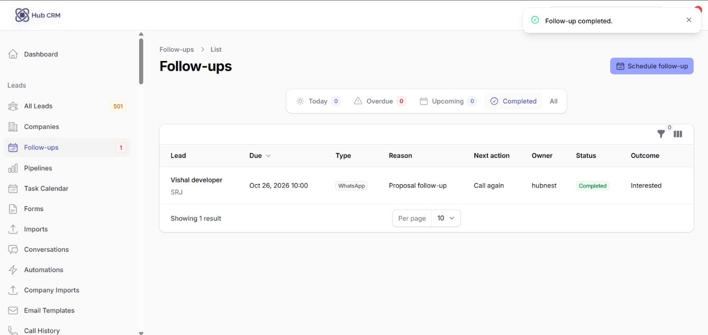
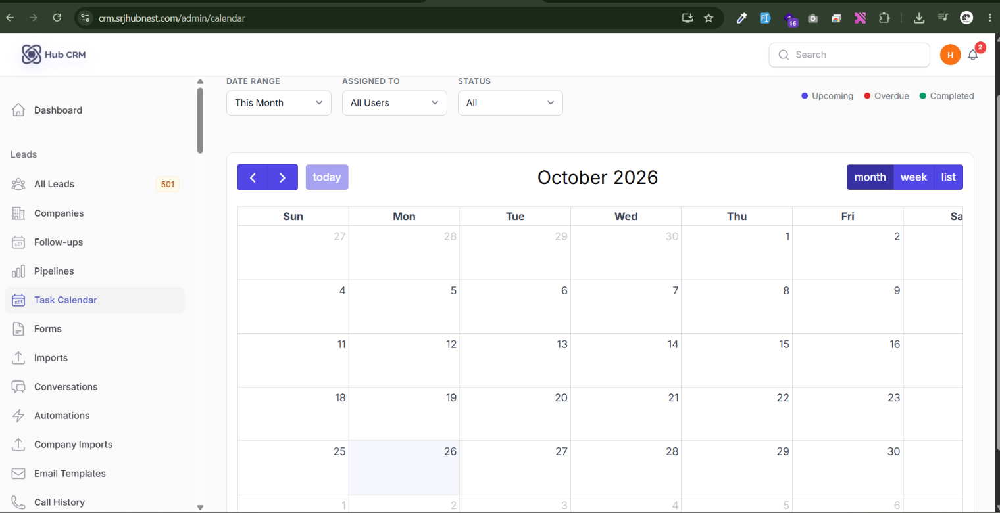

# Follow-ups and Task Calendar

A **follow-up** is a scheduled next step for a lead - a call, WhatsApp, SMS, email, demo or meeting at a set date and time.

## Where follow-ups appear

- **Leads → Follow-ups**: your queue. Tabs: **Today**, **Overdue**, **Upcoming**, **Completed**, **All**. Use **My follow-ups** to see only yours.
- **Lead detail → Follow-ups** tab: all follow-ups of one lead, with history.
- **Leads list**: filter by *Overdue / Due today / Due tomorrow / Next 7 days / None*.
- **Dashboard and notifications**: reminders and overdue alerts.

## Schedule a follow-up

1. Open a lead and click **Schedule follow-up** (or use it from the leads list or as a bulk action).
2. Choose the **Type**: Call, WhatsApp, SMS, Email, Demo, Meeting or Other.
3. Set **Date & time** and the **Follow-up owner**.
4. Add the **Reason** and the **Next action** (what will you do?).
5. Optionally set **Reminder at** - leave empty to be reminded 15 minutes before.
6. Click **Schedule follow-up**.

## Complete a follow-up

When you have done it, click **Complete**:

1. Pick the **Call outcome** (for calls).
2. Write **Calling notes / customer response** - these are saved with the follow-up and appear in the lead's history.
3. Optionally **Update lead status** (or keep the current status).
4. Tick **Schedule the next follow-up** to set the next one straight away.

## Reschedule or cancel

- **Reschedule**: choose the **New date & time** and say why. The old follow-up stays in the history as *Rescheduled*.
- **Cancel**: the follow-up stays in the history as *Cancelled* (reason optional).
- **Missed**: follow-ups not completed after their time are marked *Missed* and show as **Overdue** until handled.

## Task Calendar

**Leads → Task Calendar** shows follow-ups and tasks on a month, week or day grid. Click an entry to open the lead; drag to change the time.

## Reports

Management can review follow-up discipline in **Reports → Follow-up Performance** (completion, overdue, on-time rate per agent). See [Reports](reports.md).
