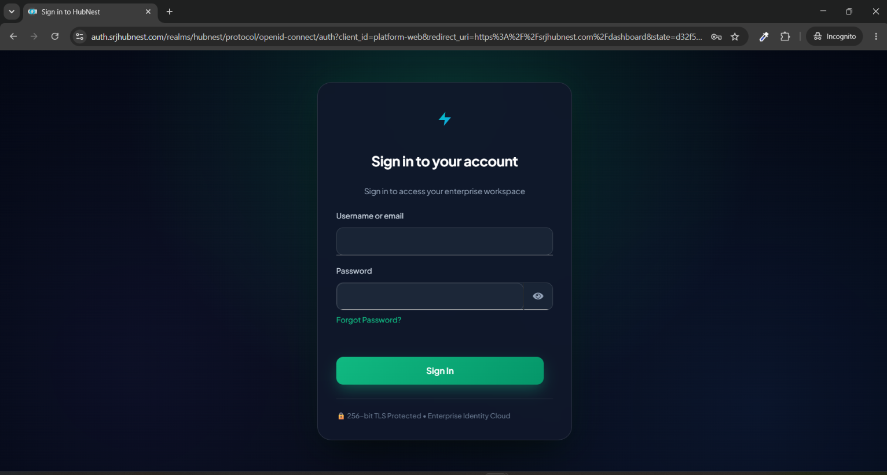

# Getting Started

## 1. Sign in

HubCRM opens through your HubNest account.

1. Go to your HubNest dashboard and open **HubCRM** (or open your HubCRM address directly and choose **Sign in with HubNest**).
2. Sign in with your HubNest email and password. If your workspace uses a custom domain or white-label login, you will see your own logo on this screen.
3. You land on the **Dashboard**.

!!! note
    Team members are added from **Settings → Team & Seats**. They receive an invitation and sign in the same way. See [Team & security](team-security.md).

## 2. The first-run wizard

The first time a workspace admin signs in, the **Onboarding Wizard** asks for the basics (company details, pipeline, how you will get leads). You can **Skip** it and finish later from the checklist.

!!! info "What the wizard asks"
    The wizard runs as a short series of full-screen steps, with a progress bar at the top and **Back / Next** buttons:

    1. **Company details** - your business name, industry and team size.
    2. **Your first pipeline** - pick a ready-made set of stages (e.g. *New → Qualified → Proposal → Won*) or start blank.
    3. **How you get leads** - tick the sources you use (website form, WhatsApp, ads, referrals...) so HubCRM can suggest the right setup.
    4. **Invite your team** (optional) - add teammates by email; you can always do this later from Team & Seats.

    **Skip** in the top-right corner closes the wizard at any point - nothing already saved is lost, and the rest shows up in the **Getting started** checklist below.

## 3. "Your first moves" checklist

The dashboard shows a **Getting started** card with the first steps (add a lead, set up a pipeline, connect a lead source and so on). Each item ticks off by itself when you do it.

!!! info "What the checklist looks like"
    A card on the dashboard titled **Getting started** (or **Your first :total moves**) lists each step as a row with a circle on the left: empty for not done, a green check once completed. Typical rows are *Add your first lead*, *Create a pipeline*, *Connect a lead source*, *Invite a teammate* and *Make your first call*. Clicking a row takes you straight to that screen. The card shrinks to a small progress bar once every step is checked, and you can dismiss it from its **×**.

## 4. The dashboard

The dashboard gives a live view of the pipeline.

| Widget | What it shows |
| :--- | :--- |
| **Lead stats** | New leads, total leads, conversions for the selected period |
| **Leads over time** | Daily lead volume |
| **Leads by source** | Which channels bring the most leads |
| **Lead status** | Share of New / Contacted / Qualified / Converted / Lost |
| **Pipeline distribution** | How many leads sit in each stage |
| **Revenue forecast** | Expected revenue from open deals weighted by stage |
| **Live lead feed** | New leads appearing in real time |

!!! info "Reading the dashboard"
    The widgets sit in a grid below the top stat cards. **Leads over time** is a line chart with days along the bottom and lead count up the side. **Leads by source** and **Lead status** are donut charts with a coloured legend (hover a slice for the exact count). **Pipeline distribution** is a horizontal bar per stage. **Revenue forecast** is a single large currency figure with a small trend arrow. **Live lead feed** is a scrolling list of the newest leads with their name, source and a timestamp like "2 minutes ago", updating on its own without a page refresh.

### Customise your dashboard

Open **Customize Dashboard** (button on the dashboard) to choose which widgets you see and their order. The choice is personal - it does not change anyone else's dashboard.

!!! info "The customise screen"
    A panel slides in listing every available widget with a toggle switch next to each - on to show it, off to hide it. Visible widgets also show a drag handle (⋮⋮) on the left so you can reorder them by dragging up or down; the dashboard behind updates live as you drag. **Save** applies the layout and closes the panel; **Reset to default** restores the original set and order.

## 5. Your profile and notifications

- **Settings → My Profile**: name, photo, phone, language, **your calling phone number** (used by click-to-call) and meeting link.
- **Settings → Notifications**: choose which alerts reach you by email, browser push or in-app.

!!! info "My Profile screen"
    A form with your photo (click it to upload a new one) at the top, then fields for **Name, Email** (read-only, changed from Security), **Phone** - this is the number HubCall rings first for click-to-call, **Language** and your personal **Meeting link**. A **Save changes** button sits at the bottom; a green toast confirms the save.

!!! info "Notification preferences screen"
    A table with one row per event (*New lead assigned, Follow-up due, Follow-up overdue, Mentioned in a note, Automation failed...*) and three checkbox columns: **Email, Push, In-app**. Tick or untick any combination per event, then **Save**. A "Send a test notification" link at the top lets you confirm delivery.

## 6. Help inside the app

**Account → Help Center** has short articles for each feature. Use **Feature Requests** (Tools) to suggest ideas and upvote other people's requests.
