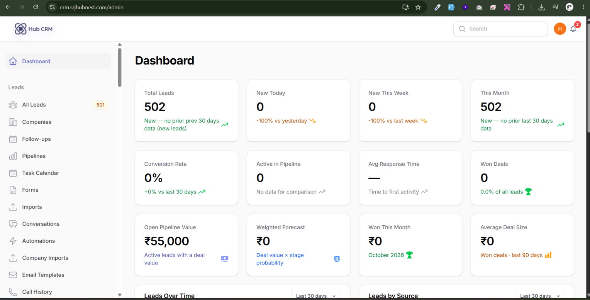

# HubCRM Workspace Guide

HubCRM is the sales workspace where your team captures leads, follows them up, calls and messages them, and turns them into customers. This guide walks through every screen of the workspace (the **tenant panel**, opened at `/admin` on your HubCRM address).

## How the workspace is laid out

The left sidebar groups everything by job. Some items only show if your role allows them.

| Sidebar group | What is inside | Guide page |
| :--- | :--- | :--- |
| **Leads** | All Leads, Follow-ups, Task Calendar, Conversations, Call History, Companies, Pipelines, Automations, Email Templates, Email Sequences, AI SDR Agents, Forms, Imports | [Leads](leads.md), [Follow-ups](followups.md), [Calls & messages](calls-messaging.md), [Automations](automations.md), [Email](email-outreach.md) |
| **Pipeline** | Kanban Board | [Pipelines & Kanban](pipelines-kanban.md) |
| **Sales** | Quotes, Invoices, Recurring Invoices | [Quotes & invoices](sales-documents.md) |
| **Tools** | Landing Pages, Lead Widgets, Web Tracking, AI Chatbot, Meeting Types, Bookings, Products, Feature Requests | [Lead capture](lead-capture.md), [Meetings](meetings.md) |
| **Integrations** | Lead Sources, Source Health, Webhook Logs, AI Settings | [Integrations & API](integrations-api.md) |
| **Reports** | All reports, Scheduled Reports, Audit Log | [Reports](reports.md) |
| **Settings / Team & Access / Brand & Domain / Communications / Advanced** | Custom fields, scoring, tags, team, roles, security, branding, domain, email, messaging, storage and more | [Settings](settings.md), [Team & security](team-security.md) |
| **Account** | Billing, Two-Factor Auth, Privacy & Data, Help Center | [Account & billing](account-billing.md) |

!!! tip "Find anything fast"
    Press **Ctrl + K** (or **Cmd + K** on Mac) anywhere in the workspace to open the command palette. Type a lead name, email or page name and jump straight to it.

## Roles in one minute

| Role | Typical access |
| :--- | :--- |
| **Admin** (workspace owner) | Everything, including billing, team, roles, security and every custom field |
| **Manager** | Team leads, reports, automations, assignment |
| **Agent** | Own leads (or all leads, depending on **Lead visibility** in Team & Seats), follow-ups, calls |

The exact permissions are editable per role in **Roles & Permissions** - see [Team & security](team-security.md).

## Suggested reading order

1. [Getting started](getting-started.md) - sign-in, first-run checklist, dashboard.
2. [Leads](leads.md) and [Follow-ups](followups.md) - the daily core.
3. [Pipelines & Kanban](pipelines-kanban.md), then [Automations](automations.md).
4. Everything else as you need it.

Need a screenshot list or want to contribute images? See the [screenshot checklist](screenshots-checklist.md).
