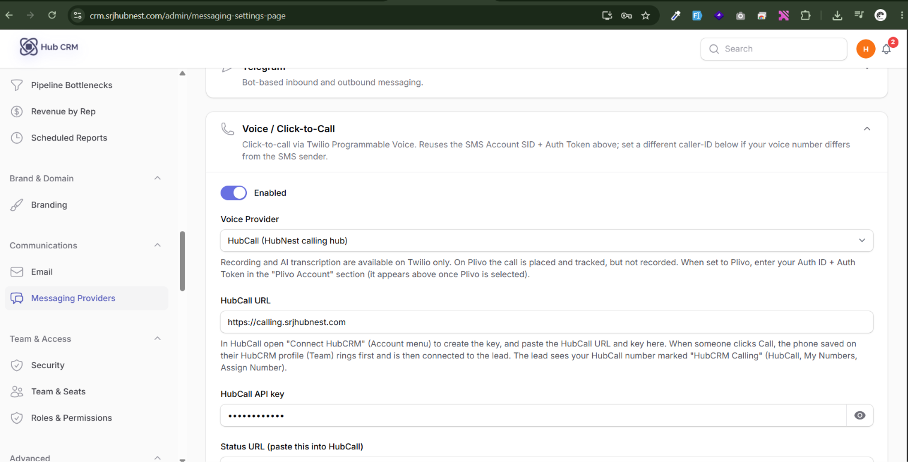
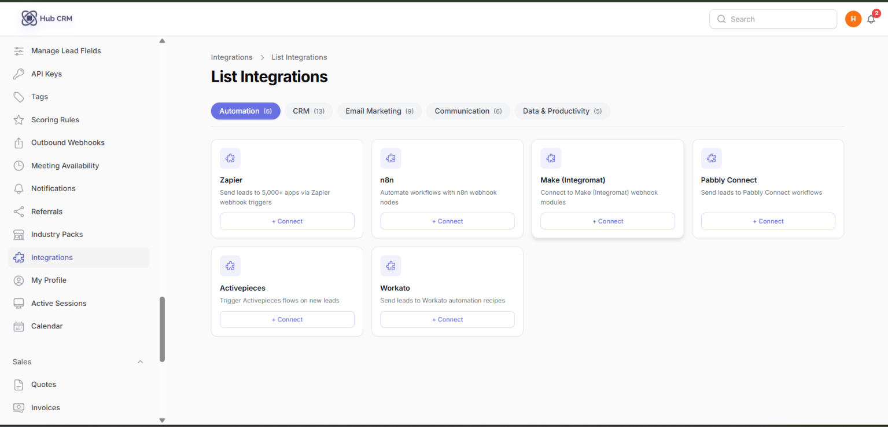
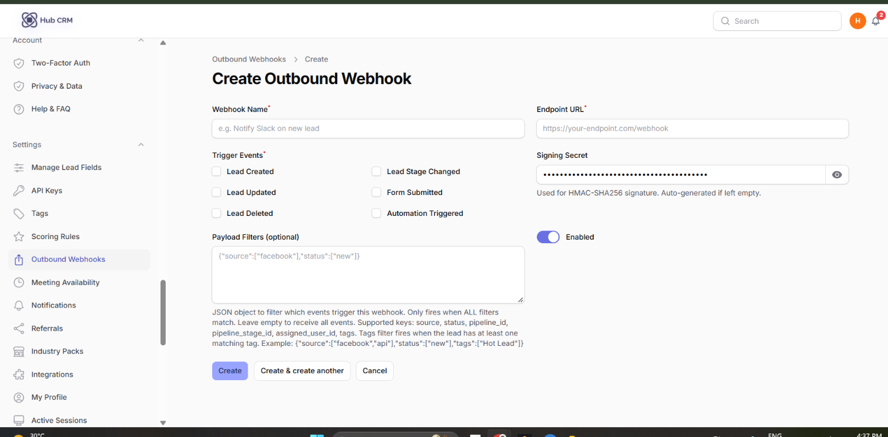
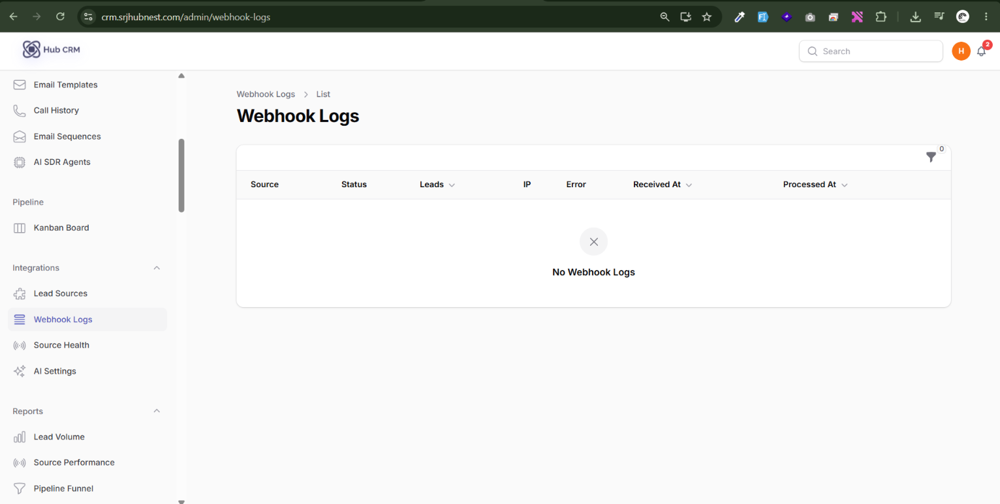
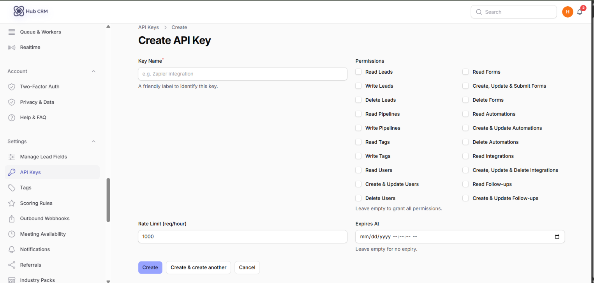
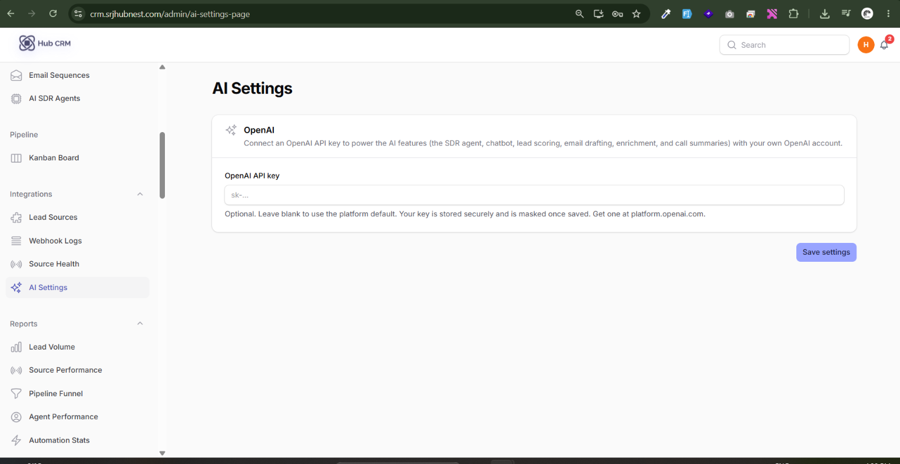
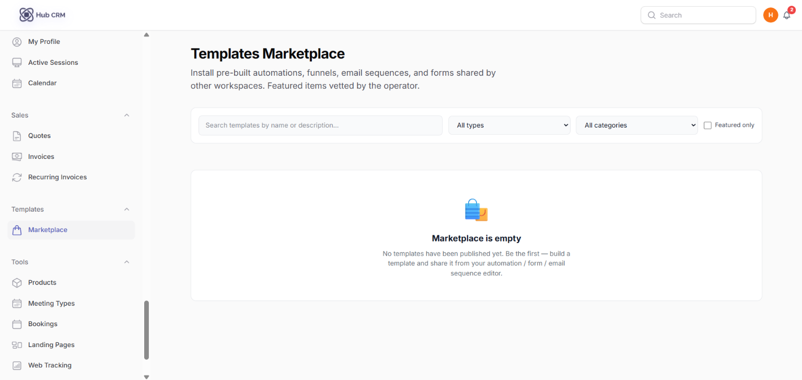
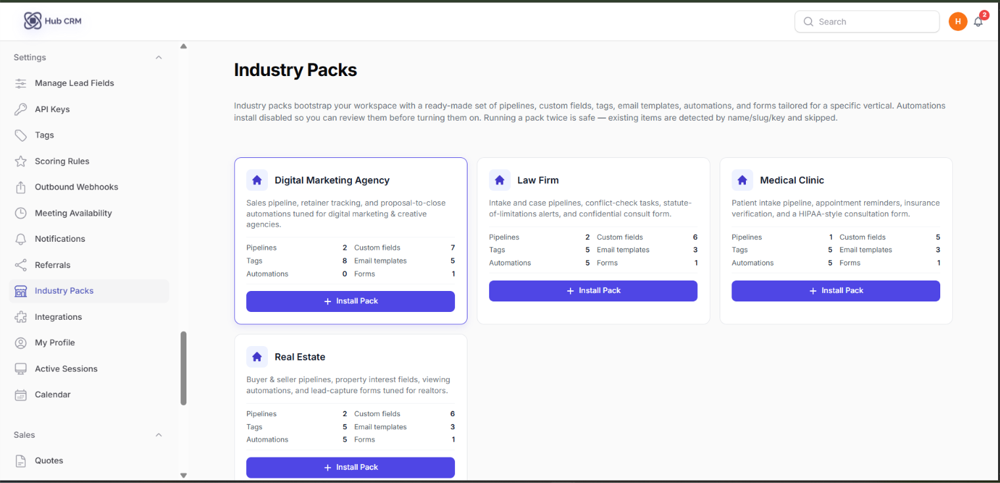

# Integrations, API Keys and Webhooks

## Connect HubCall (calling)

1. In **HubCall**, open **Connect HubCRM** (sidebar) and follow the steps to link your workspace.
2. In HubCall's number settings, set a number's use to **HubCRM Calling**.
3. In HubCRM, each rep saves their own phone in **My Profile**, then uses **Call** on leads. See [Calls, WhatsApp and SMS](calls-messaging.md).

## Settings → Integrations

**Settings → Integrations → New**: push leads and events to other tools. Choose the app, enter its credentials, click **Test**, then **Enable**. Open **Sync logs** to see every delivery and any error.

Available connectors include HubSpot, Salesforce, Zoho CRM, Pipedrive, Freshsales, Zendesk, Close, Copper, Monday, Airtable, Notion, Google Sheets, Mailchimp, Brevo, ActiveCampaign, Klaviyo, ConvertKit, MailerLite, Slack, Microsoft Teams, Twilio, Zapier, Make, n8n, Pabbly, Workato and generic Webhook / REST API push.

## Outbound Webhooks

**Settings → Outbound Webhooks → New**: send an HTTPS request to your URL when events happen (lead created, status changed, and so on). Set the URL, events and an optional secret so your server can verify the signature. Use **Test** to send a sample and **Deliveries** to see responses.

**Integrations → Webhook Logs** lists every delivery; click **Retry** on failures.

## API Keys

**Settings → API Keys → New**: create a key to call the HubCRM API from your own systems. The key is shown **once** - copy it immediately. **Revoke** a key to disable it at once.

## AI Settings

**Integrations → AI Settings**: add your AI provider key (or use the workspace default if provided). It powers the AI SDR, chatbot and email drafting.

## Marketplace and Industry Packs

- **Templates → Marketplace**: install ready-made automations, forms, sequences and templates shared by HubNest.
- **Settings → Industry Packs**: one click installs a full starter set (pipeline, custom fields, templates, automations) for your industry.

