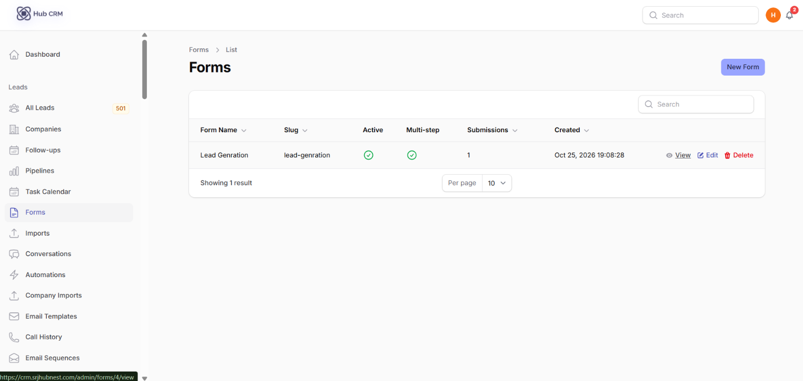
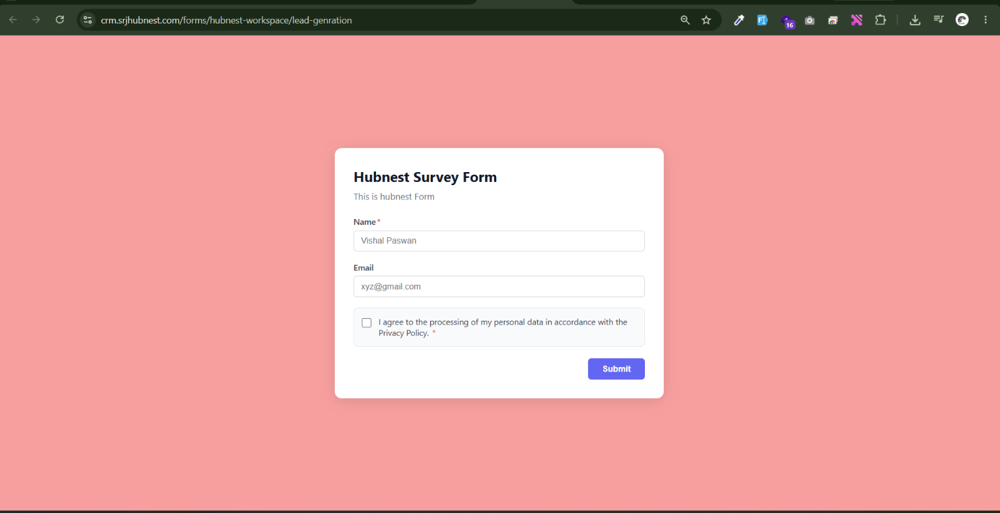
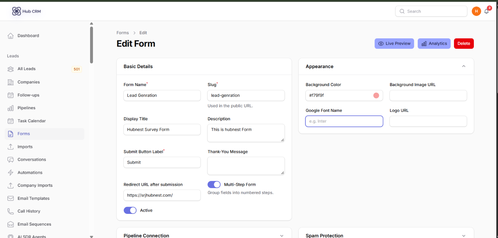
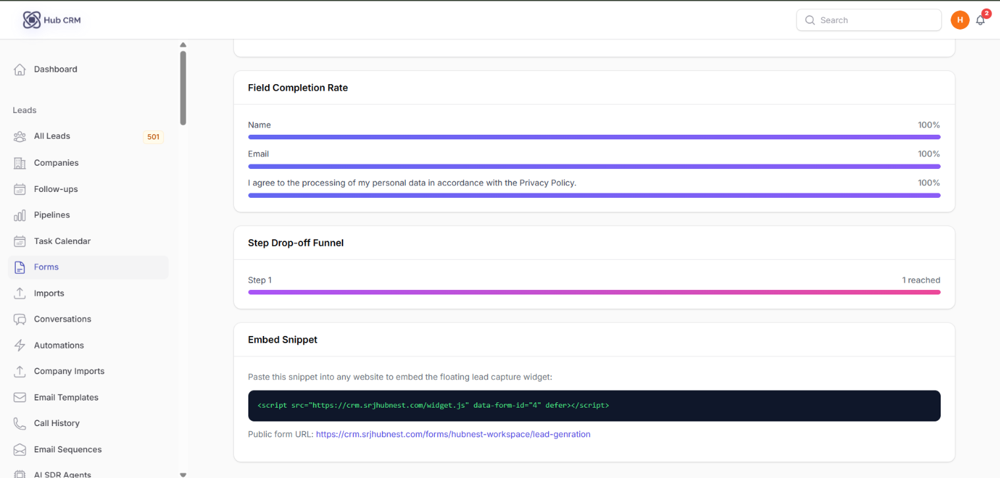
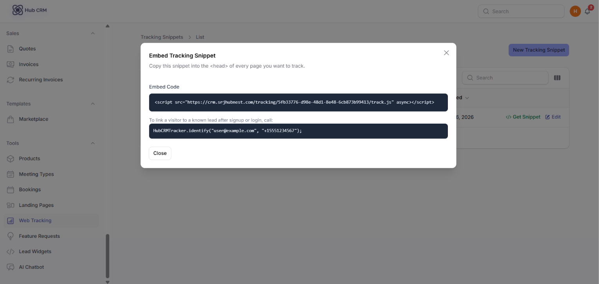
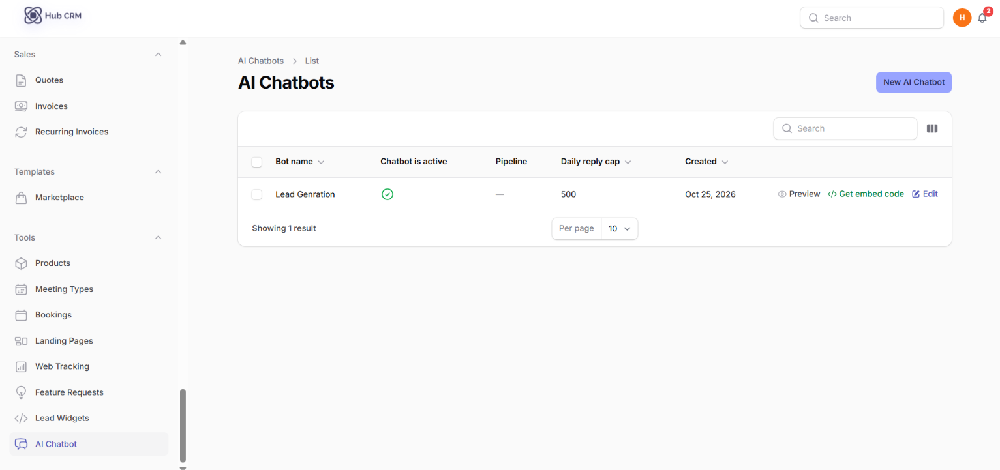
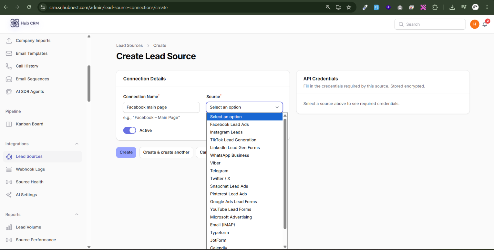

# Lead Capture

Everything that brings leads in without typing them by hand.

## Forms

**Leads → Forms → New Form**

1. **Form Name**, **Slug** (used in the public URL), **Display Title**, **Description**.
2. Set the **Submit Button Label**, **Thank-You Message** or a **Redirect URL**.
3. Add fields with **Add Field**: choose the **Field Type**, **Label**, **Placeholder**, **Required**, and the **Field Key** that maps the answer to a lead field (for example `email`, `first_name`). Drag to reorder.
4. Turn on **Multi-Step Form** to group fields into numbered steps.
5. Choose the **Pipeline** and **Stage** new leads should enter.
6. Style it: **Background colour/image, Google Font, Logo URL**. Optionally enable **reCAPTCHA v3**.
7. Share the public link or paste the **embed snippet** into any website.

A **GDPR consent** field is always added last and cannot be removed.

Results: **Reports → Form Analytics** (views, submissions, conversion rate).

## Landing Pages

**Tools → Landing Pages → New**: pick a template, edit sections (headline, benefits, form, call to action), choose the connected form, then **Preview** and publish. Leads from the page carry their UTM and landing-page attribution.

## Lead Widgets

**Tools → Lead Widgets → New**: a floating button or small form for any website. Set title, colours, position and the fields to ask, then click **Get snippet** and paste the code before `</body>`.

## Web Tracking

**Tools → Web Tracking** creates a tracking snippet. Install it on your site to record visits and attach page views, UTM data and referrer to leads that later submit a form.

## AI Chatbot

**Tools → AI Chatbot**: configure a website chat assistant that answers from your knowledge (FAQ and pages you provide) and captures name, email and phone as a lead. Use **Preview** to test it and **Get snippet** to install it.

## Lead Sources (ad platforms and apps)

**Integrations → Lead Sources → New** connects an outside channel so leads arrive automatically: Meta (Facebook/Instagram) Lead Ads, Google Ads, LinkedIn, TikTok, Typeform, JotForm, Calendly, WhatsApp, Telegram, an email inbox (IMAP) and more.

1. Choose the source type.
2. Click **Connect** (OAuth sign-in) or paste the API key / webhook details shown.
3. Click **Test**.
4. Map the destination **pipeline**, **stage** and **assignment**.

**Integrations → Source Health** shows whether each source is receiving leads, the last lead time and errors.

!!! info "The Source Health screen"
    A table with one row per connected source: its icon and name, a status dot (green *Healthy*, amber *Slow*, red *Not receiving*), **Last lead received** ("3 hours ago", or "Never" for a new connection), the lead count for the selected period, and an **error message** column that shows the last failure (e.g. an expired access token) when the status is red. Clicking a row opens that source's sync logs. A banner at the top warns you if any source has gone silent for more than 48 hours.
