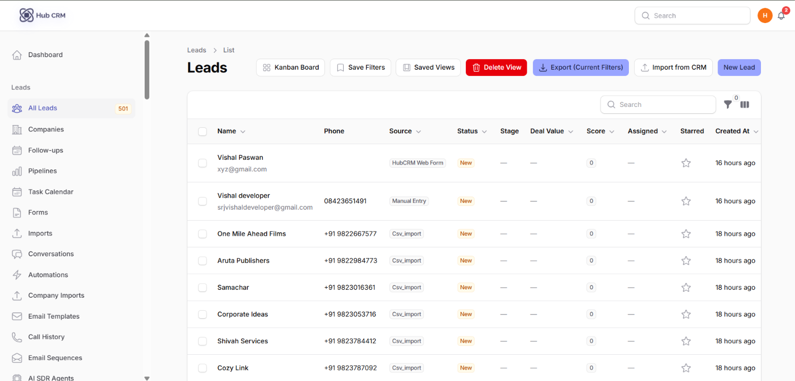
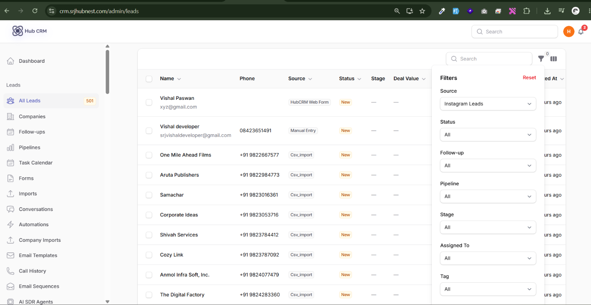
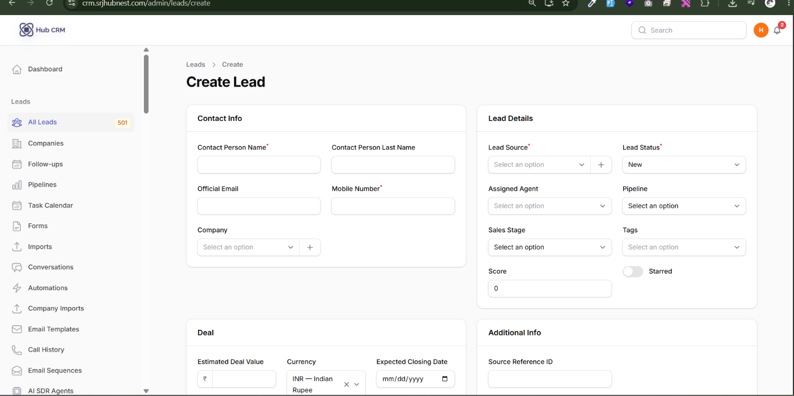
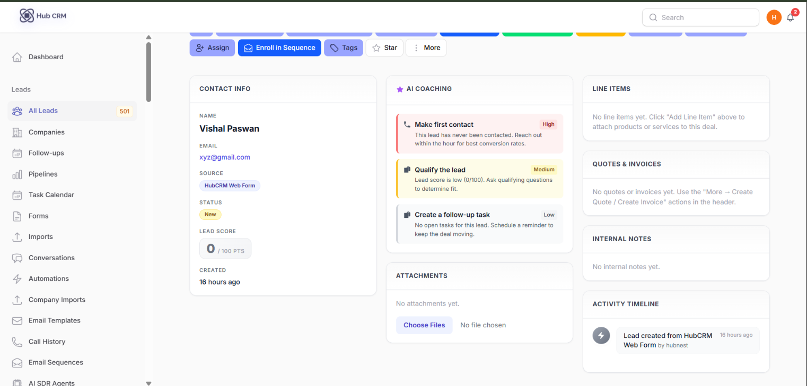
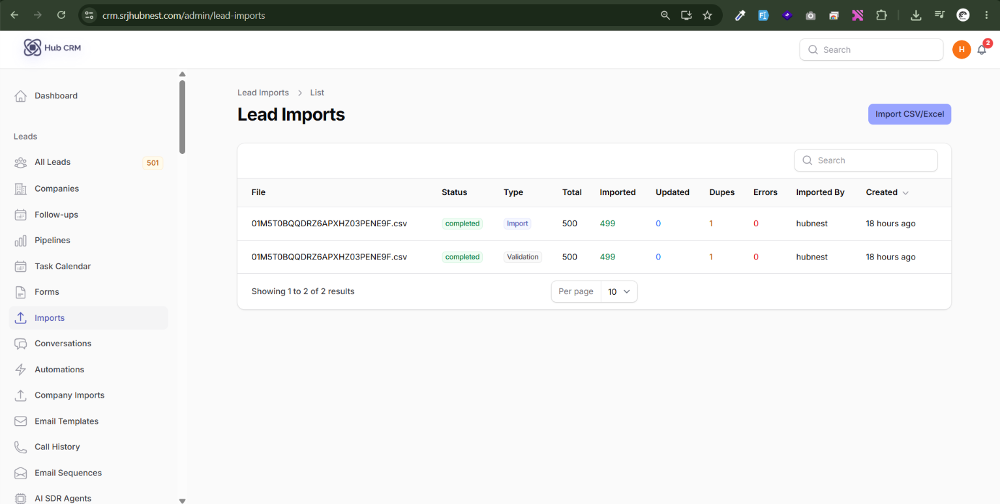
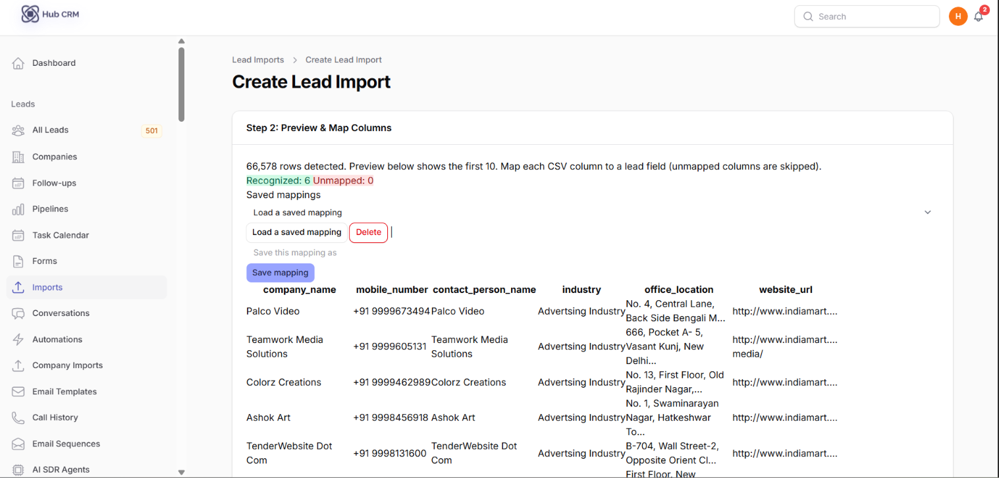
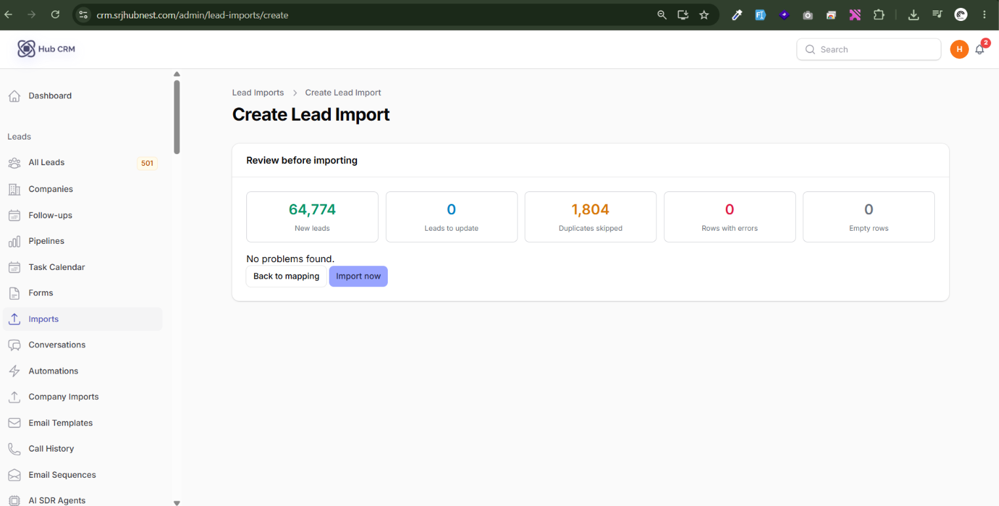

# Leads

**Leads → All Leads** is the heart of HubCRM. Every enquiry, contact or prospect is a lead.

## The leads list

Each row shows the columns your admin enabled (name, email, phone, company, source, status, assigned agent, score, tags, expected close, **Waiting On**, created date and any custom fields you may see). Use the **column picker** to show or hide columns and drag to reorder.

| Control | What it does |
| :--- | :--- |
| **Search** | Searches name, email, phone, company and custom fields marked *Searchable* |
| **Star** | Click the star to pin a lead you are watching; filter on **Starred only** |
| **Saved views** | Save the current filters (and optionally the column layout and sort) as a named view; pick it again any time |
| **Dup** | Flags a possible duplicate - use **Duplicates only** to review them |

## Filters

Open the filter panel to narrow the list:

- **Source**, **Status**, **Tag**, **Assigned To**
- **Follow-up**: Overdue, Due today, Due tomorrow, Due in the next 7 days, No follow-up scheduled
- **Waiting on**: *Us (they replied)*, *Them (we reached out)*, *New (no contact)*
- **Created from / until**, **Min score**, **Min / Max deal value**
- Custom fields marked *Show in filters*

## Add a lead

1. Click **New Lead**.
2. Fill in **First name, Last name, Email, Phone, Company**.
3. Choose **Source** (use *Custom source name* for things like Walk-in or Exhibition), **Status**, **Pipeline** and **Stage**.
4. Optionally set **Assigned To**, **Deal Value**, **Currency**, **Expected Close Date** and **Notes**.
5. Fill any **custom fields** your admin added.
6. Click **Create**.

!!! note "Duplicates"
    If the email or phone matches an existing lead, HubCRM warns you and marks the lead as a possible duplicate. Admins can merge duplicates.

## The lead detail page

Click a lead to open it. The page has the lead's summary, tabs and action buttons.

| Area | Use it for |
| :--- | :--- |
| **Header actions** | Call, WhatsApp, SMS, Email, Schedule follow-up, Change status, Move stage, Assign, Run automation, Enroll in sequence |
| **Next action / follow-up** | The next scheduled step and its due time - see [Follow-ups](followups.md) |
| **Activity timeline** | Every change, note, email, message, call and automation run, newest first |
| **Notes** | Internal notes; mention teammates |
| **Tasks** | To-dos linked to the lead |
| **Attachments** | Files uploaded to the lead |
| **Attribution** | UTM source/medium/campaign, landing page and referrer captured from forms and widgets |
| **Quotes / Invoices** | Documents created for this lead - see [Quotes & invoices](sales-documents.md) |
| **Calls** | Call history with recordings and notes - see [Calls & messages](calls-messaging.md) |

## Bulk actions

Tick the boxes on the left of several leads, then use **Bulk actions**:

| Action | Effect |
| :--- | :--- |
| **Assign Agent** | Give all selected leads to one agent, or spread them evenly (round robin) across several |
| **Change Status** | Set the same status on all |
| **Move to Stage** | Move all to a pipeline stage |
| **Add Tag / Remove Tag** | Tag or untag in one go |
| **Update a field** | Set the same value in any bulk-editable field |
| **Schedule follow-up** | Create a follow-up on each selected lead |
| **Run Automation** | Start an automation for each lead |
| **Enroll in sequence** | Add to an email sequence |
| **Export Selected (CSV)** | Download just these leads |

Large selections run in the background and you get a notification when they finish. Every change is written to each lead's history and to the **Audit Log**.

## Import and export

- **Import**: **Leads → Imports → New import**. Upload a CSV or Excel file, map your columns to HubCRM fields, preview, then start. Rows with problems are skipped and listed in a downloadable **error report**.
- **Export**: **Export** on the leads list. Choose the columns, the current filters and search are applied. You get a CSV.

!!! tip
    Fields you are not allowed to see never appear in exports. Admins can always see and export every field.
