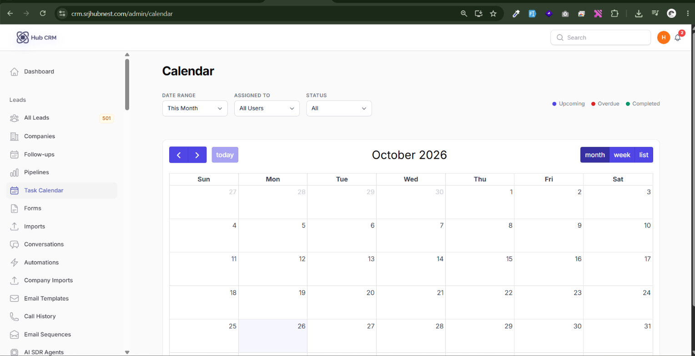
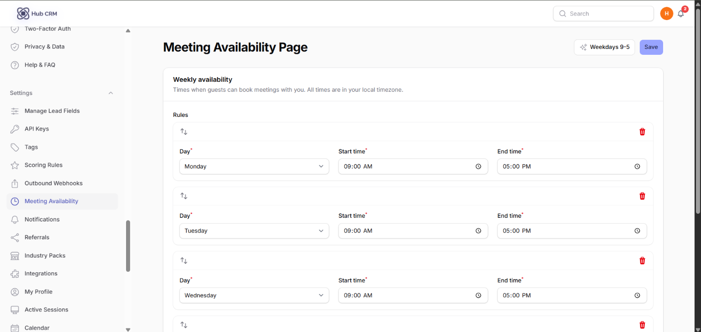
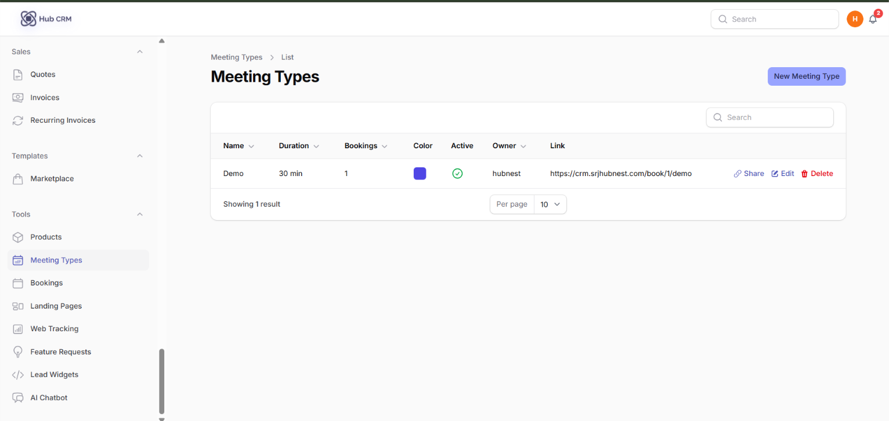
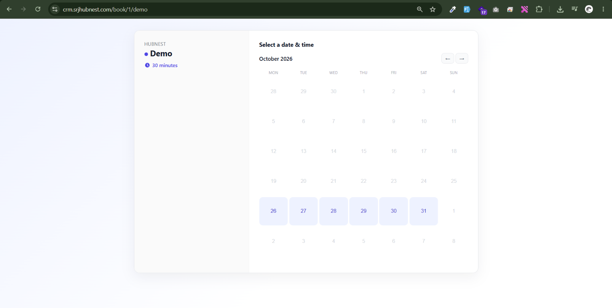

# Meetings and Booking

## 1. Connect your calendar

**Settings → Calendar**: connect Google Calendar or Outlook so bookings appear in your calendar and busy times block the booking page.

## 2. Set your availability

**Settings → Meeting Availability**: tick the days and hours you take meetings. **Preset: weekdays** fills Monday to Friday in one click. Click **Save**.

## 3. Create a meeting type

**Tools → Meeting Types → New**: **Name**, **Duration**, buffer times, location (video link, phone or in person), description and questions to ask. Click **Get link** to copy the public booking link and share it by email, WhatsApp or your website.

## 4. Manage bookings

**Tools → Bookings** lists upcoming and past bookings. Use **Mark completed**, **Mark no-show** or **Cancel**. Each booking creates or updates the lead and appears on the timeline.

!!! tip
    Each team member has a personal meeting link - see **Team Members → Meeting link** (admins) or your **My Profile**.
