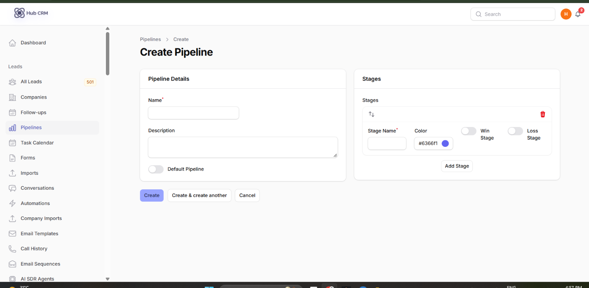
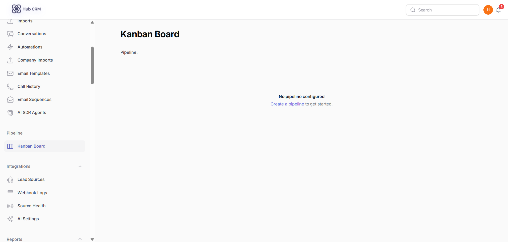
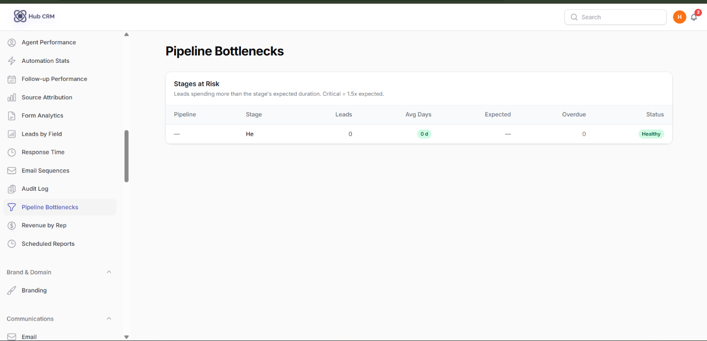

# Pipelines and Kanban Board

A **pipeline** is the set of stages a deal moves through, for example *New → Qualified → Proposal → Won*.

## Create or edit a pipeline

1. Go to **Leads → Pipelines** and click **New Pipeline**.
2. Enter the **Name** and an optional **Description**.
3. Under **Stages**, click **Add Stage** for each step. Give each a **Stage Name** and **Color**, and drag to reorder.
4. Mark one stage as the **Win Stage** and one as the **Loss Stage**. Moving a lead there closes the deal as won or lost.
5. Tick **Default Pipeline** if new leads should land here.
6. Save.

!!! tip
    You can have more than one pipeline - for example one per product or sales team - and choose the pipeline on each lead.

## The Kanban board

Open **Pipeline → Kanban Board**. Each column is a stage; each card is a lead showing name, company, deal value, score and next follow-up.

- **Drag a card** to another column to move the lead (recorded in its history; stage-change automations fire).
- Use the **pipeline selector** at the top to switch pipelines, and the filters to narrow by agent, source or tag.
- Column headers show the number of leads and total deal value.
- Click a card to open the lead.

## Find where deals get stuck

**Reports → Pipeline Bottlenecks** shows how long deals stay in each stage and where they stall. **Reports → Pipeline Funnel** shows stage-to-stage conversion. See [Reports](reports.md).

