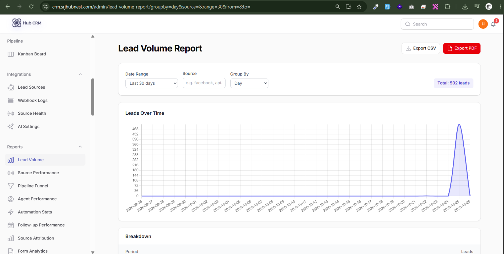
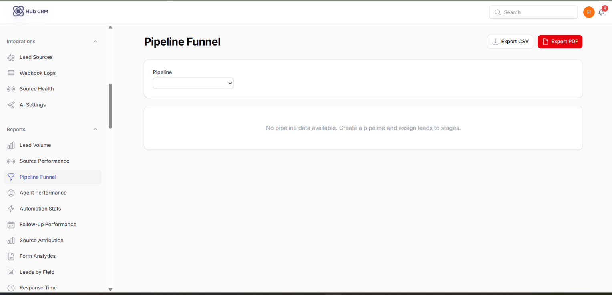
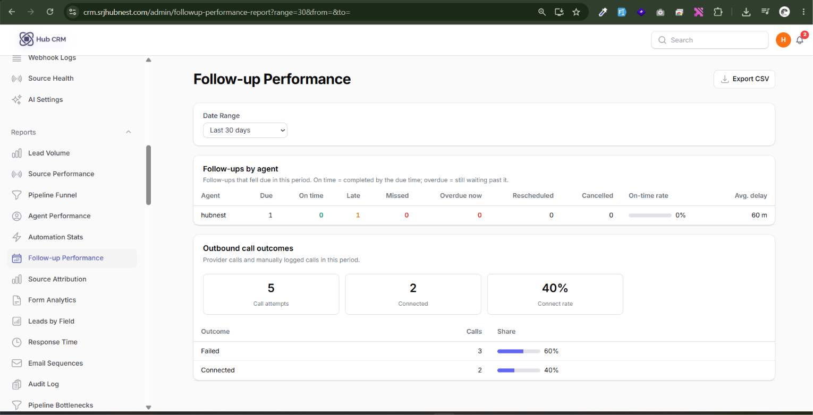
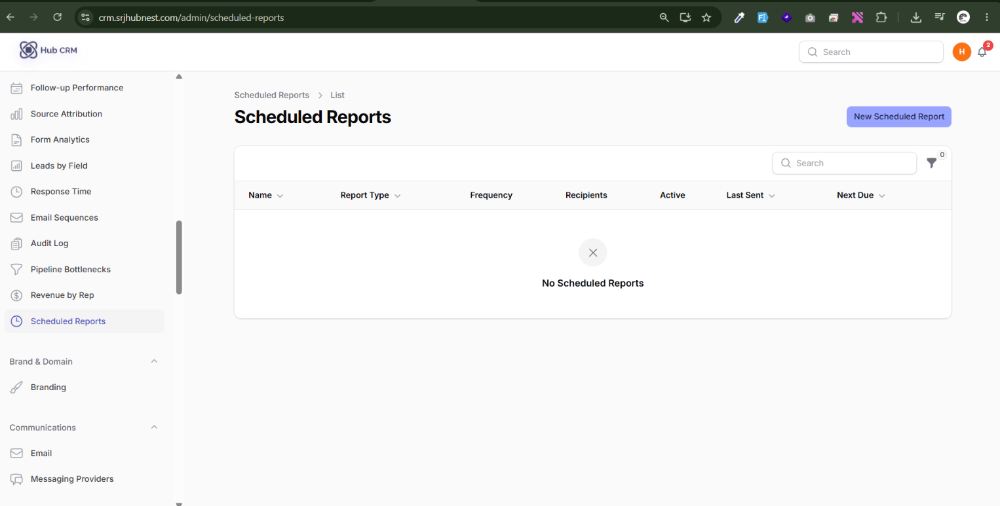
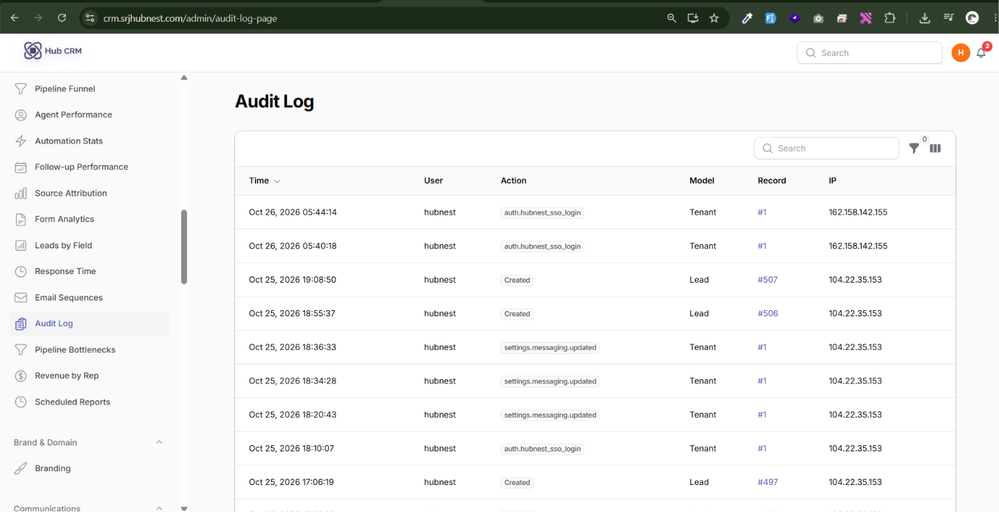

# Reports and Audit Log

All reports are under the **Reports** group. Most have date filters and **Export CSV** / **Export PDF** buttons.

| Report | Answers |
| :--- | :--- |
| **Agent Performance** | Leads handled, contacted, converted and revenue per agent |
| **Lead Volume** | How many leads arrive per day / week / month |
| **Source Performance** | Which sources produce leads that convert |
| **Source Attribution** | UTM source / medium / campaign contribution |
| **Pipeline Funnel** | Stage-to-stage conversion |
| **Pipeline Bottlenecks** | Where deals wait longest |
| **Response Time** | How fast agents first respond to new leads |
| **Follow-up Performance** | Completed, missed and on-time follow-ups per agent |
| **Revenue by Rep** | Won revenue per sales rep |
| **Automation Stats** | Runs, success rate, top automations |
| **Email Sequences** | Sent, opened, replied per sequence |
| **Form Analytics** | Views, submissions and conversion per form |
| **Lead Field Breakdown** | Distribution of leads by any custom field (dropdown, tags and so on) |
| **Lead Source Health** (Integrations) | Connected sources that stopped delivering |

!!! info "Follow-up Performance report"
    A date-range picker at the top, then a table with one row per agent: **Scheduled, Completed, Missed, Overdue (right now)** and an **On-time rate** percentage, colour-coded (green ≥ 80%, amber 50-79%, red below 50%). Below the table, a bar chart breaks down follow-ups by **type** (Call, WhatsApp, SMS, Email, Demo, Meeting, Other) so you can see which channels your team actually uses. **Export CSV** downloads the table as shown.

## Scheduled reports

**Reports → Scheduled Reports → New**: choose the report, frequency (daily, weekly, monthly), recipients and format. HubCRM emails it automatically.

## Audit Log

**Reports → Audit Log** records who did what and when: logins, lead and field changes, bulk actions, exports, settings and permission changes. Filter by user, action and date.

