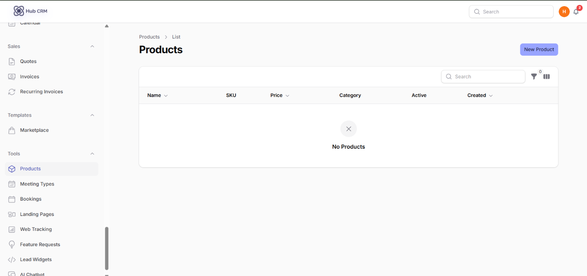
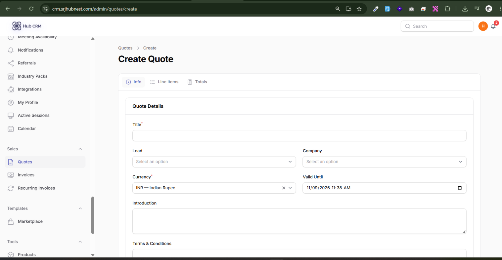
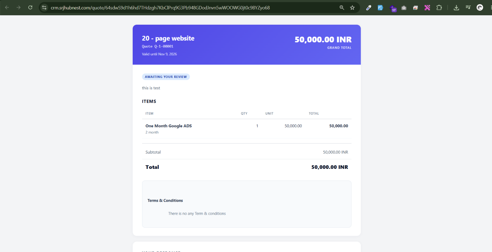
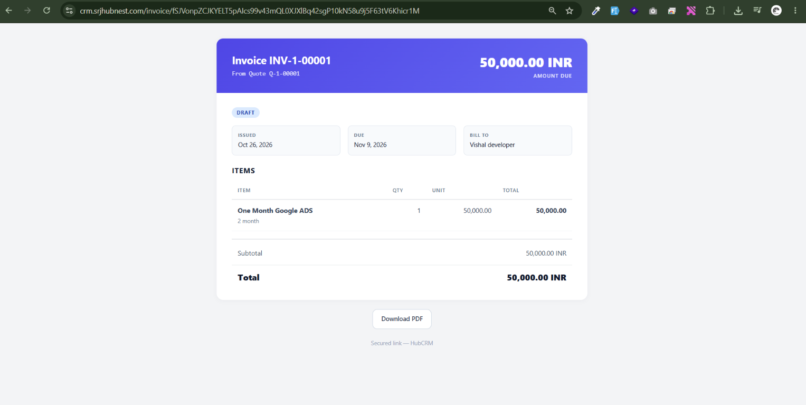
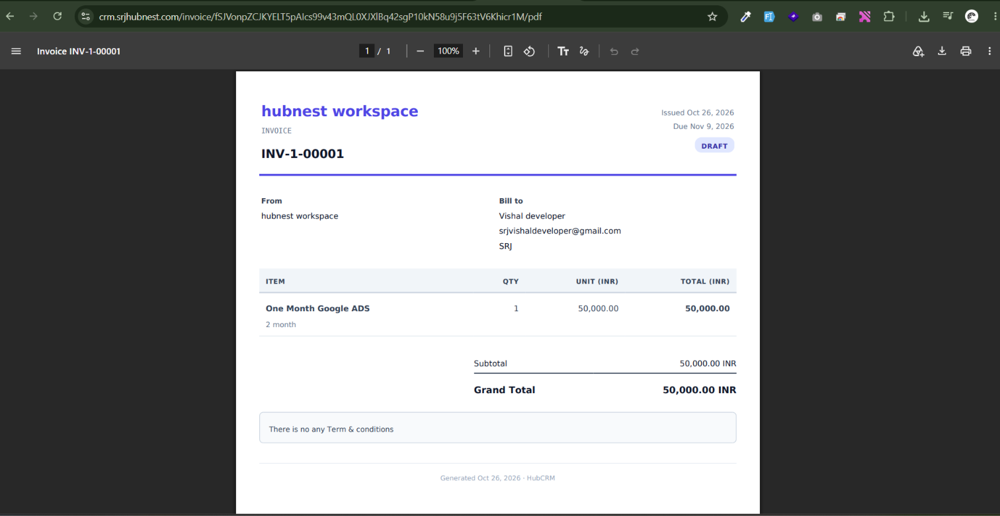

# Products, Quotes and Invoices

## Products

**Tools → Products → New**: **Name**, **SKU**, **Category**, **Description**, **Price**, **Currency**, **Active**. Products are picked when you build quotes and invoices.

## Quotes

**Sales → Quotes → New Quote**

1. **Info** tab: **Title**, **Lead**, **Company**, **Currency**, **Valid Until**, **Introduction**, **Terms & Conditions**.
2. **Line Items** tab: **Add Item**, pick a **Product** (name and unit price fill in), set **quantity** and **Discount %**.
3. **Totals** tab: **Subtotal**, **Tax Rate**, **Additional Discount** and the **Total** calculate automatically.
4. Save, then use the actions:

| Action | What it does |
| :--- | :--- |
| **Send** | Emails the lead a link to view, sign and accept the quote |
| **Send for Signature** | Sends the e-signature link |
| **Preview / Public link** | See what the customer sees |
| **Download PDF** | PDF copy |
| **Duplicate** | Copy as a starting point |
| **Convert to Invoice** | Creates an invoice with the same items |
| **Cancel** | Cancels the quote |

## Invoices

**Sales → Invoices**: create directly or from a quote. Same Info / Line Items / Totals tabs, plus **Issued** and **Due Date**.

| Action | Use it to |
| :--- | :--- |
| **Send** / **Mark as Sent** | Email the invoice, or just mark it sent if you delivered it elsewhere |
| **Record Payment** | Add a payment (amount, method, received date, reference) |
| **Mark as Paid** | Close an invoice paid in full |
| **Refund** | Record a refund in the ledger (does **not** refund through the payment gateway for you) |
| **Download PDF**, **Public link** | Share with the customer |
| **Cancel** | Void the invoice |

The **Payments** tab on an invoice lists every payment received.

## Recurring Invoices

**Sales → Recurring Invoices → New**: for a standing monthly or yearly charge. Choose the **Member / Customer**, **Description**, **Amount**, **Bills every** (month/year), **Billing day**, **Next run date** and **Due after (days)**. HubCRM creates a real invoice on each run date; **Auto-send each invoice** marks them Sent instead of Draft.

