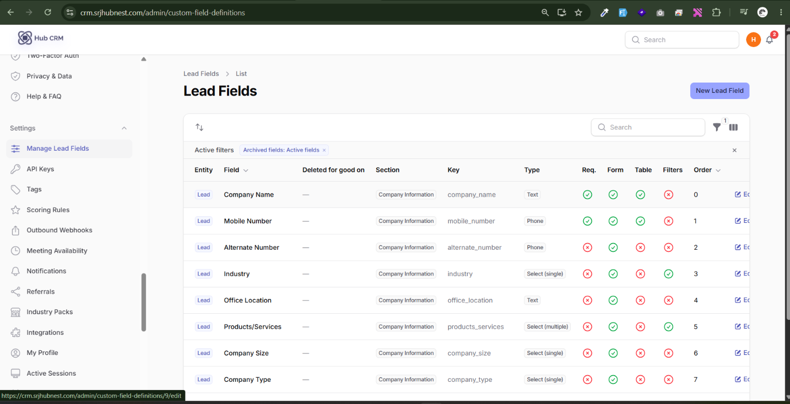
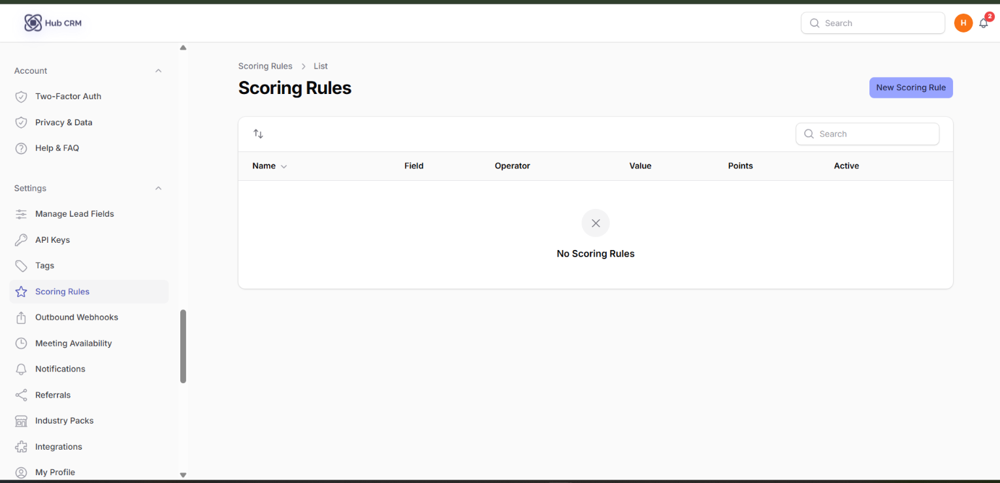
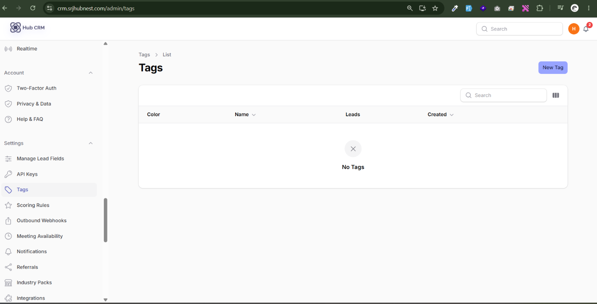
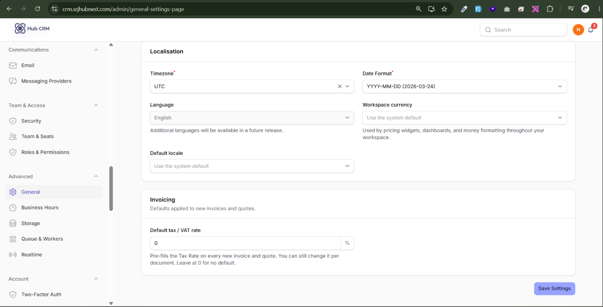
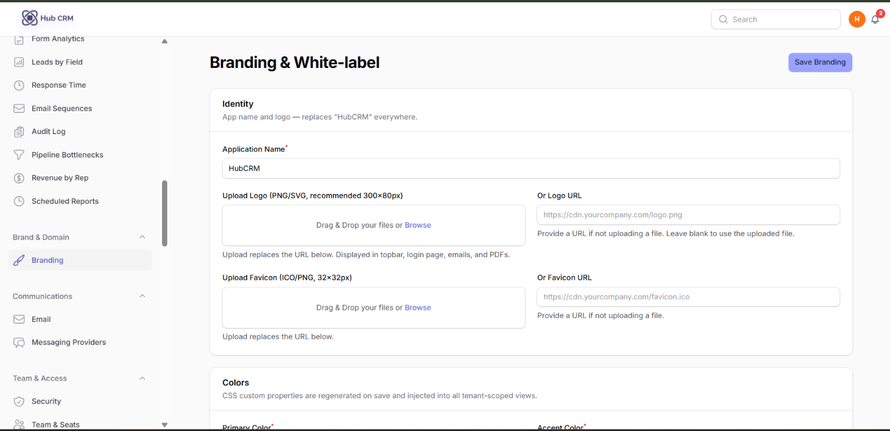
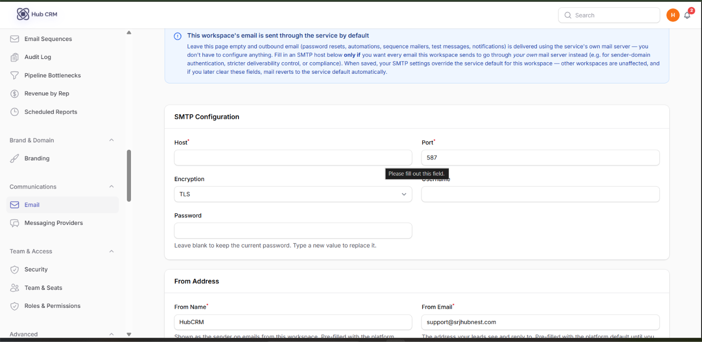
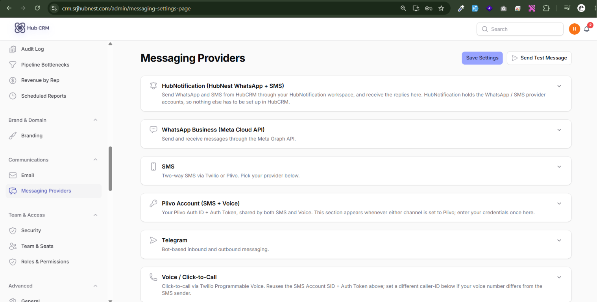
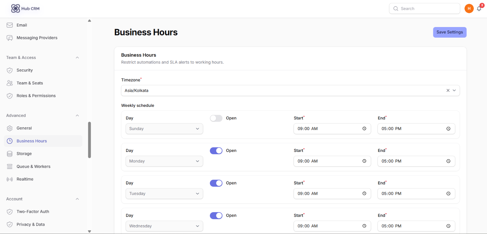
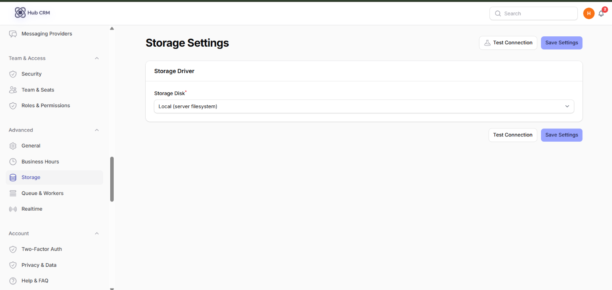
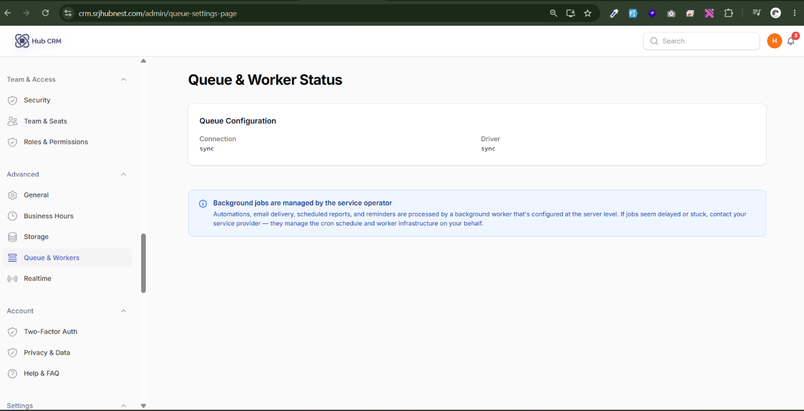

# Settings

## Companies

**Leads → Companies**: accounts that group contacts. Each company has **Name, Domain, Website, Phone, Industry, Size, Address, Account Owner**, a **Contacts** tab, **Deal summary** (open pipeline, won deals) and **Notes**. Import companies in bulk from **Company Imports**.

!!! info "The company detail page"
    The top banner shows the company name, domain and a logo placeholder (auto-filled from the domain's favicon when available), with **Edit** and **Add Contact** buttons on the right. Below it, tabs run across the page: **Contacts (with a count badge)**, **Deal Summary**, and **Notes**. The Contacts tab is a table of every lead linked to this company with their role, email and status. Deal Summary shows the company's open pipeline value as a bar and a list of won deals with amounts. Notes is a simple internal note thread, newest first.

## Manage Lead Fields (custom fields)

**Settings → Manage Lead Fields → New**: add your own fields to leads or companies.

| Option | Meaning |
| :--- | :--- |
| **Applies to** | Lead or Company |
| **Field label / Key** | What people see / the system name (lowercase, numbers, underscores) |
| **Field type** | Text, number, date, dropdown, multi-select, and others |
| **Options** | Choices for dropdown fields |
| **Required, Default value** | Force an answer; pre-fill new leads (dates accept `@today`, users `@current_user`) |
| **Show in form / table / filters** | Where it appears |
| **Searchable, Use in reports, Bulk editable, In import, In export** | How it can be used |
| **Visible to roles / Editable by roles** | Restrict who can see or change it. Empty = everyone; admins always can |

Archive a field to hide it without losing data; **Restore** brings it back.

## Lead scoring rules

**Settings → Scoring Rules → New**: add or subtract points automatically. Choose a **Field** (Email, Phone, Source, Status, names), an **Operator** (equals, contains, is present, greater than...), a **Value** and **Points** (negative subtracts). The total score shows on each lead and can trigger automations.

## Tags

**Settings → Tags**: create coloured tags to label leads, then filter or bulk-tag by them.

## Workspace options

| Page | What you set |
| :--- | :--- |
| **Advanced → General** | Workspace name, timezone, currency, date format, default behaviours |
| **Brand & Domain → Branding** | Logo, colours and white-label look of the workspace and login page |
| **Brand & Domain → Custom Domain** | Use your own domain; add the DNS record shown, then **Retry verification** |
| **Communications → Email** | SMTP server, from name/address; **Send test** to check |
| **Communications → Messaging Providers** | WhatsApp Business Cloud API, SMS and HubNotification settings; **Test configuration** |
| **Advanced → Business Hours** | Working hours used by automations that *respect business hours* |
| **Advanced → Storage** | Where uploaded files are kept; **Test storage** |
| **Advanced → Realtime** | Live updates and broadcasting |
| **Advanced → Queue & Workers** | Health of background jobs (imports, emails, automations) |

!!! info "Custom Domain screen"
    A single-field form: enter the domain you own (e.g. `crm.yourcompany.com`) and click **Add Domain**. HubCRM then shows the exact **DNS record** to create at your domain registrar - a CNAME record with its name and target value, shown with a copy-to-clipboard icon next to each. A status badge (**Pending verification** in amber, **Verified** in green) sits below, with a **Retry verification** button to re-check after you've added the DNS record. Once verified, HubCRM also provisions an SSL certificate automatically and the badge changes to **Active**.

