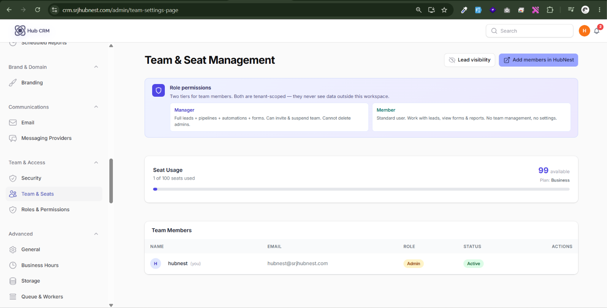
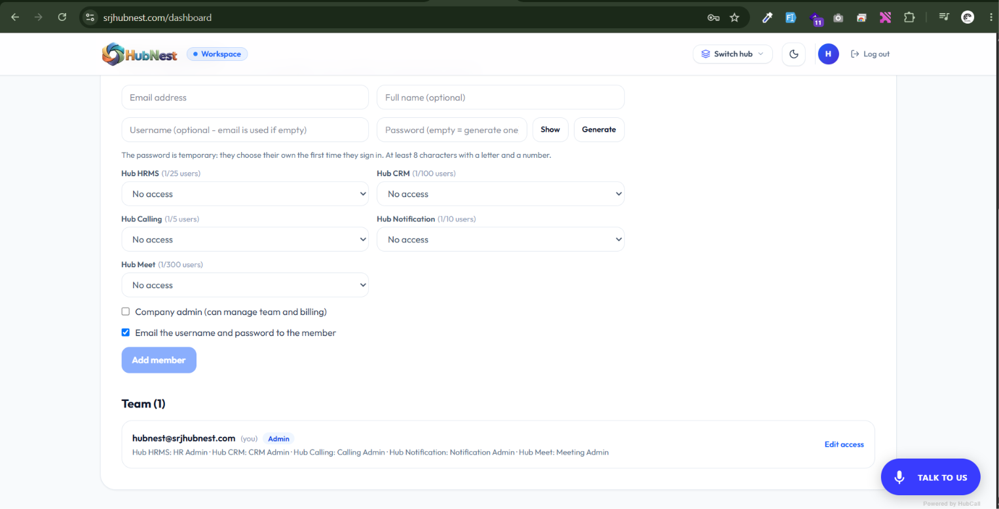
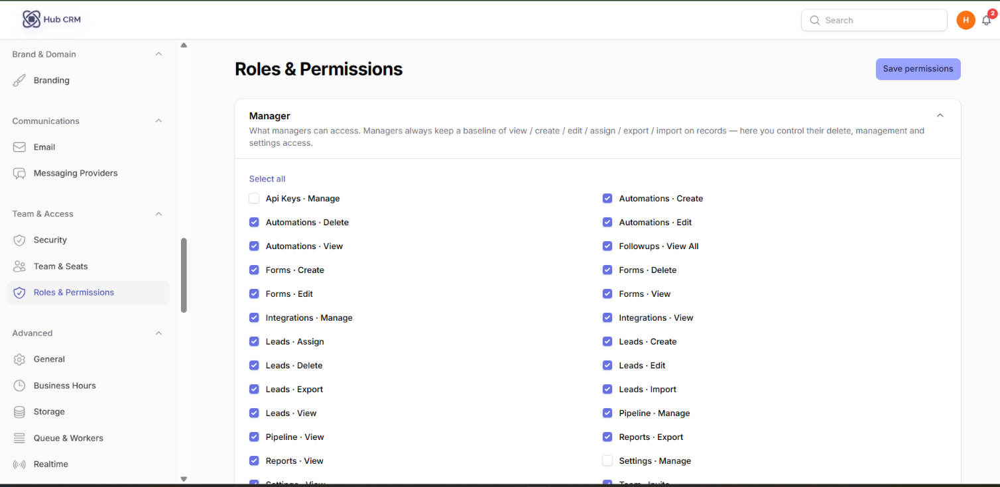
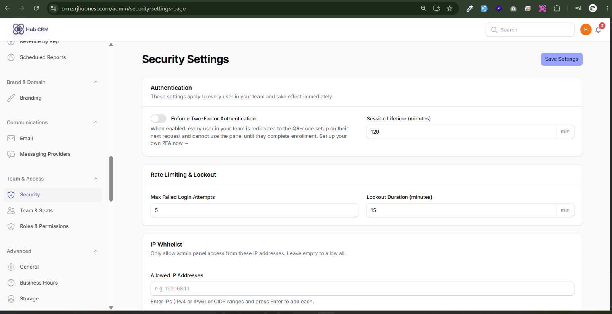
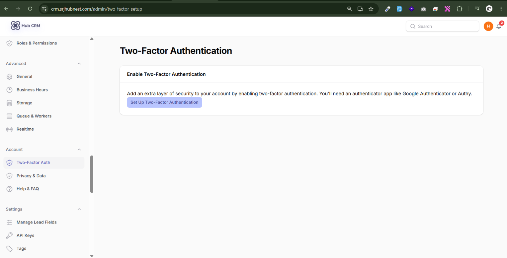
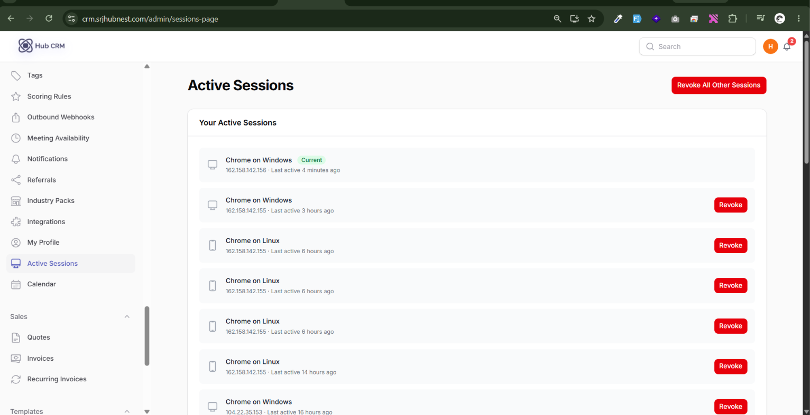

# Team, Roles and Security

## Team & Seats

**Team & Access → Team & Seats**

- **Invite**: enter an email and role; the person receives an invitation.
- **Adjust seats**: add or remove paid seats.
- **Lead visibility**: choose whether agents see only their own leads or all leads.
- **Add members in HubNest**: opens HubNest to create full accounts for your organisation.

## Team Members

**Settings → Team Members** lists everyone. Admins can **Reset password**, **Suspend / Unsuspend**, copy a member's **Meeting link** and change their role.

## Roles & Permissions

**Team & Access → Roles & Permissions**: for each role tick what it may view, create, edit and delete (leads, companies, quotes, invoices, automations, reports, settings...). Click **Save**.

## Security settings

**Team & Access → Security**: password and login rules, whether two-factor authentication is required for the workspace, and login-attempt protection.

## Two-Factor Authentication (your account)

**Account → Two-Factor Auth**: scan the QR code with an authenticator app, enter the 6-digit code and save your recovery codes somewhere safe.

## Active Sessions

**Settings → Active Sessions** lists devices signed in to your account. **Sign out everywhere** ends every other session - use it if a device is lost.

