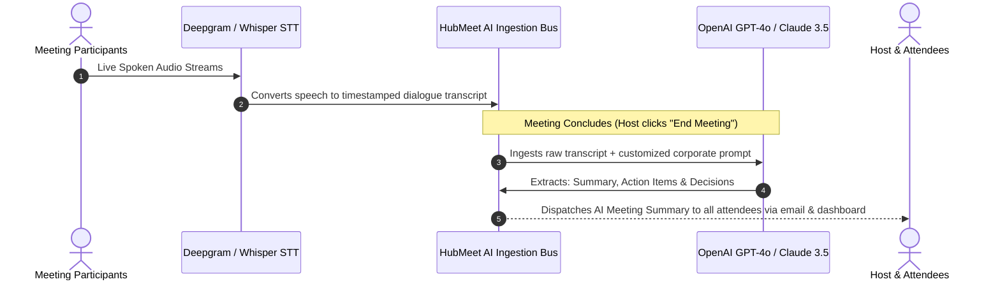
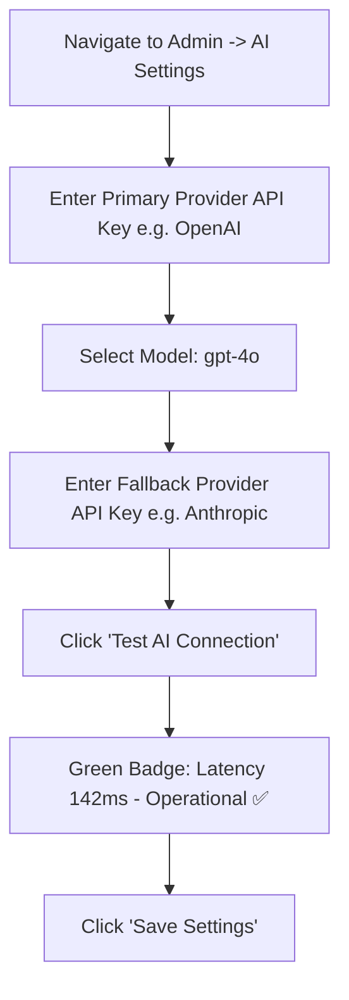

# AI Meeting Copilot & Speech Engine Settings

One of HubMeet's most praised capabilities is its autonomous **AI Meeting Copilot**. Within 60 seconds of a meeting concluding, the AI processes the full audio transcript to generate an executive meeting summary, extract concrete action items with assigned owners, and identify key discussion chapters.

As an Enterprise Administrator, you configure which AI speech and language models power your organization, set up automatic carrier failovers, test API latency, and customize company summary templates.

---

## 1. How the AI Copilot Engine Works



---

## 2. Supported AI Providers & Architecture

HubMeet supports industry-leading commercial AI providers as well as private, on-premise local models for strict data sovereignty:

| AI Provider | Primary Function | Supported Models | Key Advantage |
|---|---|---|---|
| **OpenAI** | Summarization, Action Items & Live Copilot | `gpt-4o`, `gpt-4o-mini`, `whisper-1` | Industry-standard reasoning quality and rapid processing speed. |
| **Anthropic** | Long-form Meeting Analysis | `claude-3-5-sonnet`, `claude-3-haiku` | Exceptional handling of complex 2-hour board meeting transcripts. |
| **Deepgram** | Real-Time Speech-to-Text (STT) | `nova-2`, `nova-2-general` | Sub-250ms streaming latency for live closed captions. |
| **Deepseek / Local LLM (Ollama)** | Private On-Premise Processing | `deepseek-chat`, `llama3-70b` | Transcripts never leave your private corporate data center. |

---

## 3. Configuring API Credentials & Testing Connection

To set up your organization's AI speech engine:



### Step 1: Open the AI Configuration Inspector
1. In the Enterprise Admin Console, click **AI Settings** in the left sidebar.
2. Select your **Primary AI Provider** (e.g., *OpenAI*).

### Step 2: Enter API Credentials
- **API Key:** Paste your organization's secret key (`sk-...`).
- **Default LLM Model:** Select `gpt-4o` (recommended for balanced accuracy and speed) or `gpt-4o-mini` (for maximum cost efficiency).
- **Temperature:** Set between `0.2` and `0.4` (lower temperature guarantees factual, hallucination-free meeting minutes).

### Step 3: Test the Live Handshake
- Click the blue **Test AI Connection** button.
- HubMeet sends a lightweight verification payload. Within 2 seconds, a green status badge will appear:
  `Connected ✅ | Response Latency: 168ms | Model: gpt-4o confirmed`.
- Click **Save Changes**.

---

## 4. Multi-Provider Failover Priority

To prevent AI summary generation from failing during third-party cloud outages:

1. In the AI Settings drawer, navigate to the **Provider Priority & Failover** tab.
2. Drag and drop providers to establish your failover hierarchy:
   - **Priority 1 (Primary):** OpenAI `gpt-4o`
   - **Priority 2 (Secondary):** Anthropic `claude-3-5-sonnet`
   - **Priority 3 (Tertiary):** Local Deepseek / Ollama
3. If Priority 1 encounters a rate limit (`429`) or server outage (`503`), HubMeet automatically reroutes the transcript to Priority 2 without dropping meeting summaries.

---

## 5. Customizing Corporate Summary Prompts

You can standardize how meeting minutes are structured across your company:

1. In **AI Settings**, scroll to **Summary Prompt Customization**.
2. Customize the system instructions:

```markdown
You are an executive corporate meeting assistant. Review the attached meeting transcript and output:

1. Executive Summary (2-3 concise paragraphs summarizing main decisions).
2. Key Discussion Topics (Bulleted by agenda item).
3. Action Items Table:
   - Action Item Description
   - Directly Assigned Owner (from participant names)
   - Agreed Due Date or Deadline
4. Next Meeting Follow-up Date (if mentioned).

Tone: Professional, direct, and factual. Do not include informal chit-chat or greetings.
```

3. Click **Save Prompt**. Every meeting summary generated by your employees will adhere to this structured corporate standard.
