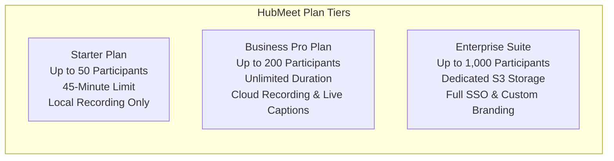
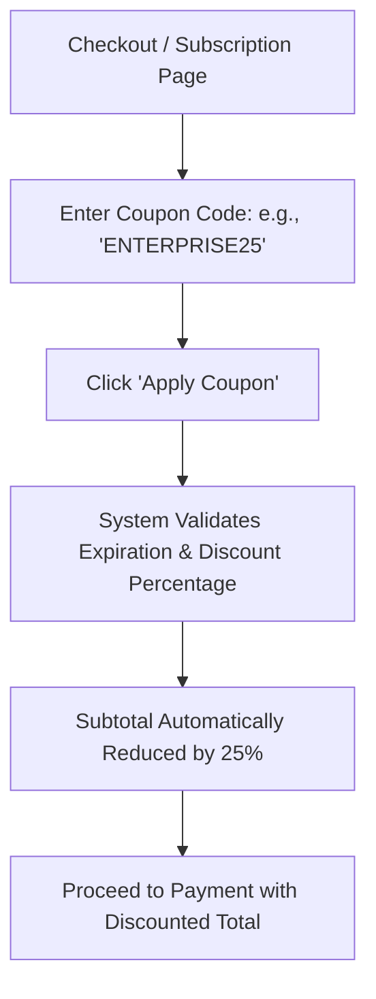

# Subscription Plans, Quotas & Invoices

Managing your organization's video conferencing budget, licensing tiers, participant capacities, and tax receipts is centralized in the HubMeet Billing Suite. As an Enterprise Administrator, you can upgrade participant room limits, apply promotional discount coupons, add cloud storage expansions, and download compliant VAT/tax invoices.

---

## 1. Subscription Tiers Overview

HubMeet offers scalable subscription plans designed for teams of any size:

| Feature / Quota | Starter Tier | Business Pro Tier | Enterprise Suite |
|---|:---:|:---:|:---:|
| **Max Participants per Room** | 50 Attendees | 200 Attendees | **Up to 1,000 Attendees** |
| **Meeting Time Limit** | 45 Minutes | Unlimited (24 Hours) | **Unlimited (24 Hours)** |
| **Cloud Egress Recording** | ❌ Local Only | 🟢 50 GB Cloud Storage | 🟢 **Unlimited / BYO-S3** |
| **AI Meeting Summaries** | 10 / month | 100 / month | **Unlimited** |
| **End-to-End Encryption** | 🟢 Included | 🟢 Included | 🟢 **Included (Enforced)** |
| **Single Sign-On (SSO)** | ❌ No | ❌ No | 🟢 **Keycloak / SAML 2.0** |
| **Custom Domain & Branding** | ❌ No | ❌ No | 🟢 **Custom Logo & URL** |

---

## 2. Upgrading or Changing Your Plan

To modify your organization's plan tier:
1. In the Enterprise Admin Console, click **Billing & Subscriptions** $\rightarrow$ **Plans**.
2. Select your billing cycle: **Monthly** or **Annual (Save 20%)**.
3. Under the desired plan card (e.g., *Business Pro*), click **Upgrade Plan**.
4. The secure checkout screen will summarize:
   - Base plan fee
   - Number of licensed Host seats
   - Any applied promotional coupon discounts
5. Complete payment via credit card or invoice. Your room capacities and cloud features unlock immediately across all user accounts.

---

## 3. Managing Promotional Coupons

If your company received an enterprise promotional code or special partner voucher:

### Steps to Redeem a Coupon:
1. On the billing checkout screen, locate the **Have a Coupon Code?** box.
2. Enter the promo code (e.g., `STARTUP2026`).
3. Click **Apply**.
4. The discount amount is deducted from your subtotal, and the updated price is reflected immediately.

---

## 4. Invoice Settings & Tax Registration

To ensure monthly invoices include your official corporate information for business expense deductions and VAT reclamation:

1. Navigate to **Billing & Subscriptions** $\rightarrow$ **Invoice Settings**.
2. Complete your corporate billing profile:
   - **Legal Entity Name:** Full registered company name (e.g., *"Acme Technologies Inc."*).
   - **Billing Email Address:** Dedicated accounts payable inbox (e.g., `ap@yourcompany.com`).
   - **Tax / VAT / GST Number:** Official corporate tax registration code.
   - **Registered Billing Address:** Street, City, State/Province, Postal Code, and Country.
3. Click **Save Invoice Profile**. All subsequent statements will automatically generate with this formal header.

---

## 5. Reviewing Transaction History & Downloading Invoices

For annual auditing and accounting reconciliation:
1. In the left navigation menu, click **Billing & Subscriptions** $\rightarrow$ **Invoices**.
2. The transaction ledger displays:
   - Invoice Reference Number (e.g., `INV-2026-0894`)
   - Billing Date and Period
   - Plan Name and Host Seat Count
   - Amount Paid
   - Status (`Paid` / `Settled`)
3. Click the **Download (PDF)** button next to any transaction to save a formal, tax-compliant invoice for your accounting archives.
