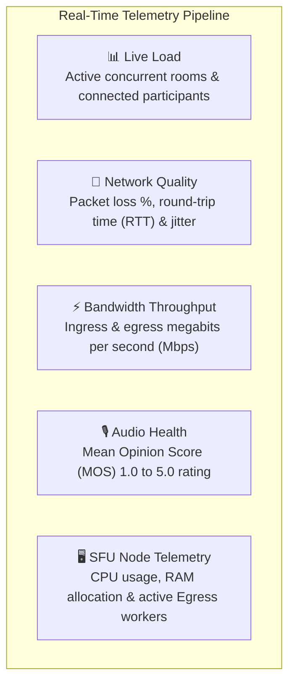
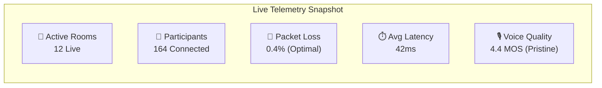

# WebRTC Cluster Telemetry & Network Health

High-quality video meetings demand continuous network monitoring and proactive performance diagnostics. In HubMeet, Enterprise Administrators have access to a real-time **WebRTC Cluster Telemetry Dashboard** that tracks active concurrent rooms, packet loss, round-trip latency, bandwidth saturation, and audio Mean Opinion Scores (MOS) across global media servers.

---

## 1. What the Telemetry Dashboard Monitors



- **Global Live Room Inspector:** See every active meeting happening right now across your organization, who is presenting, and their live bitrates.
- **Packet Loss & Latency Heatmaps:** Pinpoint whether poor call quality reported by an employee is caused by their home Wi-Fi or corporate office firewalls.
- **Audio Quality Scoring (MOS):** Real-time Mean Opinion Score analytics that benchmark voice clarity on a standard 1.0 to 5.0 scale.
- **Egress Worker Scaling:** Monitor how many background video recording workers are rendering MP4 files in real time.

---

## 2. Navigating the Telemetry Dashboard

To access live cluster diagnostics:
1. In the Enterprise Admin Console, click **Telemetry & Metrics** $\rightarrow$ **Cluster Health**.
2. The dashboard updates every 5 seconds with live telemetry streams:



| Metric | Healthy Benchmark | Warning Threshold | Critical Action Required |
|---|---|---|---|
| **Packet Loss** | **< 1.0%** (Pristine) | **2.0% – 5.0%** (Audio jitter noticeable) | **> 5.0%:** Check local ISP peering or switch user to Ethernet. |
| **Round-Trip Time (RTT)** | **< 80 ms** (Instant) | **100 ms – 200 ms** (Slight voice lag) | **> 250 ms:** Verify user is routing to closest geographical SFU cluster. |
| **Mean Opinion Score (MOS)** | **> 4.2** (High-Definition) | **3.8 – 4.1** (Acceptable mobile audio) | **< 3.5:** High packet loss or microphone distortion detected. |
| **SFU Server CPU Load** | **< 60%** | **70% – 85%** | **> 90%:** Spin up additional LiveKit media nodes in cluster. |

---

## 3. Live Room Inspector

When an executive reports: *"The audio kept cutting out during my meeting"*, you can inspect the exact call parameters in the **Live Room Inspector**:

1. In the Telemetry console, click the **Live Rooms** tab.
2. Search for the meeting by Host Name, Room ID, or Topic.
3. Click on the meeting row to open the **Diagnostic Drilldown**:
   - List of all connected participants with their device types (Mac, Windows, iOS, Android).
   - Ingress and egress video bitrate for each camera stream (e.g., `1,250 kbps`).
   - Individual participant network bars and exact packet loss percentage.
   - Disconnect reason logs (e.g., *"Client disconnected gracefully"*, *"Network timeout: Wi-Fi dropped"*).

```mermaid
sequenceDiagram
    autonumber
    actor Admin as Enterprise Admin
    participant Inspector as Live Room Inspector
    participant Node as WebRTC SFU Node

    Admin->>Inspector: Searches Room: "Board Strategy Review"
    Inspector->>Node: Queries real-time participant track stats
    Node-->>Inspector: Returns: User A (0.1% loss), User B (12.4% loss on Wi-Fi)
    Inspector-->>Admin: Flags User B as experiencing local Wi-Fi packet drop
    Admin-->>Admin: Confirms server infrastructure is healthy; issue isolated to User B's Wi-Fi
```

---

## 4. Bandwidth & Codec Optimization

HubMeet automatically adjusts video codecs to deliver maximum stability:

- **VP8 / VP9 / H.264:** Universal video codecs providing wide hardware acceleration across older laptops and mobile phones.
- **AV1 (Next-Gen):** Delivers full 1080p HD video using 40% less bandwidth on compatible modern browsers.
- **Opus HD Audio:** Dynamic audio bitrate scaling from 16 kbps (clean voice on poor mobile connections) up to 96 kbps (rich full-band stereo sound during music or video presentations).
