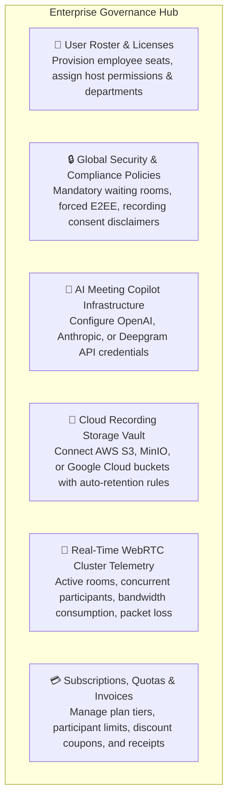
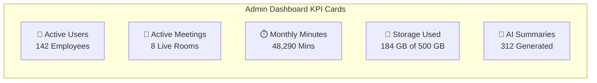
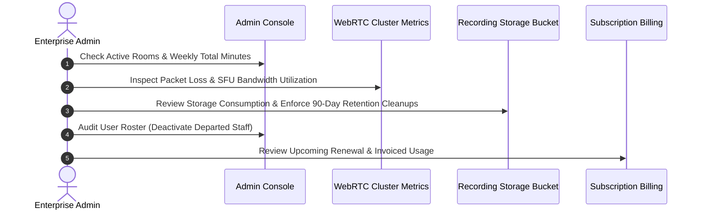

# Enterprise Meeting Administrator Overview & Architecture

Welcome to the **HubMeet Enterprise Administrator Guide**. As an IT director, enterprise telecom administrator, or corporate compliance manager, you hold organizational authority over your company's HubMeet deployment. You manage employee member rosters and host licenses, enforce organization-wide meeting security and encryption standards, configure AI meeting summary speech backbones, set S3 cloud recording retention limits, and monitor live WebRTC cluster telemetry.

---

## 1. What You Manage as an Enterprise Administrator

- **User Roster & Seat Allocation:** Provision company employees, allocate premium Host licenses, and define role-based access controls (`Enterprise Admin`, `Meeting Host`, `Standard Member`).
- **Organization-Wide Meeting Security:** Standardize security settings across all company meetings: enforce mandatory alphanumeric room passcodes, require waiting room screening, restrict screen sharing, or mandate End-to-End Encryption (E2EE).
- **AI Meeting Summaries & Speech Engines:** Power automated meeting minutes and smart action-item extraction by integrating API keys for OpenAI, Anthropic, or Deepgram with automatic failover priority.
- **Cloud Recording Vault (S3 & MinIO):** Store encrypted meeting video archives directly in your organization's own AWS S3, Cloudflare R2, or private on-premise MinIO storage buckets with configurable retention days.
- **WebRTC Network Telemetry:** Inspect live network health, concurrent active video streams, packet loss rates, latency, and MOS audio scores across global server clusters.
- **Billing & Subscription Management:** Upgrade participant capacities (e.g., 100, 300, or 1,000 attendees per room), apply enterprise discount coupons, and download corporate VAT/tax invoices.

---

## 2. Accessing the Enterprise Admin Console

To enter the administrative workspace:
1. Sign in to **HubMeet** with your administrator credentials.
2. In the top right corner of your screen, click your **Profile Avatar**.
3. Select **Enterprise Admin Console** (or navigate to `/admin/dashboard`).
4. The administrative dashboard displays real-time organizational KPIs:

---

## 3. Administrator Weekly & Monthly Routine

To keep your meeting infrastructure secure, compliant, and cost-effective, follow this recommended checklist:

### Weekly Routine:
1. **Audit Live Telemetry:** Check the **Cluster Telemetry** dashboard for any regional packet loss or network congestion reports.
2. **Review Storage Consumption:** Check S3 storage capacity to ensure cloud recording uploads are not reaching quota limits.
3. **Audit User Additions:** Confirm that new hires in HubHRMS have been provisioned with appropriate meeting host privileges.

### Monthly Routine:
1. **Security Policy Check:** Ensure compliance mandates (e.g., E2EE for legal meetings) are enforced across all departments.
2. **AI Credit & API Key Health:** Verify that underlying OpenAI/Anthropic API balances are funded to avoid interruptions in meeting summaries.
3. **Invoice Reconciliation:** Download monthly billing statements and verify corporate seat counts.

---

## 4. Next Steps in this Guide

Explore each administrative guide to configure and govern your HubMeet environment:

- 👥 **[User Roster & Host Licenses](user-roster-licenses.md):** Managing employee seats, provisioning host licenses, and assigning roles.
- 🔒 **[Security & Meeting Policies](security-meeting-policies.md):** Mandatory passcodes, waiting room rules, and recording consent notices.
- 🤖 **[AI Copilot & Speech Engine Settings](ai-copilot-settings.md):** Configuring OpenAI, Anthropic, and Deepgram credentials for smart summaries.
- 💾 **[Recording Vault & S3 Storage](recording-vault-storage.md):** Connecting AWS S3/MinIO buckets and setting automated retention rules.
- 📡 **[Cluster Telemetry & Network Health](cluster-telemetry-health.md):** Monitoring live WebRTC server health, active streams, and packet loss.
- 💳 **[Billing Plans, Quotas & Invoices](billing-plans-invoices.md):** Managing subscription tiers, participant seat caps, and payment receipts.
