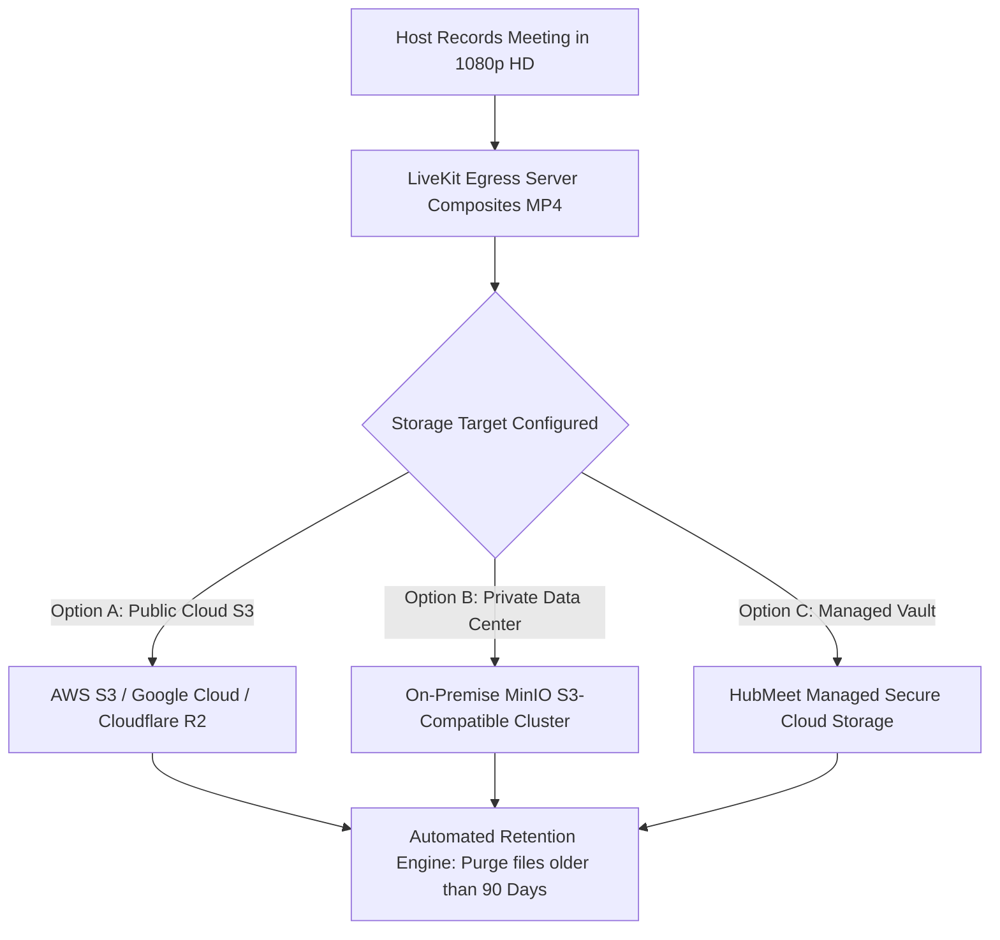
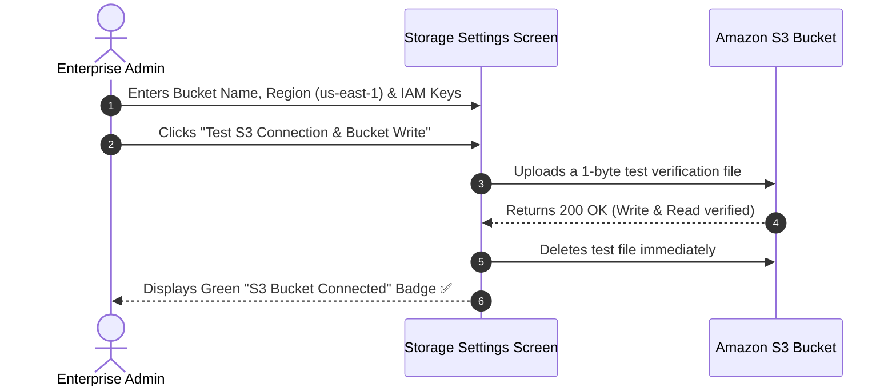
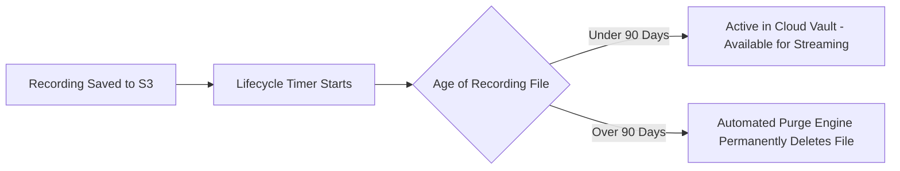

# Cloud Recording Vault & S3 Storage Configuration

High-definition meeting recordings consume significant storage capacity over time. To ensure total data sovereignty and predictable cloud infrastructure costs, HubMeet allows Enterprise Administrators to connect your company's own **Amazon S3**, **Cloudflare R2**, **Google Cloud Storage (GCS)**, or private **MinIO** storage buckets, and enforce automated lifecycle retention rules.

---

## 1. Storage Architecture Overview

- **BYOS (Bring Your Own Storage):** Meeting recordings never need to reside on third-party servers; you can store files directly inside your company's own secure AWS VPC or on-premise data center.
- **Automated Lifecycle Cleanups:** Prevent runaway cloud storage bills by setting automated deletion rules (e.g., automatically archiving or deleting video recordings after 90 or 180 days).
- **Encryption at Rest:** All video archives are stored encrypted using AES-256 server-side encryption (SSE-S3 or SSE-KMS).

---

## 2. Supported Cloud Storage Providers

| Storage Provider | Configuration Type | Recommended Use Case |
|---|---|---|
| **Amazon Web Services (AWS S3)** | Standard AWS S3 Bucket | Industry standard for enterprise compliance and cross-region replication. |
| **Cloudflare R2** | S3-Compatible API | High-bandwidth teams wanting **Zero Egress Fees** when downloading large video files. |
| **Google Cloud Storage (GCS)** | S3 Interoperability Mode | Organizations operating their core IT infrastructure on Google Cloud. |
| **MinIO (Self-Hosted)** | Private S3 Cluster | Defense, government, banking, and healthcare requiring strict on-premise data isolation. |
| **HubMeet Managed Vault** | Built-in Managed Storage | Default plug-and-play storage included with your subscription tier. |

---

## 3. Connecting an AWS S3 Storage Bucket

To connect your corporate AWS S3 bucket:

### Step 1: Open Storage Settings
1. In the Enterprise Admin Console, click **Storage & Vault** in the left sidebar.
2. Select **Storage Provider** $\rightarrow$ **Amazon Web Services (AWS S3)**.

### Step 2: Enter IAM Credentials
- **Bucket Name:** e.g., `acme-hubmeet-recordings-vault`.
- **AWS Region:** e.g., `us-east-1`, `eu-west-1`, or `ap-south-1`.
- **Access Key ID:** IAM user access key with `s3:PutObject`, `s3:GetObject`, and `s3:DeleteObject` permissions.
- **Secret Access Key:** Corresponding IAM secret key.

### Step 3: Test Bucket Access
- Click the blue **Test S3 Connection** button.
- HubMeet performs an automated write-read-delete verification handshake.
- Once verified, click **Save Storage Configuration**. All subsequent meeting recordings will be streamed directly into your S3 bucket.

---

## 4. Connecting Self-Hosted MinIO or Cloudflare R2

If using MinIO on-premise or Cloudflare R2:

1. Select **Provider** $\rightarrow$ **S3-Compatible / MinIO**.
2. Complete the custom connection fields:
   - **Endpoint URL:** e.g., `https://minio.internal.yourcompany.com` or `https://<account_id>.r2.cloudflarestorage.com`.
   - **Bucket Name:** e.g., `meeting-recordings`.
   - **Access Key:** MinIO / R2 Access Key.
   - **Secret Key:** MinIO / R2 Secret Key.
   - **Path Style Access:** Check **[✓] Enable Path-Style Access** if required by your MinIO installation.
3. Click **Test & Save**.

---

## 5. Setting Automated Retention Policies & Storage Quotas

To comply with data privacy policies and optimize costs:

1. In the **Storage Settings** console, scroll to **Lifecycle & Retention Governance**.
2. **Auto-Delete Recordings After:** Choose your corporate retention threshold:
   - `30 Days` (Standard project meetings).
   - `90 Days` (Recommended for balanced corporate compliance).
   - `180 Days` or `365 Days` (Legal, HR, and compliance reviews).
   - `Never (Keep Indefinitely)` (Manual deletion only).
3. **Storage Quota Alerts:** Set an email warning threshold (e.g., alert when storage usage exceeds `85%` of allocated quota).
4. Click **Apply Retention Rules**. HubMeet's daily maintenance job will automatically purge aged files based on your policy.
