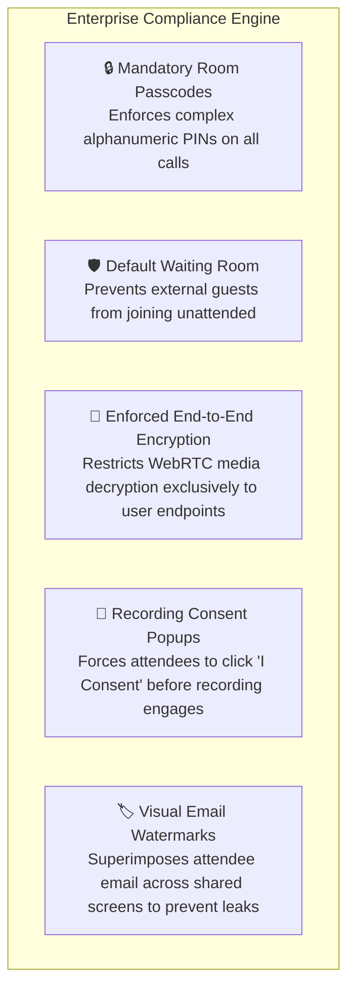
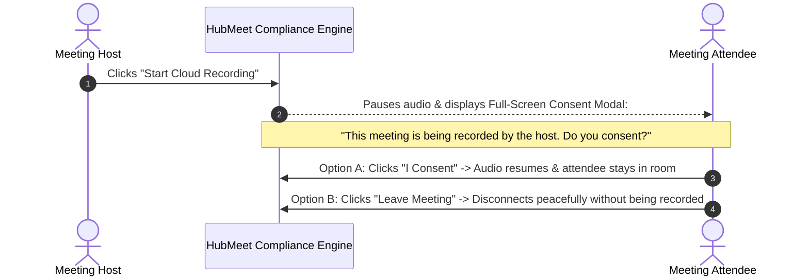
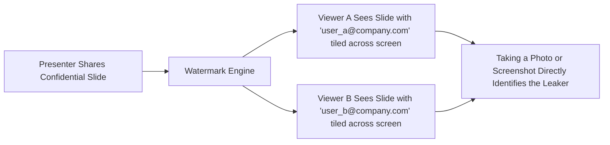

# Enterprise Security & Compliance Meeting Policies

Maintaining uniform security and confidentiality across hundreds of simultaneous video calls requires automated organizational governance. In HubMeet, Enterprise Administrators can enforce company-wide security baselines so individual meeting hosts cannot accidentally disable crucial safeguards like passcodes, waiting rooms, or recording consent notices.

---

## 1. Enterprise Security Baseline

---

## 2. Configuring Global Security Policies

To inspect and enforce company-wide meeting policies:
1. In the Enterprise Admin Console, click **Security & Compliance** $\rightarrow$ **Meeting Policies**.
2. Toggle and configure the following master policies:

| Master Security Policy | Default Setting | Recommended Enterprise Setting | Regulatory Benefit |
|---|:---:|:---:|---|
| **Mandatory Room Passcode** | `Optional` | 🟢 **Forced (Enforced)** | Blocks brute-force guessing of room codes. |
| **Mandatory Waiting Room** | `Optional` | 🟢 **Forced for External Guests** | Prevents uninvited participants from entering corporate calls. |
| **End-to-End Encryption (E2EE)** | `Optional` | 🟢 **Enforced for Confidential Teams** | Cryptographically shields trade secrets, legal discussions, and medical records. |
| **Recording Consent Dialog** | `Disabled` | 🟢 **Mandatory (Enforced)** | Satisfies GDPR, CCPA, and wiretapping legal consent requirements. |
| **Visual Email Watermarking** | `Disabled` | 🟢 **Enabled for Executive Meetings** | Deters corporate espionage by watermarking the viewer's email on shared slides. |
| **Screen Share Policy** | `All Users` | 🟡 **Host & Co-Hosts Only** | Prevents accidental or rogue screen takeovers during town halls. |
| **Domain Restriction** | `Open` | 🟢 **Internal Domain Only (`@company.com`)** | Restricts sensitive internal meetings exclusively to verified corporate employees. |

---

## 3. Mandatory Recording Consent Disclaimers

In many jurisdictions (such as the European Union under GDPR, and US states like California), recording conversations without explicit affirmative consent can result in severe legal penalties.

### How to Enable Mandatory Consent:
1. In **Meeting Policies**, scroll to **Recording Governance**.
2. Toggle **Mandatory Attendee Consent Dialog** to `Active`.
3. In the disclaimer text box, you can customize your corporate legal notice:
   *"This meeting is recorded for quality, training, and compliance purposes by Acme Corp. By continuing, you consent to audio, video, and transcript processing."*
4. Click **Save Policies**.
5. Once active, whenever any host in your company starts a cloud recording, every attendee must explicitly click **I Consent** to remain on the call.

---

## 4. Visual Screen Watermarking (Anti-Leak Protection)

When presenting confidential quarterly financial numbers, unannounced product roadmaps, or merger discussions, participants could take screenshots or record their screens with an external phone.

HubMeet's **Visual Screen Watermarking** deters leaks by superimposing a semi-transparent, dynamic watermark across the shared presentation:

- **Dynamic Tiling:** The watermark displays the viewing participant's own email address and IP address tiled subtly across the video stream.
- **Leak Deterrence:** If an attendee takes a smartphone photo of the confidential slide and posts it online, their exact identity and email address are visible across the image.

---

## 5. In-Meeting Chat File Restrictions

To protect your corporate network against malware and data exfiltration:

1. In **Security Policies**, scroll to **Chat & Attachment Restrictions**.
2. Under **Allowed File Extensions**, restrict attachments to safe business formats:
   `pdf, docx, xlsx, pptx, png, jpg, jpeg`
   *(Executable files like `.exe`, `.bat`, `.sh`, `.apk` are permanently blocked by default).*
3. **Maximum File Size:** Cap attachment sizes (e.g., `25 MB`) to conserve storage and prevent network congestion.
4. Click **Apply Policy Updates**. All active and future rooms will enforce these rules instantly.
