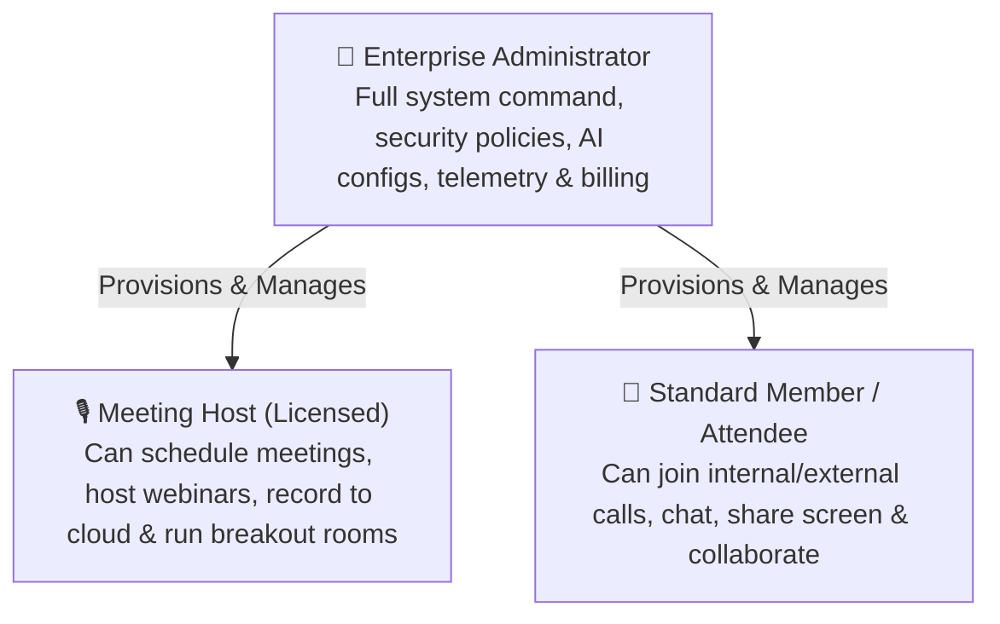
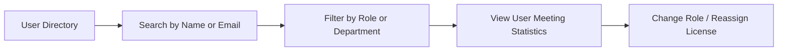
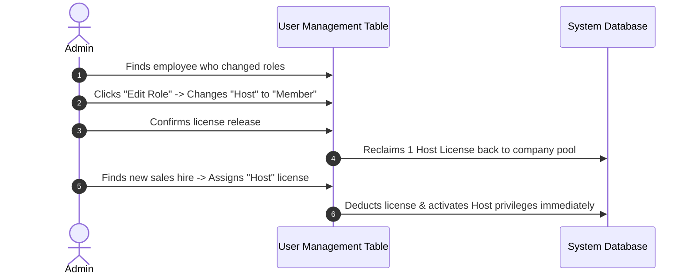

# User Roster & Host License Management

As an Enterprise Administrator, you control employee access, provision meeting host licenses, assign administrative roles, and organize team members into departments to ensure efficient meeting collaboration across your company.

---

## 1. HubMeet Role Hierarchy

HubMeet provides 3 distinct organizational roles with clearly separated privileges:



| Role | Permitted Actions | Recommended Assignees |
|---|---|---|
| **Enterprise Administrator** | Complete control over Admin Console, user accounts, security policies, AI keys, S3 storage, and billing. | IT Directors, Telecom Leads, System Admins. |
| **Meeting Host** | Can create and schedule meetings up to plan participant capacity, run waiting rooms, record calls, and launch polls/breakouts. | Managers, Team Leads, Account Executives, Teachers, Recruiters. |
| **Standard Member** | Can join all internal meetings, share camera/mic/screen, use whiteboard, and chat. Cannot schedule large enterprise meetings. | General staff, contractors, interns, temporary team members. |

---

## 2. Navigating the User Management Workspace

To access your organization's user directory:
1. In the Enterprise Admin Console, click **User Management** in the left sidebar.
2. The user directory displays:
   - **Name & Email Address**
   - **Assigned Role Badge** (`Admin`, `Host`, `Member`)
   - **Department / Team** (e.g., *Sales*, *Engineering*, *Marketing*)
   - **Account Status** (`Active` or `Suspended`)
   - **Last Meeting Attended** timestamp
   - **Actions** (Edit Role, Reset Password, Deactivate)



---

## 3. Adding New Users & Inviting Team Members

You can provision team members individually or in bulk using a CSV spreadsheet:

### Method 1: Single User Invitation
1. In the top right corner of the user management table, click **+ Add User**.
2. Enter the employee's details:
   - **Full Name:** e.g., *"Sarah Jenkins"*.
   - **Corporate Email:** e.g., `s.jenkins@yourcompany.com`.
   - **Role:** Select **Meeting Host** or **Standard Member**.
   - **Department:** Assign to an existing team.
3. Click **Send Invitation**.
4. An automated welcome email containing a 1-click activation link is sent to the employee immediately.

### Method 2: CSV Bulk Import (100+ Users)
1. Click the **Bulk Import** button.
2. Download the sample CSV template:
   ```csv
   name,email,role,department
   Alex Rivera,a.rivera@yourcompany.com,host,Sales
   Maya Patel,m.patel@yourcompany.com,host,Marketing
   Liam Smith,l.smith@yourcompany.com,member,Engineering
   ```
3. Fill out the spreadsheet with your staff roster and upload the `.csv` file.
4. HubMeet validates the email addresses, creates the accounts, and sends invitation emails in parallel.

---

## 4. Reassigning Host Licenses

If an employee leaves your company or transfers to a role that does not require scheduling video meetings, you can reclaim and reassign their host license:



1. Locate the employee's card in the **User Directory**.
2. Click the **Edit (Pencil Icon)** button.
3. Under **Role**, switch the selection from **Host** to **Member**.
4. Click **Save Changes**.
5. The host license is returned to your organization's available license pool immediately, ready to be assigned to another team member.

---

## 5. Suspending or Offboarding Users

When an employee departs the organization, revoking access promptly protects meeting confidentiality:

1. In the **User Management** table, locate the departed employee.
2. Click the **Three Dots Icon** (`...`) next to their name.
3. Select **Deactivate User**.
4. A confirmation prompt will ask: *"Deactivate [Name]? This will immediately terminate all active meeting sessions and prevent future logins."*
5. Click **Confirm Deactivation**.
6. Their active session tokens are revoked, scheduled future meetings are canceled, and their host license is freed up for your team.
