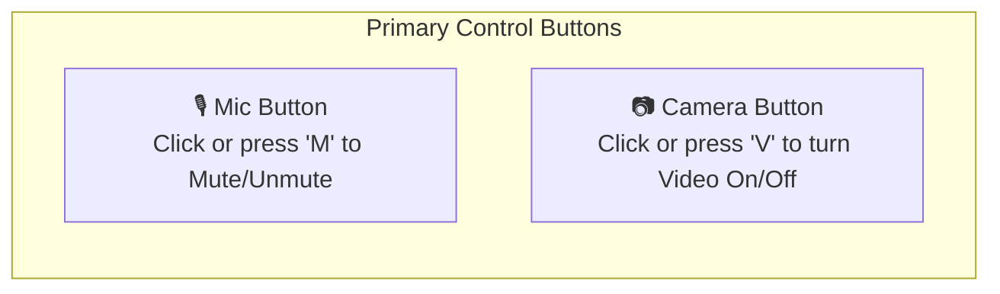
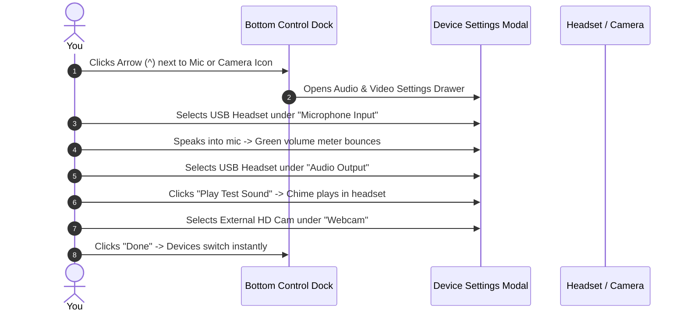
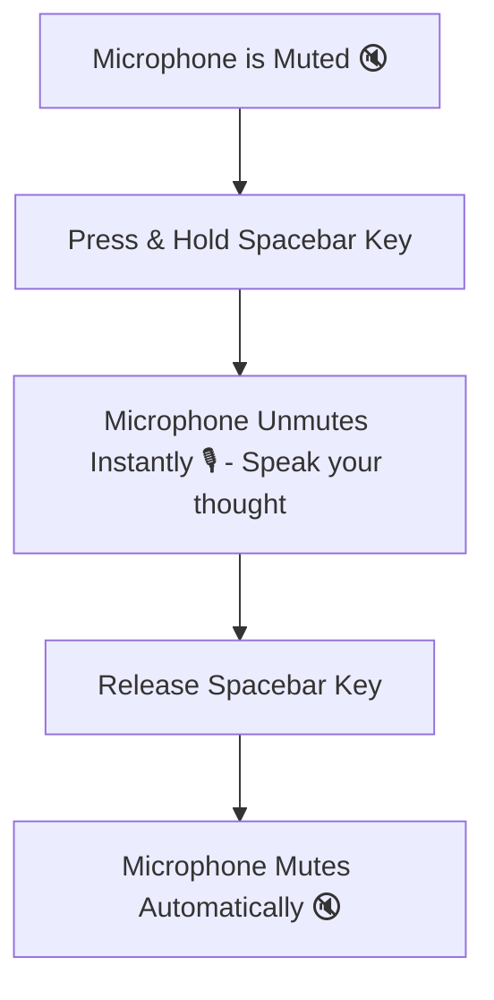

# Audio, Video Setup & Keyboard Shortcuts

Having reliable audio and high-definition video is essential for effective meetings. HubMeet allows you to switch microphones, cameras, and audio output speakers on the fly, adjust video resolution, talk instantly using **Push-to-Talk (Spacebar)**, and navigate the room using lightning-fast keyboard shortcuts.

---

## 1. Quick Mute & Camera Controls

The primary audio and video buttons are always accessible in the center of your bottom control dock:

- **Muting / Unmuting Your Microphone:** Click the round **Microphone Icon** (or press the `M` key on your keyboard).
  - 🟢 **Green Icon:** Your microphone is live, and your voice is heard by everyone.
  - 🔴 **Red Icon with Slash:** Your microphone is completely muted.
- **Toggling Your Webcam:** Click the round **Camera Icon** (or press the `V` key).
  - 🟢 **Green Icon:** Your webcam is streaming video into the room.
  - 🔴 **Red Icon with Slash:** Your camera is stopped; others will see your profile photo or name initials.

---

## 2. Audio & Video Device Settings Modal

If you plug in external USB headphones, a podcast microphone, or a high-end external webcam, you can switch devices without leaving the call:

### How to Change Devices:
1. Click the small **Upward Arrow (`^`)** right next to the Microphone or Camera button (or click the **Gear Icon** in the dock).
2. The **Device Settings Dialog** will open:
   - **Microphone (Audio Input):** Select your preferred mic (e.g., *"Jabra Evolve2 65"*, *"Realtek High Definition Audio"*).
   - **Speaker (Audio Output):** Choose where room voices and ring chimes should play (e.g., your headphones instead of laptop speakers). Click **Play Test Tone** to confirm you can hear audio clearly.
   - **Webcam (Video Input):** Choose your video source (e.g., *"Logitech C920 HD Pro"*, *"Integrated Camera"*).
   - **Video Resolution Preset:** Choose your streaming quality:
     - **Auto (Recommended):** HubMeet continuously balances quality based on available bandwidth.
     - **720p HD:** Crisp, standard high-definition video.
     - **1080p Full HD:** Maximum sharpness (ideal when presenting physical documents or whiteboards to camera).
     - **360p Standard:** Conserves mobile data or works reliably on unstable Wi-Fi connections.
3. Click **Close** or press `Escape` to save your selections.

---

## 3. Push-to-Talk via Spacebar

When attending large group webinars or team presentations where you mostly listen, staying permanently muted prevents background coughing, dog barks, or keyboard tapping from interrupting the speaker.

With HubMeet's **Push-to-Talk Feature**, you can remain muted and speak only when holding down the **Spacebar**:

### How to Use Push-to-Talk:
1. Ensure your microphone is muted (Red mic icon).
2. While muted, **press and hold down the Spacebar** on your keyboard.
3. A floating green indicator will appear on your screen: *"🎙️ Spacebar active: You are talking..."*
4. Say your question or response.
5. **Release the Spacebar.** Your microphone immediately snaps back to muted silence.

> [!TIP]
> You do not need to click anything on your screen. Push-to-talk works seamlessly whenever the HubMeet browser tab has focus.

---

## 4. Master Keyboard Shortcuts Cheat Sheet

HubMeet is built with keyboard-first ergonomics so power users can control meetings with a single keystroke:

| Key Press | Action | When to Use It |
|---|---|---|
| `Spacebar` *(Hold)* | **Push-to-Talk** | Speak quickly while staying muted. |
| `M` | **Toggle Microphone** | Instantly mute or unmute your voice. |
| `V` | **Toggle Camera** | Turn your webcam video on or off. |
| `S` | **Toggle Screen Share** | Open or close the screen share picker. |
| `C` | **Toggle In-Meeting Chat** | Slide the right-side chat drawer open or closed. |
| `P` | **Toggle Participants List** | View who is currently in the room. |
| `H` | **Raise / Lower Hand** | Politely notify the host that you have a question. |
| `W` | **Toggle Whiteboard** | Launch the collaborative digital drawing board. |
| `?` | **Show Shortcuts Modal** | Pop up the complete in-app keyboard shortcuts guide. |
| `L` | **Leave Meeting** | Safely disconnect from the room. |

---

## 5. Troubleshooting Audio & Video Glitches

| Problem | Likely Reason | Quick Solution |
|---|---|---|
| **Others cannot hear you** | Microphone is physically switched off or wrong mic is selected. | 1. Check if your headset cord has a physical inline mute switch. 2. Click `^` next to the Mic icon and select your headset microphone. 3. Verify browser permissions show "Allowed". |
| **You cannot hear other participants** | Sound routed to wrong speaker or volume muted. | 1. Open Device Settings (`^` next to Mic) and select your headphones under Audio Output. 2. Click "Play Test Sound" to test volume. 3. Check computer master volume. |
| **Video is blurry or stuttering** | Bandwidth congestion or weak Wi-Fi signal. | 1. Move closer to your Wi-Fi router or plug in an Ethernet cable. 2. In Device Settings, reduce video resolution preset from 1080p to 360p. 3. Close background video downloads or torrents. |
| **"Camera blocked by another application"** | Another software (Zoom, Teams, Skype) is using the webcam. | Close any other video apps running in the background and refresh your HubMeet browser tab. |
