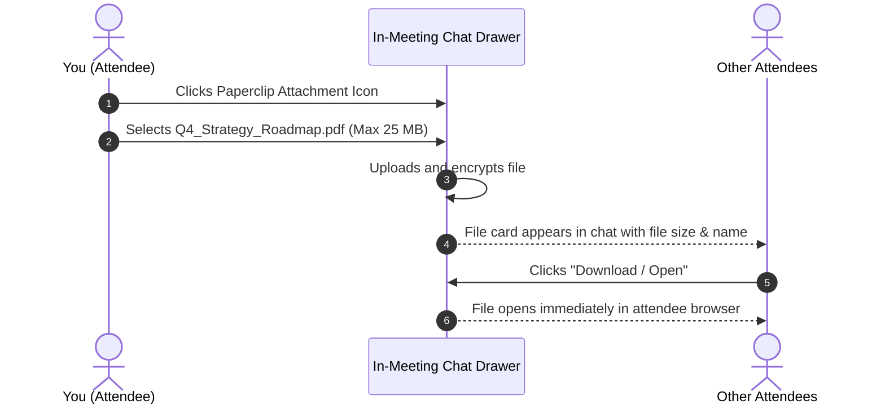
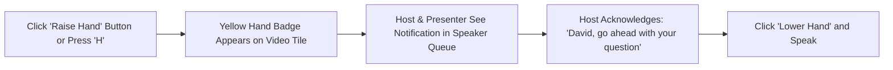

# In-Meeting Chat, Reactions & File Sharing

Effective meetings require continuous two-way communication without speaking over the presenter. HubMeet offers an integrated suite of non-verbal collaboration tools: a **Real-Time Group & Private Chat**, an **In-Meeting File Attachment Vault**, a chronological **Hand Raise Queue**, and animated **Floating Emoji Reactions**.

---

## 1. Opening the In-Meeting Chat Drawer

To access the chat room:
1. In the bottom control dock, click the **Chat Icon** (speech bubble), or press the `C` key on your keyboard.
2. The **Chat Drawer** smoothly slides out from the right side of your screen without covering the active video grid.

```mermaid
graph TD
    A[Open Chat Drawer (Key: C)] --> B{Select Message Destination}
    B -->|To Everyone| C[Public Message visible to all attendees]
    B -->|To Specific Person| D[Private Direct Message to one attendee]
    C & D --> E[Type Message or Click Paperclip to Attach File]
    E --> F[Press Enter to Send]
```

---

## 2. Public vs. Private Direct Messaging

HubMeet lets you choose who sees your messages:

| Destination | Visibility | Best Use Case |
|---|---|---|
| **Everyone in Room (Default)** | All meeting attendees and co-hosts can read the message. | Sharing links to Google Docs, asking open questions, or posting meeting notes. |
| **Direct / Private Message** | Only you and the chosen recipient can see the thread. | Asking a colleague a quiet question or sending confidential feedback to the host. |

### How to Send a Private Message:
1. At the top of the chat drawer, click the **Send To** dropdown menu (default is *"Everyone"*).
2. Select the specific person from the participant list.
3. A discreet banner will appear: *"🔒 Direct message with [Name]"*.
4. Type your message and press **Enter**.
5. The message is labeled with a purple **[Private]** badge so you can verify it was delivered confidentially.

> [!NOTE]
> Even if cloud meeting recording is enabled, private 1-on-1 direct messages between attendees are **never** included in public meeting transcripts or recording playback logs.

---

## 3. Sharing Files & Document Attachments

You do not need to switch to email or Slack to hand out a PDF report, an agenda document, or a screenshot during a live call:



### Steps to Attach a File:
1. Open the **In-Meeting Chat Drawer**.
2. Click the **Paperclip Icon** next to the message input box.
3. Select any file from your computer (PDF, Word, Excel, PowerPoint, PNG, JPG, or ZIP; up to 25 MB).
4. Type an optional message to accompany the file (e.g., *"Here is the contract draft we are reviewing on slide 4"*).
5. Press **Enter**.
6. A clickable file card appears in the chat stream with the document name, extension badge, and file size. Attendees can click **Download** to save it locally.

---

## 4. Raising Your Hand

When you have a question during a presentation, interrupting the speaker with your voice can disrupt their train of thought. Using **Raise Hand** places a polite visual indicator on your video tile:



- **How to Raise Your Hand:** Click the **Hand Icon** in the bottom control dock, or press the `H` key.
- **The Queue:** HubMeet tracks the exact second each person raised their hand. In the **Participants Panel**, raised hands are sorted chronologically from oldest to newest so the host can call on people in the exact order they raised their hands.
- **Lowering Your Hand:** Click the button again (or press `H`) to lower your hand once your question is answered.

---

## 5. Floating Emoji Reaction Bursts

Want to applaud a great announcement, celebrate a team milestone, or show quick agreement without unmuting? Use **Floating Emoji Reactions**:

1. In the bottom control dock, click the **Reactions Icon** (smiling face 🙂).
2. Click any reaction emoji:
   - 👏 **Applause / Clap:** For celebrating good news or presentation conclusions.
   - 👍 **Thumbs Up:** Quick agreement or sign of approval.
   - ❤️ **Heart / Love:** Showing appreciation or gratitude.
   - 😂 **Laugh:** For lighthearted moments and jokes.
   - 🎉 **Party Popper:** Celebrating launches, promotions, and birthdays.
   - 😮 **Surprised / Wow:** For exciting or unexpected insights.
3. When clicked, an animated burst of that emoji floats upwards from your video tile and dances across everyone's screen for 3 seconds.
