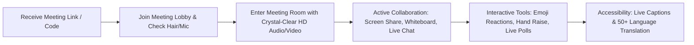
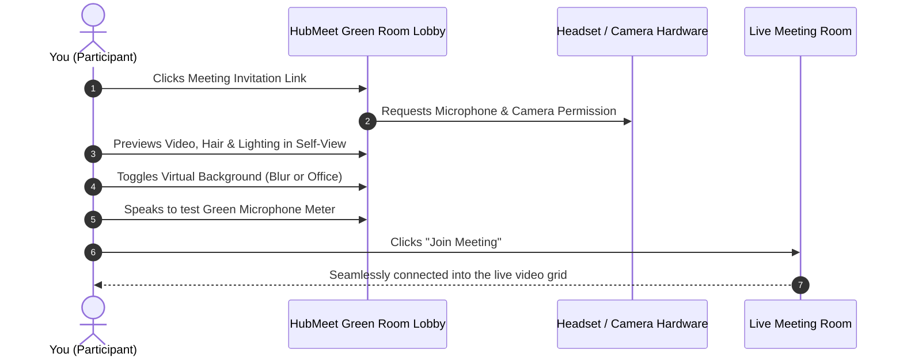
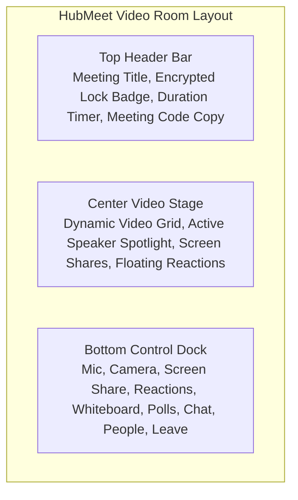

# Meeting Participant & Attendee Overview & Checklist

Welcome to the **HubMeet Participant & Attendee Guide**. HubMeet is HubNest's high-definition WebRTC video conferencing and collaboration workspace. Whether you are dialing into a daily team standup, participating in a corporate training session, or joining a client strategy call, HubMeet works directly in your web browser or desktop app with zero plugins, ultra-low audio latency, and enterprise-grade end-to-end encryption.

---

## 1. What You Can Do as a Participant

- **1-Click Browser Joining:** Join instant meetings from Google Chrome, Edge, Firefox, or Safari on Windows, macOS, Linux, iOS, or Android without installing extra software.
- **Crystal-Clear Audio & HD Video:** Dynamic video quality scaling (720p/1080p) that adapts automatically to your internet connection speed.
- **AI Background Noise Suppression:** Advanced acoustic filtering eliminates typing sounds, barking dogs, fans, and street noise from your microphone.
- **Professional Virtual Backgrounds:** Blur your bedroom or home office, choose professional studio backdrops, or upload your own corporate branded wallpaper.
- **Full-Screen & Tab Sharing:** Present PowerPoint decks, spreadsheets, or browser video tabs with high-fidelity stereo system audio.
- **Live Multilingual Translation:** Read live spoken captions translated into over 50 international languages in real time.
- **Interactive Team Brainstorming:** Sketch ideas on the shared digital whiteboard, vote on real-time polls, and collaborate in focused breakout rooms.

---

## 2. Participant Daily Pre-Flight Checklist

Before entering an important client meeting or executive review, spend 30 seconds running through this simple 4-step checklist:

### Step 1: Check Your Hardware & Lighting
- Wear a dedicated headset with a microphone rather than your computer's built-in laptop mic.
- Position your main light source (window or desk lamp) in front of your face, not behind your back, so your camera image is bright and clear.

### Step 2: Allow Browser Permissions
- When prompted by your browser: *"meet.srjhubnest.com wants to Use your camera and microphone"*, click **Allow**.
- If you accidentally clicked block, click the **Padlock Icon** on the left of your browser address bar and switch both Camera and Microphone to **Allow**, then refresh the page.

### Step 3: Configure Your "Green Room" Lobby
- Before entering the room, HubMeet shows your **Pre-Join Lobby Screen**.
- Look at your video preview: Is your hair neat? Is your background appropriate?
- Click the **Background Icon** to apply a gentle background blur if your room is messy.
- Speak a few words: Confirm that the green **Mic Activity Dots** bounce when you speak.

### Step 4: Click Join Meeting
- Click the blue **Join Meeting** button.
- If the host has enabled a **Waiting Room**, you will see a polite notice: *"Please wait, the meeting host will admit you shortly."* Once admitted, your audio and video connect automatically.

---

## 3. Meeting Room Screen Tour

Once connected, your meeting room interface is clean, distraction-free, and organized into 3 primary zones:

| Interface Area | What It Contains | How to Use |
|---|---|---|
| **Top Header Bar** | Meeting title, security lock icon (`🔒 E2EE`), call timer (`18:42`), and meeting ID. | Click the **Copy Link Icon** to quickly grab the invite URL to share with a colleague. |
| **Center Video Stage** | Adaptive video grid showing all participant video tiles with active speaker highlighting (yellow border). | Displays screen shares in full resolution. Double-click any participant to pin their video tile. |
| **Bottom Control Dock** | Floating pill containing all primary call buttons: **Mic**, **Camera**, **Share Screen**, **Reactions**, **Whiteboard**, **Chat**, **Participants**, and **Leave Room**. | Hover your mouse over the bottom of your screen to reveal the dock anytime. |

---

## 4. Understanding Audio & Video Indicators

Look at the small icons on each participant's video tile to understand their live status:

| Visual Icon | Meaning | What You Need to Know |
|---|---|---|
| 🎙️ **Green Microphone Dots** | Active Audio | This person is currently speaking. HubMeet highlights their video box with a glowing border. |
| 🔇 **Red Microphone with Slash** | Muted Microphone | This person's microphone is muted. They cannot be heard. |
| 📷 **Red Camera with Slash** | Camera Off | This person has turned off their camera. Their profile avatar or name initials are displayed. |
| ✋ **Raised Hand Badge** | Hand Raised | This participant has raised their hand to ask a question without interrupting the speaker. |
| 📶 **Network Bars (Green/Yellow/Red)** | Connection Quality | Shows real-time connection strength. Red indicates weak Wi-Fi or packet loss. |

---

## 5. Next Steps

Explore the individual participant guides below to master every tool in your workspace:

- 🎙️ **[Audio & Video Setup](audio-video-setup.md):** Selecting microphones, speakers, using Spacebar push-to-talk, and keyboard shortcuts.
- 🖼️ **[Virtual Backgrounds & AI Noise Cancellation](virtual-backgrounds-noise.md):** Blurring your background, using custom backdrops, and eliminating barking dogs or keyboard clicks.
- 🖥️ **[Screen Sharing & System Audio](screen-sharing.md):** Presenting slides, documents, or video tabs with pristine audio.
- 💬 **[In-Meeting Chat, Reactions & File Sharing](chat-reactions-files.md):** Sending private/group messages, uploading attachments, raising hand, and sending emoji bursts.
- 🌐 **[Live Captions & 50+ Language Translation](live-captions-translation.md):** Enabling real-time subtitles translated into your native language.
- 🎨 **[Interactive Whiteboard, Polls & Breakouts](whiteboard-polls-breakouts.md):** Drawing collaboratively, answering live voting polls, and participating in breakout groups.
