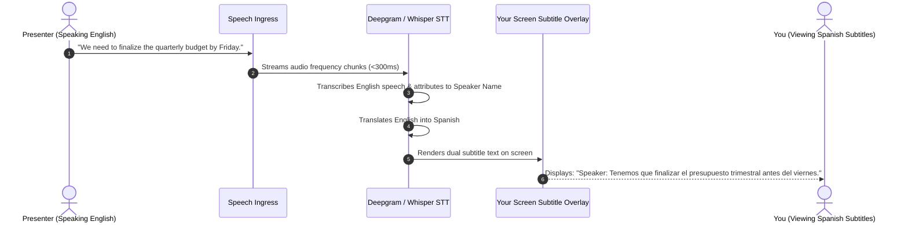
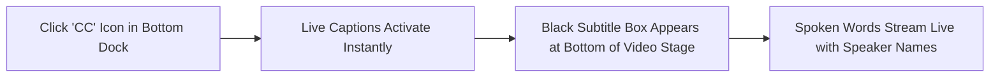
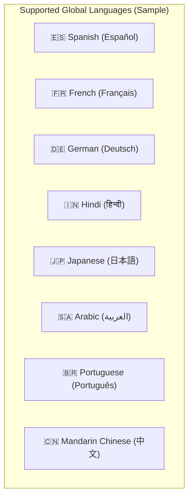
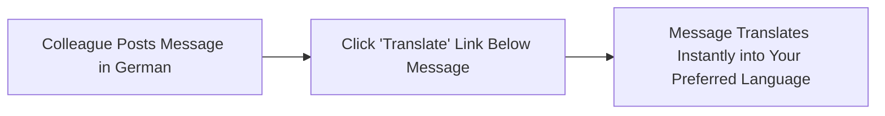

# Live Captions & 50+ Language Translation

Modern business and education are global. In cross-border meetings, accents, language barriers, hearing impairments, or noisy surroundings can make spoken dialogue difficult to follow. HubMeet includes built-in **AI Live Closed Captions** and **Real-Time 50+ Language Translation** that transcribe spoken speech into instant subtitles and translate dialogue directly on your screen.

---

## 1. How Live Captions Work

HubMeet's neural speech-to-text engine processes audio tracks directly as participants speak, generating continuous subtitle streams with sub-second latency:

- **Speaker Identification:** Every subtitle sentence is labeled with the speaker's name so you always know who said what.
- **Client-Side Toggle:** Turning on captions on your computer does not affect other participants; each attendee controls their own subtitle preferences independently.
- **Accessibility:** Fully compliant with accessibility standards for deaf and hard-of-hearing professionals.

---

## 2. Enabling Live Closed Captions (CC)

To turn on live subtitles during a meeting:

1. In the bottom control dock, click the **Closed Captions (CC)** icon.
2. A semi-transparent black banner will appear at the bottom center of your video screen.
3. As soon as someone speaks, their words will appear in clean, crisp text:
   - `Sarah Jenkins:` *"Let's review the customer feedback from our beta launch."*
   - `David Chen:` *"Overall engagement is up 34% month-over-month."*
4. To hide subtitles, click the **CC Icon** again.

---

## 3. Real-Time Language Translation (50+ Languages)

If you speak a different native language than the presenter, HubMeet can translate their spoken words into your preferred language in real time:

### How to Select Your Translation Language:
1. Click the upward arrow (`^`) next to the **CC Icon** (or open **Settings** $\rightarrow$ **Captions & Translation**).
2. Under **Spoken Language**, confirm the language being spoken in the room (e.g., *English*).
3. Under **Translate Subtitles Into**, select your native language:

4. Click **Apply Language**.
5. When the English presenter speaks, the subtitle overlay instantly displays the translated sentences in your chosen language with natural grammar and vocabulary.

---

## 4. Translating In-Meeting Chat Messages

In addition to spoken voice translation, you can translate written chat messages with a single click:

1. When an international colleague sends a chat message in another language (e.g., Japanese or French).
2. Look directly below their message bubble in the chat drawer.
3. Click the small **Translate** link.
4. The translated version appears immediately below the original text.

---

## 5. Customizing Subtitle Appearance

To ensure subtitles are easy to read against different video backgrounds:

1. In the **Captions Settings** drawer:
   - **Font Size:** Choose between **Normal**, **Large**, or **Extra Large** (recommended for large monitors or living room screens).
   - **Background Contrast:** Select between **Dark Box** (high contrast black background with white text) or **Transparent Text** with drop-shadow.
2. Changes take effect immediately without interrupting the call.
