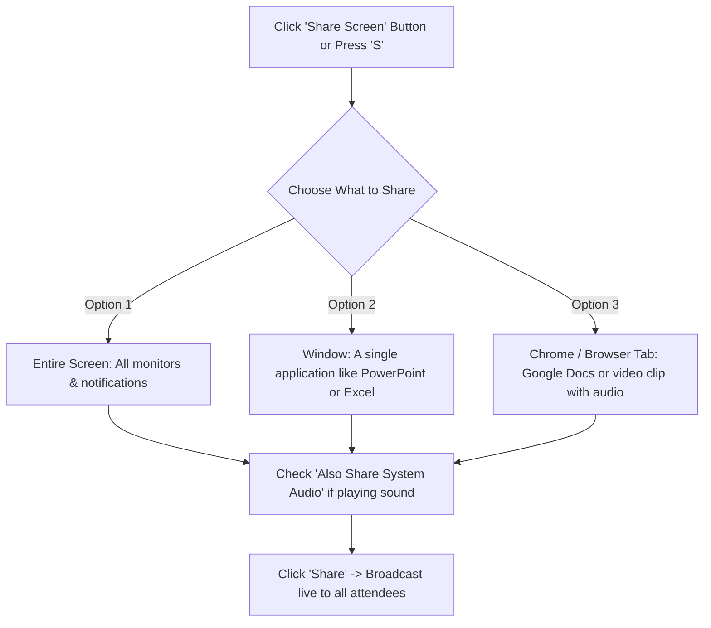
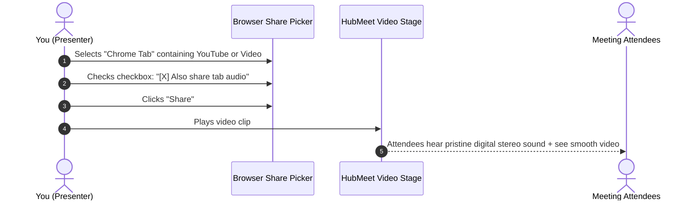
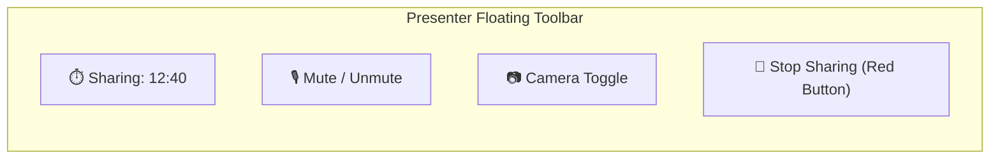

# Screen Sharing & System Audio

Sharing your screen is one of the most powerful collaboration tools in HubMeet. Whether you are presenting a slide deck to an executive board, demonstrating a software feature, reviewing a spreadsheet, or playing a video clip with stereo audio, HubMeet delivers crisp text, vibrant colors, and smooth frame rates.

---

## 1. Starting a Screen Share

To begin presenting your screen:
1. In the bottom control dock, click the **Share Screen** button (monitor icon with an upward arrow), or press the `S` key on your keyboard.
2. The browser's native **Share Your Screen** dialog will appear.

---

## 2. Choosing What to Share: Screen vs. Window vs. Tab

Selecting the right share target protects your privacy and provides the best viewing experience for attendees:

| Share Target | What Attendees See | Privacy Level | Best Use Case |
|---|---|---|---|
| **Entire Screen** | Everything visible on your monitor (including incoming popups, Slack notifications, email previews). | ⚠️ **Low** (Sensitive notifications may be seen). | Navigating across multiple programs (e.g., jumping between code editor, terminal, and browser). |
| **Application Window** | Only the specific software selected (e.g., Microsoft PowerPoint or Excel). If you switch to another app, attendees only see the frozen PowerPoint. | 🔒 **High** (Notifications and other apps stay completely hidden). | Formal corporate slide presentations, spreadsheet reviews, or PDF contract walk-throughs. |
| **Browser Tab** | Only the single browser tab selected (e.g., YouTube or a web dashboard). | 🛡️ **Highest** (Restricted to a single URL). | Demonstrating web applications or playing high-definition video clips with **System Audio**. |

> [!WARNING]
> **Privacy Tip:** When choosing **Entire Screen**, always turn on *"Do Not Disturb"* or *"Focus Assist"* on your computer to prevent personal messages or email alerts from popping up on screen during a presentation.

---

## 3. Sharing Computer Audio (System Sound)

If your presentation includes a video clip, a podcast snippet, or software sound effects, you must transmit your computer's audio stream so attendees can hear it:

### How to Enable Audio Sharing:
1. When the screen share picker appears, select **Browser Tab** (or **Entire Screen** on Windows/ChromeOS).
2. At the bottom left corner of the dialog, check the box: **[✓] Share audio** (or **Also share tab audio**).
3. Click **Share**.
4. Play your audio or video file. Attendees will hear the high-definition sound directly through their headphones without annoying microphone echo.

---

## 4. Presenter Floating Bar & Controls

While you are presenting, HubMeet minimizes into a compact floating bar so you can focus on your slides:

- **Stop Sharing:** Click the red **Stop Sharing** button on the floating bar, click the blue icon in your browser tab, or press the `S` key.
- **Audience View Mirror:** You can keep HubMeet's mini-window open on a secondary monitor to see attendee facial reactions, raised hands, and chat messages while presenting.

---

## 5. Viewing Another Person's Screen Share

When another participant shares their screen, HubMeet automatically shifts into **Presentation Mode**:

- **Full-Screen View:** Click the **Expand (Full Screen)** icon in the top right corner of the shared screen to fill your entire monitor. Press `Escape` to exit full screen.
- **Zooming In & Out:** Use your mouse scroll wheel over the shared screen to zoom into small spreadsheet numbers or tiny code text. Click and drag with your mouse to pan around the zoomed image.
- **Side-by-Side Mode:** View the presenter's screen on the left while keeping participant webcam video tiles visible in a vertical column on the right.
