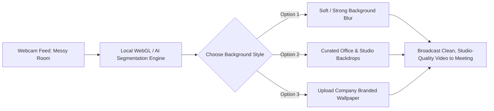
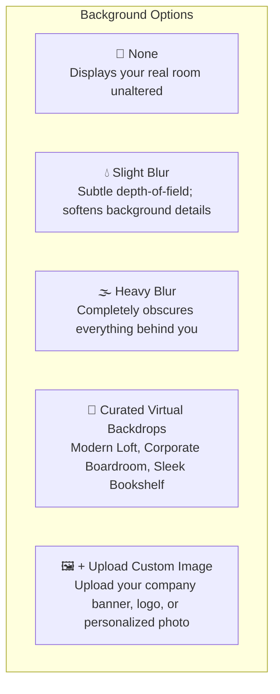
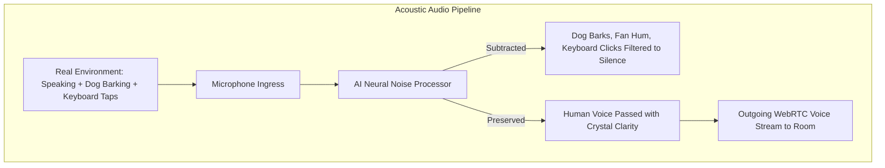

# Virtual Backgrounds & AI Noise Cancellation

Working from home, coffee shops, or busy open-plan offices should never compromise your professional presence. HubMeet comes equipped with cutting-edge **AI-Powered Virtual Backgrounds** that cleanly isolate your silhouette from messy rooms, and **Deep Neural Noise Suppression** that eliminates keyboard typing, barking dogs, crying babies, and air conditioner hums from your microphone stream.

---

## 1. Virtual Backgrounds Overview

You do not need a green screen or specialized studio lighting to use virtual backgrounds in HubMeet. Our computer vision AI runs locally and securely inside your browser to separate your body from your surroundings in real time:

---

## 2. Choosing & Customizing Your Background

You can select a virtual background from the **Pre-Join Green Room** before entering the meeting, or change it anytime during an active call:

### Step 1: Open the Background Effects Drawer
1. In the bottom control dock, click the **Three Dots (More Options)** icon (or click the upward arrow `^` next to the Camera icon).
2. Click **Virtual Backgrounds** (or click the **Sparkles Icon** ✨).
3. The background gallery will open on the right side of your screen with an instant live mirror preview.

### Step 2: Select Your Preferred Style

| Background Style | Recommended Use Case | Visual Effect |
|---|---|---|
| **🚫 None** | When you are seated in a clean, quiet physical conference room. | Real camera image is shown with zero processing overhead. |
| **💧 Slight Blur** | Casual team check-ins and one-on-ones. | Creates a professional DSLR depth-of-field effect while keeping your space recognizable. |
| **🌫️ Heavy Blur** | Home office with family walking behind you. | Blurs everything 2 feet behind your chair into a smooth, unrecognizable color wash. |
| **🏢 Modern Executive Office** | Formal sales presentations and executive calls. | Places you in front of a sleek glass-walled corporate high-rise office. |
| **📚 Modern Bookshelf** | Educational lectures, training, and seminars. | Provides a warm, scholarly library backdrop. |
| **🖼️ Custom Upload** | Marketing events, branded pitches, and webinars. | Lets you upload any `.png` or `.jpg` image (up to 10 MB) featuring your company logo and brand colors. |

### Step 3: Apply & Remember
- Click on any tile to see it applied to your live video immediately.
- HubMeet automatically saves your selection in your browser. The next time you join a meeting, your chosen background is applied automatically before you even speak!

> [!TIP]
> **Lighting Tip for Sharp Cutouts:** To prevent your hair or ears from glitching against the background, ensure your face is evenly lit from the front. Avoid sitting with a bright sunny window directly behind your head.

---

## 3. AI Acoustic Noise Cancellation

Have you ever struggled to hear a colleague because of mechanical keyboard clacking, a loud ceiling fan, or street traffic outside their window? HubMeet's **Neural Noise Cancellation Engine** analyzes incoming microphone audio in real time, isolating human vocal frequencies and subtracting unwanted ambient noises.

---

## 4. Configuring Noise Cancellation Modes

To adjust your noise filtering sensitivity:

1. Click the **Gear (Settings)** icon in the bottom control dock.
2. Navigate to the **Audio** tab.
3. Under **AI Noise Suppression**, select your operating mode:

| Mode | Filtering Level | What It Eliminates | When to Use |
|---|---|---|---|
| **Off** | Raw Audio Only | No filtering. Transmits raw studio sound. | When playing a musical instrument or streaming high-fidelity audio over your mic. |
| **Standard (Default)** | Balanced Filtering | Standard background hums, AC noise, computer fan drone. | Typical quiet office or home environment. Extremely low CPU usage. |
| **Aggressive AI Filter** | Deep Neural Suppression | Loud mechanical keyboards, barking dogs, lawn mowers, kitchen clatter, siren echoes. | When working from noisy coffee shops, airports, or busy living rooms. |

---

## 5. Automatic Echo Cancellation (AEC) & Gain Control

In addition to noise suppression, HubMeet automatically applies two essential audio optimizations:
- **Acoustic Echo Cancellation (AEC):** Prevents your microphone from picking up voices coming out of your computer speakers and echoing them back into the room.
- **Auto Gain Control (AGC):** Automatically adjusts your microphone volume so you sound consistent whether you whisper softly or lean back in your chair.
