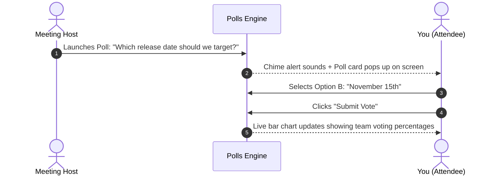
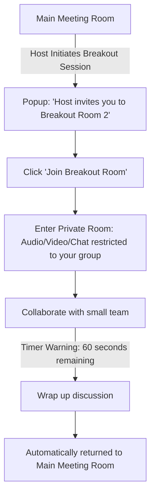

# Interactive Whiteboard, Polls & Breakouts

Meetings are most productive when participants actively contribute rather than passively listen. HubMeet provides three built-in collaborative work environments: an **Interactive Vector Whiteboard**, **Live Audience Polls**, and **Focused Breakout Rooms**.

---

## 1. Collaborative Real-Time Whiteboard

The **HubMeet Whiteboard** is a shared digital canvas where all attendees can sketch system architectures, brainstorm marketing ideas, annotate diagrams, and map user flows together in real time.

```mermaid
graph TD
    A[Launch Whiteboard (Icon or Key: W)] --> B[Infinite Vector Drawing Canvas Opens]
    B --> C[Select Drawing Tools: Pen, Shapes, Sticky Notes, Text]
    C --> D[All Participants Draw Simultaneously with Live Cursors]
    D --> E[Export Finished Board as PNG Image or PDF]
```

### Opening the Whiteboard:
1. In the bottom control dock, click the **Whiteboard Icon** (easel / canvas icon), or press the `W` key.
2. The collaborative whiteboard expands into the center stage.

### Tour of the Whiteboard Tool Palette:
On the left side of the whiteboard, you have access to a complete creative toolbox:

| Tool Icon | Tool Name | What You Can Do |
|---|---|---|
| ✏️ | **Pen / Pencil** | Freehand sketching and quick handwriting. |
| 🖍️ | **Highlighter** | Semi-transparent marker to emphasize key text or diagram blocks. |
| 🔲 | **Shapes** | Draw perfect rectangles, circles, diamonds, lines, and directional arrows. |
| 🔤 | **Text Box** | Click anywhere to type clean typography with font size controls. |
| 📝 | **Sticky Notes** | Place colored digital post-it notes (Yellow, Blue, Green, Pink) for agile brainstorming. |
| 🧹 | **Eraser** | Click or drag over any stroke or shape to remove it. |
| 🎨 | **Color Palette** | Choose ink colors and stroke thicknesses (Thin, Medium, Thick). |
| ↩️ / ↪️ | **Undo / Redo** | Quickly revert or restore recent drawing actions. |
| 💾 | **Export Board** | Click the download button to export the entire canvas as a high-resolution `.png` image or `.pdf` file. |

> [!TIP]
> Everyone's cursor is color-coded with their name tag, making it easy to see where teammates are sketching simultaneously.

---

## 2. Participating in Live Polls & Quizzes

When the meeting host launches a live vote, survey, or quiz, you can submit your answer in seconds without unmuting:



### How to Vote in a Poll:
1. When a poll is launched, a prominent drawer opens on the right side of your screen with an audible chime alert.
2. Read the question and options carefully:
   - **Radio Buttons (`○`):** Single-choice question (pick your top choice).
   - **Checkboxes (`□`):** Multi-choice question (select all options that apply).
3. Click your selected choice(s).
4. Click the blue **Submit Vote** button.
5. Once your vote is cast, the screen transforms into an animated live bar chart displaying the real-time breakdown of votes across all participants.

---

## 3. Working in Breakout Rooms

In large workshops, training sessions, or team retrospectives, the host may divide participants into smaller **Breakout Rooms** (typically 3 to 6 people) to allow for intimate discussion:



### What to Expect When Joining a Breakout Room:
1. A popup invitation appears on your screen: *"The host has invited you to join Breakout Room [Name/Number]"*.
2. Click **Join Breakout Room**.
3. You will experience a 1-second transition as you leave the main room and enter your private breakout space.
4. **Isolated Audio & Video:** Inside your breakout room, you only hear and see the specific teammates assigned to your room.

### Important Breakout Room Features:
- **Countdown Banner:** At the top of your screen, a timer bar shows how many minutes remain in your breakout session.
- **🙋 Ask Host for Help:** If your group has a question or needs clarification, click the **Ask Host for Help** button. The meeting host will be notified and can drop into your room immediately.
- **Broadcast Announcements:** When the host sends an announcement (e.g., *"5 minutes left! Make sure to pick a team presenter"*), it appears as a floating banner across everyone's screen.
- **Returning to the Main Room:** When the host closes the breakout session, a 60-second warning countdown begins. When it reaches zero, everyone is smoothly transported back to the main meeting room together.
