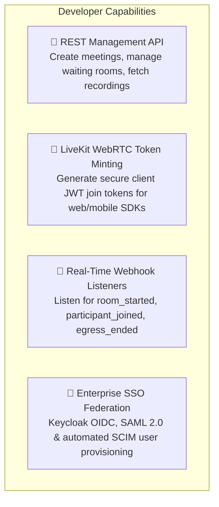
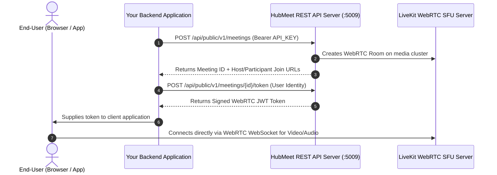

# Developer & API Integrator Overview & Architecture

Welcome to the **HubMeet Developer & API Integration Guide**. HubMeet is designed as an open, programmable WebRTC communications platform. Software engineers, full-stack developers, and DevOps teams can leverage HubMeet's REST APIs, LiveKit WebRTC SDKs, and event webhooks to embed high-definition video conferencing directly into third-party portals, mobile applications, telemedicine workflows, or internal CRM systems.

---

## 1. What You Can Build with HubMeet APIs

- **Programmatic Meeting Automation:** Create, update, and terminate video rooms automatically from your backend application or calendar scheduler.
- **Embedded In-App Video:** Integrate LiveKit React, Flutter, iOS, or Android SDKs to embed video tiles directly inside your own application shell without sending users away to a new tab.
- **Real-Time Event Automation:** Receive asynchronous HTTP webhooks whenever participants join, leave, or when cloud recordings finish transcoding.
- **Enterprise Identity Bus:** Connect HubMeet directly to HubNest Keycloak, Microsoft Entra ID (Azure AD), Okta, or Google Workspace via standard OIDC and SAML 2.0 protocols.

---

## 2. Technical Architecture & Integration Stack

Understanding the data and signaling flow between your custom application, HubMeet REST servers, and the WebRTC media SFU:

---

## 3. Developer Best Practices & Security Guidelines

| Technical Area | Recommended Practice | What to Avoid |
|---|---|---|
| **API Key Storage** | Keep secret API keys exclusively on your secure backend server (environment variables). | Never expose `live_...` API keys in client-side JavaScript, React bundles, or public GitHub repositories. |
| **Token Generation** | Mint short-lived WebRTC join tokens (e.g., valid for 1 to 2 hours) on demand as users join. | Minting permanent or multi-day tokens that cannot be revoked if leaked. |
| **Webhook Security** | Validate the HMAC-SHA256 signature header (`X-HubMeet-Signature`) on all incoming webhook dispatches. | Processing unverified webhook payloads without signature checking. |
| **Error Handling** | Implement exponential backoff when handling `429 Too Many Requests` rate-limit responses. | Retrying failing API requests in tight, unthrottled loops. |

---

## 4. Next Steps in this Guide

Explore the individual developer chapters below to integrate HubMeet into your stack:

- 🔑 **[API Keys & Scoped Authentication](api-keys-authentication.md):** Generating keys, setting permissions, and managing rate limits.
- 🔌 **[Meeting Creation & Token API](meeting-creation-api.md):** Creating rooms programmatically and minting LiveKit join tokens.
- 📡 **[Webhook Event Listeners](webhook-event-listeners.md):** Setting up webhook endpoints for room, participant, and recording events.
- 🏢 **[Enterprise SSO & Identity Federation](sso-enterprise-federation.md):** Integrating Keycloak OIDC, SAML 2.0, and automated user provisioning.
