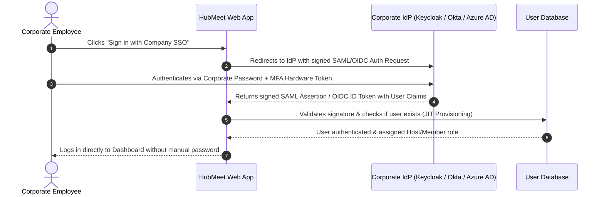

# Enterprise Single Sign-On (SSO) & Identity Federation

To simplify user onboarding and eliminate password fatigue, HubMeet natively supports enterprise **Single Sign-On (SSO)** and Identity Federation. Employees can authenticate using their existing corporate credentials through **HubNest Keycloak**, **Microsoft Entra ID (Azure AD)**, **Okta**, or **Google Workspace** via standard **OIDC (OpenID Connect)** and **SAML 2.0** protocols.

---

## 1. Single Sign-On Architecture

- **Just-In-Time (JIT) Provisioning:** When a new employee joins your company, they do not need an account manually created in HubMeet. The first time they log in via SSO, their account is provisioned automatically with their corporate email, name, and department.
- **Enforce SSO Login:** Administrators can disable local password authentication so all employees are required to pass through your corporate Identity Provider and hardware MFA tokens.
- **Instant Revocation:** When an employee is offboarded in Okta or Azure AD, their HubMeet access is revoked immediately across all devices.

---

## 2. HubNest Native Ecosystem SSO (Keycloak)

If your organization uses HubNest's central Keycloak identity bus (linking HubHRMS, HubCRM, and Calling Hub):

1. In the Enterprise Admin Console, navigate to **Settings** $\rightarrow$ **Single Sign-On (SSO)**.
2. Under **Ecosystem Bridge**, toggle **HubNest Keycloak OIDC** to `Active`.
3. Enter your **Keycloak Realm URL** and **Client Secret**.
4. Click **Save Settings**.
5. Employees can now switch between HubHRMS, HubCRM, and HubMeet with a single unified corporate session.

---

## 3. Configuring SAML 2.0 (Okta, Azure AD, OneLogin)

For external enterprise identity providers:

### Step 1: Gather HubMeet SP Metadata
HubMeet provides the standard Service Provider (SP) coordinates:
- **Entity ID (Audience URI):** `https://meet.srjhubnest.com/sso/saml/metadata`
- **Assertion Consumer Service (ACS) URL:** `https://meet.srjhubnest.com/api/enterprise/sso/saml/consume`
- **NameID Format:** `urn:oasis:names:tc:SAML:1.1:nameid-format:emailAddress`

### Step 2: Configure in Your IdP (e.g., Microsoft Entra ID / Okta)
1. In your IdP console, create an Enterprise Application named *"HubMeet"*.
2. Paste the Entity ID and ACS URL.
3. Map the following SAML Attribute Claims:
   - `email` $\rightarrow$ `user.mail`
   - `firstName` $\rightarrow$ `user.givenname`
   - `lastName` $\rightarrow$ `user.surname`
   - `role` $\rightarrow$ `user.assignedRoles`
4. Download your IdP **Federation Metadata XML** (or copy the Metadata URL).

### Step 3: Complete Setup in HubMeet
1. In HubMeet's **SSO Settings** console, select **SAML 2.0**.
2. Upload the **Metadata XML** file (or paste your Identity Provider SSO URL and x509 Signing Certificate).
3. Click **Test SAML Handshake**.
4. Authenticate in the popup window. When successful, a green confirmation badge appears: *"SAML 2.0 Handshake Verified ✅"*.
5. Click **Enable SAML SSO**.

---

## 4. Role Mapping from IdP Claims

HubMeet can automatically assign **Meeting Host** or **Standard Member** licenses based on Active Directory / Okta groups:

| Corporate IdP Security Group | Mapped HubMeet Role | Resulting License |
|---|---|---|
| `CN=HubMeet-Admins` | **Enterprise Administrator** | Complete admin console access. |
| `CN=HubMeet-Hosts` | **Meeting Host** | Can schedule meetings, cloud record, and run breakout rooms. |
| `CN=All-Employees` | **Standard Member** | Can attend and collaborate on all company calls. |

---

## 5. Enforcing Strict SSO-Only Authentication

To prevent employees from bypassing corporate Multi-Factor Authentication (MFA):

1. In **SSO Settings**, locate **Authentication Enforcement**.
2. Check the box: **[✓] Enforce SSO-Only Login**.
3. Any employee attempting to log in with an email and password will be automatically redirected to your corporate Okta / Keycloak login page.
