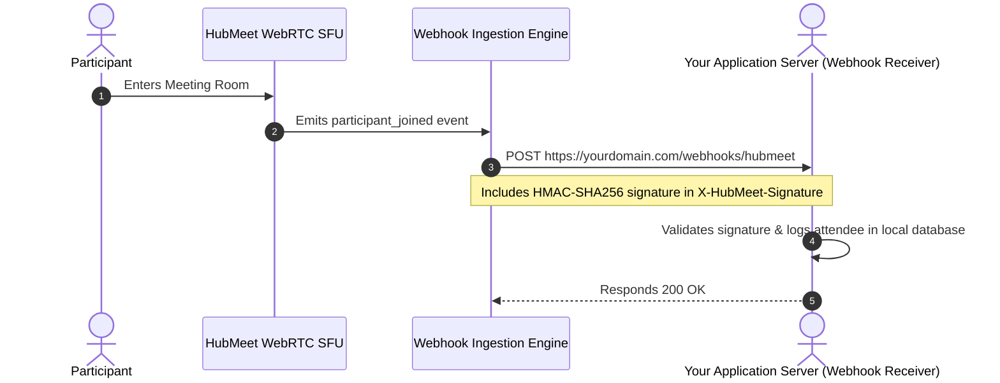

# Webhook Event Listeners & Real-Time Automation

Webhooks allow your external backend servers to be notified asynchronously when real-time events occur in HubMeet. Instead of continuously polling the REST API, HubMeet pushes HTTP `POST` payloads to your registered endpoint whenever a room begins, an attendee joins, an AI summary is generated, or a cloud recording completes.

---

## 1. How Webhooks Work



---

## 2. Registering a Webhook Endpoint

To register your receiver URL:
1. In the Enterprise Admin Console, navigate to **Developer** $\rightarrow$ **Webhooks**.
2. Click **+ Add Webhook Endpoint**.
3. Fill in the endpoint form:
   - **Endpoint URL:** e.g., `https://api.yourcompany.com/v1/hubmeet-events`.
   - **Events to Listen For:** Check the specific events your application handles (or select *All Events*).
   - **Webhook Secret:** Click **Generate Secret** (copied for signature validation).
4. Click **Save Endpoint**. HubMeet will send an immediate `ping` event to verify reachability.

---

## 3. Supported Webhook Event Catalog

| Event Name | Trigger Condition | Key Payload Fields |
|---|---|---|
| `room.started` | When the first participant connects to an active room. | `meetingId`, `roomName`, `startedAt` |
| `room.finished` | When all participants leave or host clicks "End Meeting". | `meetingId`, `durationSeconds`, `endedAt` |
| `participant.joined` | An attendee successfully joins the video grid. | `meetingId`, `participantIdentity`, `name`, `joinedAt` |
| `participant.left` | An attendee disconnects or is removed by host. | `meetingId`, `participantIdentity`, `durationSeconds`, `reason` |
| `recording.finished` | Cloud MP4 recording transcoding finishes. | `meetingId`, `recordingId`, `downloadUrl`, `fileSizeBytes`, `durationSeconds` |
| `ai.summary.ready` | AI Copilot completes generating meeting minutes. | `meetingId`, `summaryText`, `actionItems`, `generatedAt` |

---

## 4. Sample Webhook Payload (`recording.finished`)

```json
{
  "event": "recording.finished",
  "id": "evt_9a8b7c6d5e4f",
  "createdAt": "2026-10-16T11:05:30Z",
  "data": {
    "meetingId": "meet-402-918",
    "recordingId": "rec_33091824",
    "durationSeconds": 1824,
    "fileSizeBytes": 348910240,
    "downloadUrl": "https://s3.us-east-1.amazonaws.com/acme-vault/meet-402-918.mp4",
    "layout": "screen_share_speaker"
  }
}
```

---

## 5. Validating Webhook Signatures (Security)

To verify that incoming requests originate authentically from HubMeet and have not been tampered with in transit, validate the `X-HubMeet-Signature` header:

### Node.js / Express Validation Example:
```javascript
import crypto from 'crypto';

app.post('/webhooks/hubmeet', (req, res) => {
  const signature = req.headers['x-hubmeet-signature'];
  const webhookSecret = process.env.HUBMEET_WEBHOOK_SECRET;

  // Compute expected HMAC-SHA256 signature
  const expectedSignature = crypto
    .createHmac('sha256', webhookSecret)
    .update(JSON.stringify(req.body))
    .digest('hex');

  if (signature !== expectedSignature) {
    console.warn('Unauthorized webhook signature mismatch!');
    return res.status(401).send('Invalid signature');
  }

  // Handle event
  const { event, data } = req.body;
  if (event === 'recording.finished') {
    console.log(`Recording ready for meeting ${data.meetingId}: ${data.downloadUrl}`);
  }

  res.status(200).send('Event received');
});
```

> [!TIP]
> **Retry Mechanism:** If your server responds with HTTP `5xx` or times out, HubMeet automatically retries delivery up to 3 times with exponential backoff (after 1 minute, 5 minutes, and 15 minutes).
