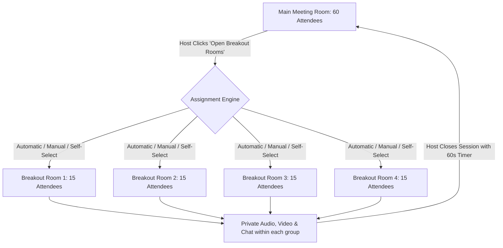
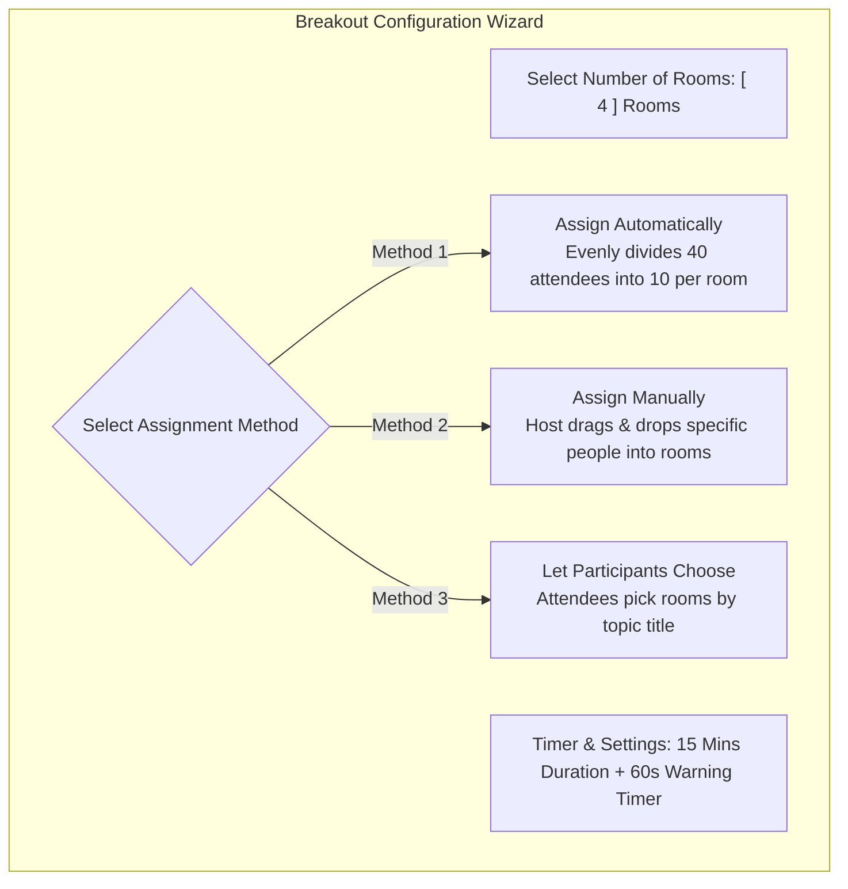
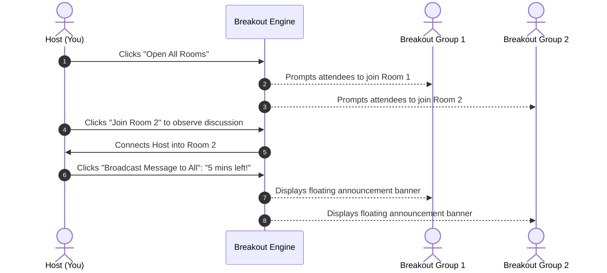

# Breakout Rooms Management

In large virtual workshops, design sprints, seminars, and academic lectures, having 50 or 100 people in a single room makes intimate discussions impossible. HubMeet's **Breakout Rooms Engine** allows hosts to divide participants into smaller discussion groups (2 to 50 separate rooms), distribute attendees automatically or manually, broadcast announcements across all rooms, and seamlessly return everyone to the main stage.

---

## 1. How Breakout Rooms Work

- **Independent Audio & Video:** Inside a breakout room, participants only see, hear, and chat with their assigned group.
- **Host Super-Powers:** The host and co-hosts can freely jump between any breakout room to check on progress, answer questions, or facilitate discussions.
- **Synchronized Closing:** When time is up, a global countdown timer brings every attendee back to the main room automatically.

---

## 2. Setting Up Breakout Rooms

To configure breakout rooms:
1. In the bottom control dock, click the **Breakout Rooms Icon** (four small squares).
2. The **Breakout Rooms Configuration Modal** will open.

### Step 1: Choose Number of Rooms
- Use the counter to specify how many rooms to create (e.g., `2` to `50` rooms).
- The system automatically calculates group size (e.g., *"30 participants into 5 rooms = 6 people per room"*).

### Step 2: Choose Assignment Method
- **Assign Automatically:** HubMeet instantly shuffles attendees and balances room sizes evenly. (Fastest and best for general brainstorming).
- **Assign Manually:** Displays a drag-and-drop list where you assign specific clients or colleagues to designated rooms. (Best for pairing mentors with students or client account reviews).
- **Let Participants Choose Room:** Gives each room a custom title (e.g., *"Room A: Marketing"*, *"Room B: Engineering"*). Attendees pick which room aligns with their interests.

### Step 3: Configure Timer & Closing Rules
Click the **Gear (Settings)** icon in the modal:
- **[✓] Auto-close rooms after:** Set a session duration (e.g., `15 minutes`). A countdown clock will display at the top of every attendee's screen.
- **[✓] Countdown after closing:** Provide a buffer (e.g., `60 seconds` or `30 seconds`) so groups can finish their sentences before being returned to the main stage.

---

## 3. Running an Active Breakout Session

Once configured, click the green **Open All Rooms** button:

### Host Actions During the Session:
- **Jumping Between Rooms:** In the breakout manager panel, click the blue **Join** button next to any room (e.g., *Room 3*). Your audio and camera immediately transition into that room. Click **Leave Room** to return to the main lobby.
- **Broadcasting Announcements:** Need to give a time warning? Click **Broadcast Message to All**, type: *"5 minutes remaining! Make sure to pick your team spokesperson"*, and click **Send**. The text banner floats across every participant's screen in all rooms.
- **Handling "Ask for Help" Calls:** When a group clicks *"Ask Host for Help"*, a notification card pops up on your screen: *"Breakout Room 2 has requested assistance."* Click **Join Room** to assist them immediately.

---

## 4. Closing the Breakout Session

When the discussion time concludes:
1. Click the red **Close All Rooms** button in the Breakout Manager.
2. A 60-second warning countdown bar appears on everyone's screen: *"Breakout rooms will close in 60 seconds."*
3. Attendees can click **Return Now** immediately, or use the remaining seconds to finish their thoughts.
4. When the timer reaches zero, all video and audio streams seamlessly merge back into the main room video grid.
