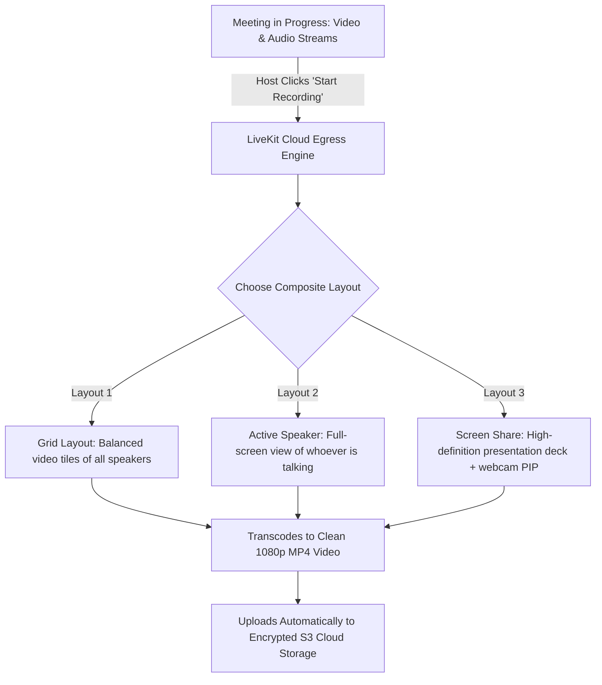
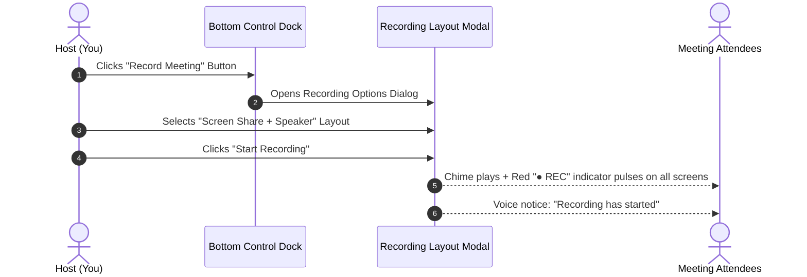
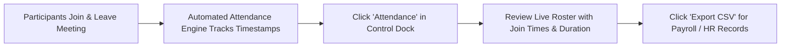

# Cloud Recording & Live Attendance Reports

Capturing meeting discussions for absent colleagues and tracking official attendance records are vital for corporate governance and remote team accountability. HubMeet includes high-definition **LiveKit Cloud Egress Recording** with customizable video layouts, as well as an automated **Live Attendance Tracker** with instant CSV export.

---

## 1. Cloud Recording vs. Local Recording

HubMeet utilizes an enterprise **Cloud Egress Recording** architecture:

- **Zero Load on Your Laptop:** Recording is rendered entirely on high-performance cloud servers. Your laptop's CPU and fan remain cool, and your Wi-Fi is not strained.
- **Universal Accessibility:** Once the meeting ends, the recording is processed into a universal `.mp4` file ready to share with teammates.
- **Legal Compliance:** When recording begins, an audible voice announcement (*"Recording in progress"*) plays, and a red pulsing badge (`● REC`) appears on all screens so participants have clear notice.

---

## 2. How to Start a Cloud Recording

To record a live session:

### Step 1: Open the Recording Wizard
1. In the bottom control dock, click the **Record Button** (circle with dot).
2. The **Recording Options Modal** will open.

### Step 2: Choose Your Recording Layout
- **Grid Layout:** Records all participants in a balanced multi-tile grid (ideal for panel discussions, roundtables, and team standups).
- **Active Speaker Layout:** Focuses primarily on whoever is speaking in full screen with a subtle picture-in-picture thumbnail (best for webinars and keynote speeches).
- **Screen Share Layout (Recommended for Presentations):** Captures the shared presentation deck at full 1080p resolution while placing the speaker's webcam in the corner.
- **Audio Only:** Records an ultra-compact `.m4a` audio file (ideal for podcasts or board minute reviews).

### Step 3: Start & Stop Recording
- Click **Start Recording**. Within 3 seconds, the red **● REC** banner pulses in the top header.
- To end recording, click the button again and select **Stop Recording** (or simply end the meeting). The system finalizes the MP4 file automatically.

---

## 3. Accessing & Sharing Past Recordings

After a meeting concludes:
1. Navigate to your **HubMeet Dashboard** $\rightarrow$ **Past Meetings & Recordings**.
2. Locate the meeting card.
3. You have 3 immediate actions:
   - ▶️ **Play in Browser:** Watch the video directly in HubMeet's built-in web player.
   - ⬇️ **Download MP4:** Save the high-definition video file to your local computer.
   - 🔗 **Copy Shareable Link:** Generate a password-protected link to share with clients or absent team members.

---

## 4. Live Attendance Tracking & Reporting

Tracking who attended a mandatory compliance training, university lecture, or corporate town hall is completely automated in HubMeet:

### Viewing the Live Attendance Roster:
1. In the bottom control dock, click the **Attendance Icon** (clipboard with checkmarks).
2. The **Attendance Modal** displays every participant with:
   - Full Name and Registered Email
   - Exact Join Timestamp (e.g., `10:02:14 AM`)
   - Exact Leave Timestamp (e.g., `10:58:30 AM`)
   - Total Active Duration in Call (e.g., `56 mins 16 secs`)
   - Location / Country (if enabled by administrator)

### Exporting the Attendance Register to CSV:
- In the top right corner of the Attendance Modal, click the green **Export CSV** button.
- A clean, spreadsheet-ready `.csv` file downloads immediately to your computer. Open it in Microsoft Excel, Google Sheets, or import it directly into HubHRMS for attendance payroll reconciliation.
