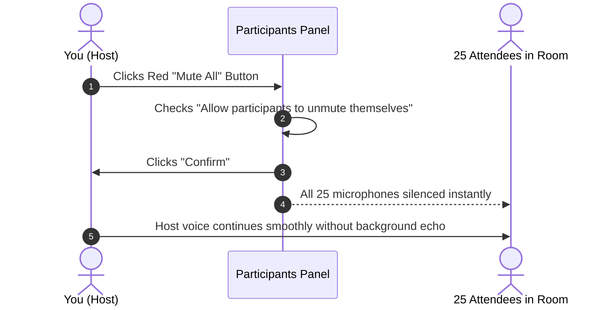
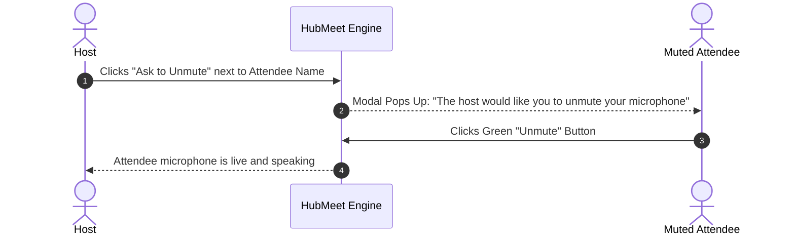

# In-Meeting Host Controls & Moderation

During live discussions, maintaining meeting order and professional decorum is the host's primary responsibility. HubMeet gives hosts and appointed co-hosts decisive in-call controls: **1-Click Mute All**, polite **Unmute Requests**, **Participant Spotlighting**, **Co-Host Appointments**, and the ability to **Remove Disruptive Users** instantly.

---

## 1. Accessing the Participants Management Panel

To manage attendees in your room:
1. In the bottom control dock, click the **Participants Icon** (showing the total live attendee count, e.g., `👥 18`), or press the `P` key.
2. The **Participants Panel** slides open on the right side of your screen.
3. Attendees are organized with hosts and co-hosts at the top, followed by participants who have raised their hands, then all remaining participants listed alphabetically.

```mermaid
graph TD
    A[Open Participants Panel (Key: P)] --> B[View Live Attendee List]
    B --> C[Click 'Mute All' Button at Bottom]
    B --> D[Hover Over Any Name for 3-Dots Action Menu]
    D --> E[Mute / Ask to Unmute / Make Co-Host / Spotlight / Remove]
```

---

## 2. Using "Mute All" vs. Individual Mute

When someone begins coughing, typing loudly, or experiencing microphone feedback, you can silence their audio without interrupting the ongoing presentation:

### Muting an Individual Participant:
1. In the **Participants Panel** (or on the person's video tile), hover your mouse over their name.
2. Click the **Mute (Microphone with Slash)** icon.
3. Their microphone is muted immediately.

### Muting Everyone at Once (Mute All):
1. At the bottom of the **Participants Panel**, click the red **Mute All** button.
2. A confirmation prompt will ask:
   *"Mute all current and new participants? [✓] Allow participants to unmute themselves."*
3. Click **Confirm**.
4. Every attendee's microphone in the room is muted simultaneously (your host microphone remains unaffected).



---

## 3. Asking a Participant to Unmute

For privacy and legal consent reasons, **hosts cannot forcibly turn on an attendee's microphone or camera without their knowledge**. Instead, HubMeet provides a courteous **Ask to Unmute** request:



1. In the Participants list, locate the muted person.
2. Click **Ask to Unmute**.
3. A friendly modal pops up on their screen: *"The host would like you to unmute your microphone. Would you like to speak now?"*
4. The attendee clicks **Unmute**, and their audio stream engages smoothly.

---

## 4. Appointing Co-Hosts

In meetings with more than 10 attendees, running the slide presentation while simultaneously monitoring the chat and admitting guests from the waiting room can be overwhelming. You can promote trusted teammates to **Co-Hosts**:

1. In the **Participants Panel**, find your colleague's name.
2. Click the **Three Dots Icon** (`...`) next to their name.
3. Click **Make Co-Host**.
4. A purple **[Co-Host]** badge appears next to their name.
5. They now have immediate access to admit guests, mute noisy microphones, launch polls, and assist with breakout rooms.

> [!TIP]
> You can appoint multiple co-hosts in a single meeting, and revoke co-host privileges anytime by clicking **Remove Co-Host Permissions**.

---

## 5. Spotlighting & Pinning Video Tiles

During keynote presentations or executive updates, you want everyone to focus on the active speaker rather than smaller tiles:

- **Spotlight for Everyone:** Hover over the speaker's video tile, click the three dots, and select **Spotlight for Everyone**. That speaker's video tile expands to fill the main screen for all attendees.
- **Pin for Yourself:** If you want to keep an eye on a specific interpreter or presenter on your own screen without affecting others, click **Pin Video**.

---

## 6. Removing a Disruptive Participant

If an uninvited guest slips into your meeting or someone behaves inappropriately:

```mermaid
graph TD
    A[Disruptive Attendee in Room] --> B[Hover Over Name in Participants Panel]
    B --> C[Click 'Remove from Meeting']
    C --> D[Check: '[✓] Do not allow this person to rejoin']
    D --> E[Click 'Remove']
    E --> F[User is disconnected immediately & blocked from room]
```

1. Locate the person in the **Participants Panel**.
2. Click the **Three Dots Icon** (`...`).
3. Click **Remove from Meeting**.
4. A warning modal will appear: *"Are you sure you want to remove [Name]? [✓] Block this user from rejoining this meeting."*
5. Click **Remove**.
6. The user is instantly severed from the WebRTC media stream and blocked from returning.

---

## 7. Ending the Meeting Gracefully

When the agenda is finished and you are ready to conclude:
1. In the bottom control dock, click the red **Leave / End** button.
2. HubMeet provides two clear choices:
   - **End Meeting for All:** Disconnects all participants, terminates the cloud recording, and closes the room completely. (Recommended for hosts).
   - **Leave Meeting:** Allows you to leave while letting remaining participants continue chatting. If you select this, you will be prompted to assign a new host before exiting.
