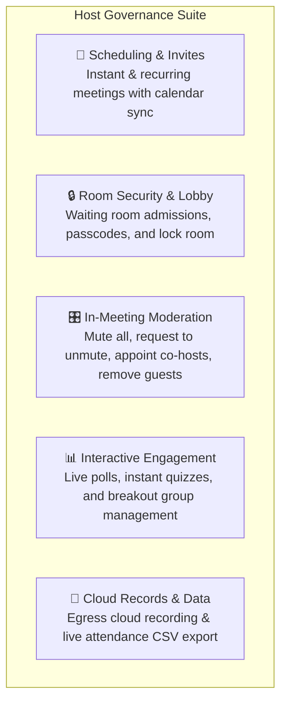
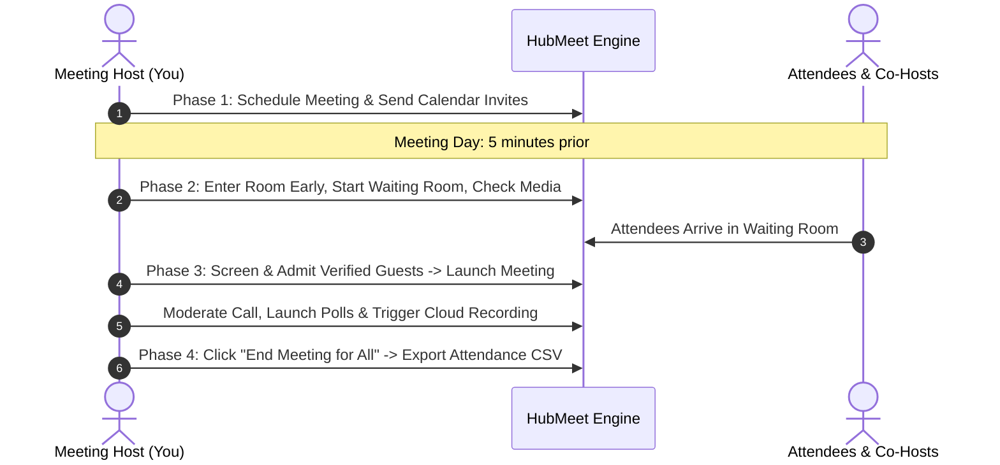

# Meeting Host & Event Organizer Overview & Checklist

Welcome to the **HubMeet Host & Event Organizer Guide**. As a team leader, project manager, corporate trainer, or event host, you have full command over the meeting environment. HubMeet provides you with advanced scheduling controls, waiting room security screening, in-call moderation tools (Mute All, Co-Hosts), interactive polling engines, breakout room facilitation, and high-definition cloud recording.

---

## 1. What You Can Do as a Host

- **Flexible Meeting Scheduling:** Create instant ad-hoc meetings or schedule recurring weekly check-ins with automated Google Calendar and Microsoft Outlook links.
- **Waiting Room & Access Screening:** Prevent uninvited gatecrashers with a secure waiting room where you review and admit attendees individually or in bulk.
- **In-Call Moderation & Mute Control:** Keep meetings quiet and orderly with 1-click **Mute All**, gentle **Unmute Requests**, and the ability to appoint trusted colleagues as **Co-Hosts**.
- **Audience Polling & Quizzes:** Author and launch single-choice or multi-choice polls during live calls and share real-time percentage charts with the room.
- **Dynamic Breakout Rooms:** Divide up to 500 attendees into 2–50 smaller breakout discussion groups with automatic assignment, countdown timers, and broadcast messaging.
- **Cloud Egress Recording:** Record meetings in pristine 1080p HD with customizable video layouts (Grid vs Active Speaker vs Screen Share) saved securely to cloud storage.
- **Live Attendance Reports:** Download detailed CSV attendance records showing participant join times, leave times, total durations, and geographical locations.

---

## 2. Host Operational Lifecycle

Every successful video meeting follows a 4-phase lifecycle:

### Phase 1: Planning & Scheduling
- Decide whether the meeting is an **Instant Quick Call** or a **Scheduled Meeting**.
- Configure room security: Set an optional meeting passcode and enable the waiting room.
- Dispatch invitations with 1-click join URLs directly to attendee calendars.

### Phase 2: Pre-Meeting Setup (5 Minutes Prior)
- Join the room 5 minutes early to test your slide deck screen share and microphone.
- Appoint co-hosts so you have assistance monitoring the chat and admitting late arrivals.

### Phase 3: Live Facilitation & Moderation
- Click **Admit All** to let attendees enter from the waiting room.
- Use **Mute All** if someone has background noise.
- Click **Start Recording** to capture meeting discussions for teammates in other timezones.
- Launch live polls and breakout rooms to keep engagement high.

### Phase 4: Meeting Wrap-Up & Records
- When concluding, click **End Meeting for All** to safely disconnect all participants.
- Access your cloud recording and export the **Attendance CSV** for HR or project records.

---

## 3. Host vs. Co-Host Permissions Matrix

HubMeet lets you designate trusted colleagues as **Co-Hosts** to assist in managing large rooms:

| Administrative Permission | Primary Host | Co-Host | Standard Participant |
|---|:---:|:---:|:---:|
| **Schedule / Edit Meeting Settings** | ✅ Yes | ❌ No | ❌ No |
| **Start / End Meeting for All** | ✅ Yes | ❌ No | ❌ No |
| **Admit / Deny Waiting Room Guests** | ✅ Yes | ✅ Yes | ❌ No |
| **Mute All Participants** | ✅ Yes | ✅ Yes | ❌ No |
| **Request Participant to Unmute** | ✅ Yes | ✅ Yes | ❌ No |
| **Remove / Kick Participant** | ✅ Yes | ✅ Yes | ❌ No |
| **Launch Live Polls** | ✅ Yes | ✅ Yes | ❌ No (Vote Only) |
| **Create & Manage Breakout Rooms** | ✅ Yes | ✅ Yes | ❌ No (Join Only) |
| **Start / Stop Cloud Recording** | ✅ Yes | ✅ Yes | ❌ No (View Only) |
| **Appoint Another Co-Host** | ✅ Yes | ❌ No | ❌ No |

---

## 4. Next Steps in this Guide

Explore each chapter below to master your host tools:

- 📅 **[Scheduling & Calendar Invites](scheduling-invites.md):** Instant vs recurring meetings and Google/Outlook calendar invites.
- 🔒 **[Room Security & Waiting Room](room-security-waiting-room.md):** Screening guests, locking meetings, and toggling E2EE encryption.
- 🎛️ **[In-Meeting Host Controls](in-meeting-host-controls.md):** Muting participants, appointing co-hosts, and managing room order.
- 📊 **[Live Polls & Audience Quizzes](live-polls-quizzes.md):** Creating engaging polls and visualizing live audience feedback.
- 👥 **[Breakout Rooms Management](breakout-rooms-management.md):** Dividing attendees, assigning groups, and managing session timers.
- 🎥 **[Cloud Recording & Attendance Reports](cloud-recording-attendance.md):** Managing HD recordings and exporting attendee CSV registers.
