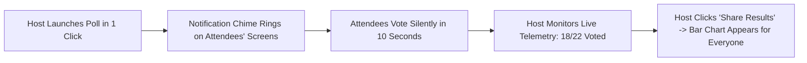
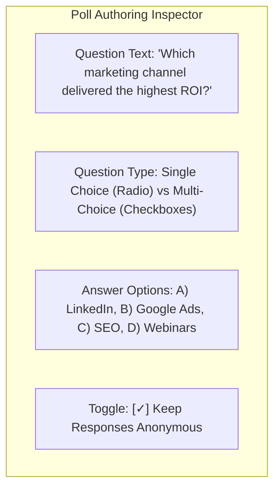
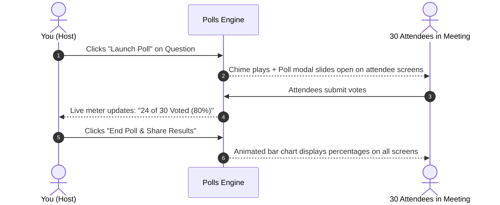

# Live Polls & Audience Quizzes

Audience polling is one of the fastest ways to transform passive listeners into active participants. HubMeet's built-in **Live Polling Engine** allows hosts and co-hosts to author interactive single-choice or multi-choice questions, launch instant votes during presentations, monitor voting progress live, and broadcast animated percentage charts to the entire room.

---

## 1. Why Use Live Polls in Meetings?

- **Make Fast Team Decisions:** Vote on launch dates, feature priorities, or design mockups without debating in circles.
- **Test Comprehension:** Quiz students or employees during corporate training to verify learning retention.
- **Gather Honest Feedback:** Enable anonymous polling so attendees can share candid opinions without peer pressure.
- **Zero External Tools:** No need for third-party tools like Slido or Mentimeter; polling runs natively inside the video room.

---

## 2. Creating a Poll

You can create polls on-the-fly during a live meeting or pre-configure them before the call starts:

### Step 1: Open the Polls Drawer
1. In the bottom control dock, click the **Polls Icon** (bar chart icon).
2. The **Polls Drawer** will open on the right side of your screen.
3. Click the blue **+ Create Poll** button.

### Step 2: Configure the Question & Options

- **Question Title:** Type your question clearly (e.g., *"Which marketing channel delivered the highest ROI this month?"*).
- **Answer Type:**
  - **Single Choice (Radio Buttons):** Attendees can pick only one best answer.
  - **Multiple Choice (Checkboxes):** Attendees can select multiple answers.
- **Add Choices:** Enter your answer options (click **+ Add Option** to add up to 10 choices).
- **Anonymous Voting:** Check **[✓] Anonymous Poll** if you want to conceal participant names and display only aggregate percentage totals.

### Step 3: Save as Draft
- Click **Save Poll**. The question is saved into your meeting's poll library, ready to be launched whenever you reach that point in your presentation.

---

## 3. Launching a Poll Live in the Meeting

When you are ready to collect votes from your audience:

1. In the **Polls Drawer**, locate your saved question.
2. Click the green **Launch Poll** button.
3. An audible notification chime will sound, and the poll modal pops open on every attendee's screen.
4. As attendees submit their answers, your host screen shows a live progress meter:
   - `Votes Received:` **24 of 30 Voted (80%)**
   - Live bar graphs grow dynamically before your eyes.

---

## 4. Ending the Poll & Sharing Results

Once voting has stabilized (typically after 30 to 45 seconds):

1. Click the red **End Poll** button. This closes the poll and stops accepting new votes.
2. Click the blue **Share Results** button.
3. The results immediately broadcast to everyone's screen in a clean, visual bar chart:
   - `LinkedIn Ads:` **12 votes (50%)**
   - `Google Search:` **8 votes (33%)**
   - `Webinars:` **4 votes (17%)**
4. Discuss the outcome with the room: *"As we can see, 50% of the team recommends focusing our budget on LinkedIn Ads."*
5. Click **Stop Sharing** to dismiss the results from attendees' screens.

---

## 5. Exporting Poll Results to CSV

For compliance records, university grades, or executive board documentation:
1. In the **Polls Drawer**, click the **Three Dots Icon** next to the completed poll.
2. Select **Export Results (CSV)**.
3. The downloaded spreadsheet includes:
   - Poll question and launch timestamp
   - Choice breakdown and percentages
   - Individual attendee votes (if the poll was not set to anonymous)
