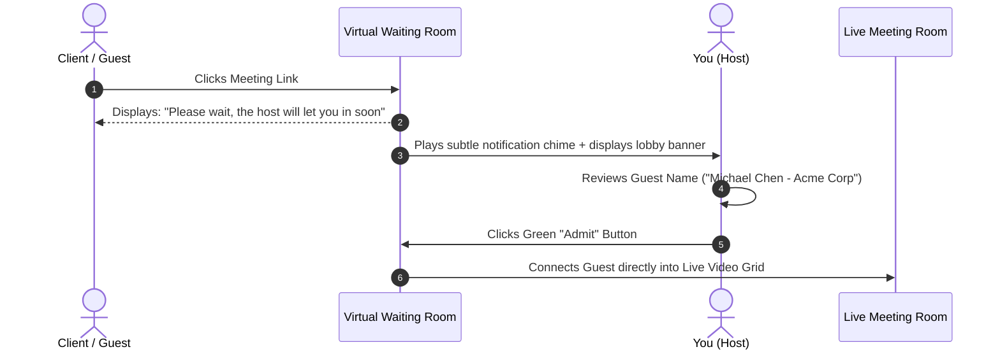
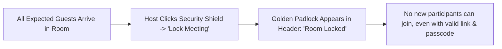

# Room Security, Waiting Rooms & Lock Meeting

Meeting security and confidentiality are vital when discussing strategic business plans, financial results, or patient records. HubMeet provides hosts with comprehensive perimeter controls: a **Secure Waiting Room Lobby**, **1-Click Meeting Lockdown**, **End-to-End Encryption (E2EE)**, and granular in-room participant permission restrictions.

---

## 1. The Waiting Room: Screening Attendees

The **Waiting Room** acts as a virtual reception lobby. When guests click your meeting link, they are placed on hold outside the room until you or a designated co-host verifies their identity and admits them:



### Enabling the Waiting Room:
- **Before the Call:** In meeting scheduling settings, check the box: **[✓] Enable Waiting Room**.
- **During an Active Call:**
  1. In the bottom control dock, click the **Security Icon** (shield with a padlock).
  2. Toggle **Waiting Room** to `Enabled`. Any new arrival will immediately be routed to the waiting room.

---

## 2. Managing the Waiting Room During a Meeting

When participants are waiting to be admitted, a blue notification banner appears at the top of your screen: *"2 people are waiting in the lobby."*

```mermaid
graph TD
    A[Lobby Banner: '2 people waiting'] --> B[Open Participants Panel (Key: P)]
    B --> C[View 'Waiting Room' Section at top of list]
    C -->|Option 1| D[Click 'Admit All' to let everyone in at once]
    C -->|Option 2| E[Click 'Admit' next to a verified name]
    C -->|Option 3| F[Click 'Deny / Remove' for unrecognized guests]
```

### Options for Admitting Guests:
- **Admit Individually:** In the **Participants Panel**, locate the guest's name under *Waiting Room* and click the green **Admit** button.
- **Admit All:** Click **Admit All** in the top banner to let all verified attendees enter simultaneously.
- **Deny / Remove:** If an unrecognized email or stranger attempts to join, click the red **Deny** button. They are disconnected from the lobby without ever seeing or hearing your room.

---

## 3. Locking the Meeting

Once all expected team members or registered clients have joined, you can **Lock the Meeting** to guarantee total privacy:



### How to Lock the Room:
1. In the bottom control dock, click the **Security Icon** (Shield).
2. Click **Lock Meeting**.
3. A golden padlock icon appears in your header bar: `🔒 Room Locked`.
4. Anyone who attempts to join after this moment will see a message: *"This meeting has been locked by the host."*
5. You can unlock the room anytime by toggling the switch off.

---

## 4. End-to-End Encryption (E2EE)

For ultra-sensitive legal, medical, or executive consultations, HubMeet features true client-side **End-to-End Encryption (E2EE)**:

- **How It Works:** Audio and video streams are encrypted directly on each participant's device before leaving their browser using Web Worker cryptography.
- **Zero Decryption in Cloud:** Not even HubNest servers or network routers can decrypt the audio/video media keys.
- **Verification:** Look at the top left corner of your screen. A green **E2EE Badge** (`🔒 End-to-End Encrypted`) confirms the cryptographic pipeline is active.

---

## 5. In-Room Participant Permissions Menu

To prevent disruptions (such as accidental screen sharing or unmuting during a formal lecture), hosts can customize room permissions in real time:

Click **Security (Shield Icon)** $\rightarrow$ **Allow Participants To**:

| Permission Toggle | Default State | Recommended Setting for Webinars |
|---|:---:|:---:|
| **Share Their Screen** | `Enabled` | 🔴 **Disabled** (Prevents accidental screen shares). |
| **Unmute Themselves** | `Enabled` | 🔴 **Disabled** (Attendees must be invited to speak). |
| **Send In-Meeting Chat Messages** | `Enabled` | 🟢 **Enabled** (Allows written questions). |
| **Start Video Camera** | `Enabled` | 🟢 **Enabled** (Allows face-to-face interaction). |
| **Rename Themselves** | `Enabled` | 🔴 **Disabled** (Ensures attendee names match attendance records). |
