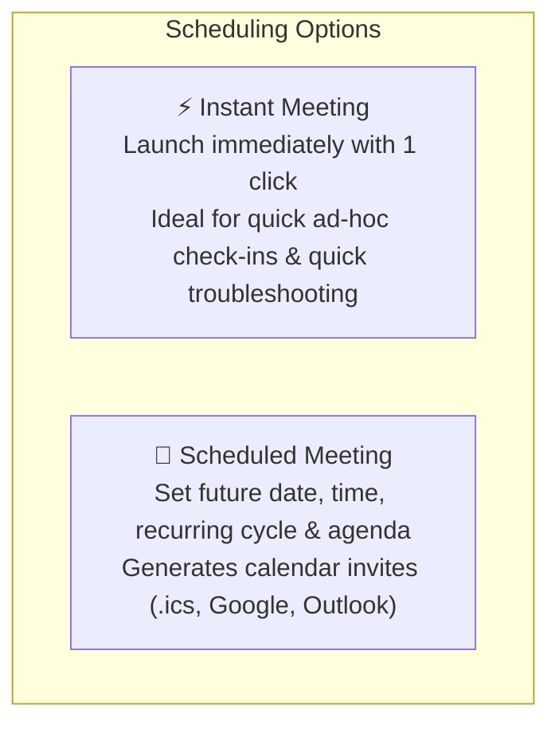
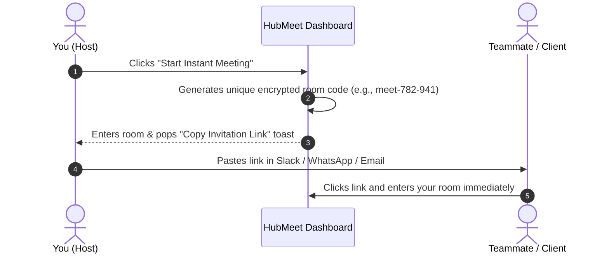
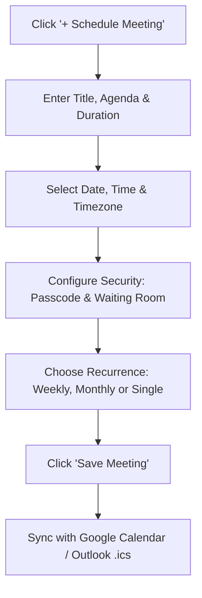
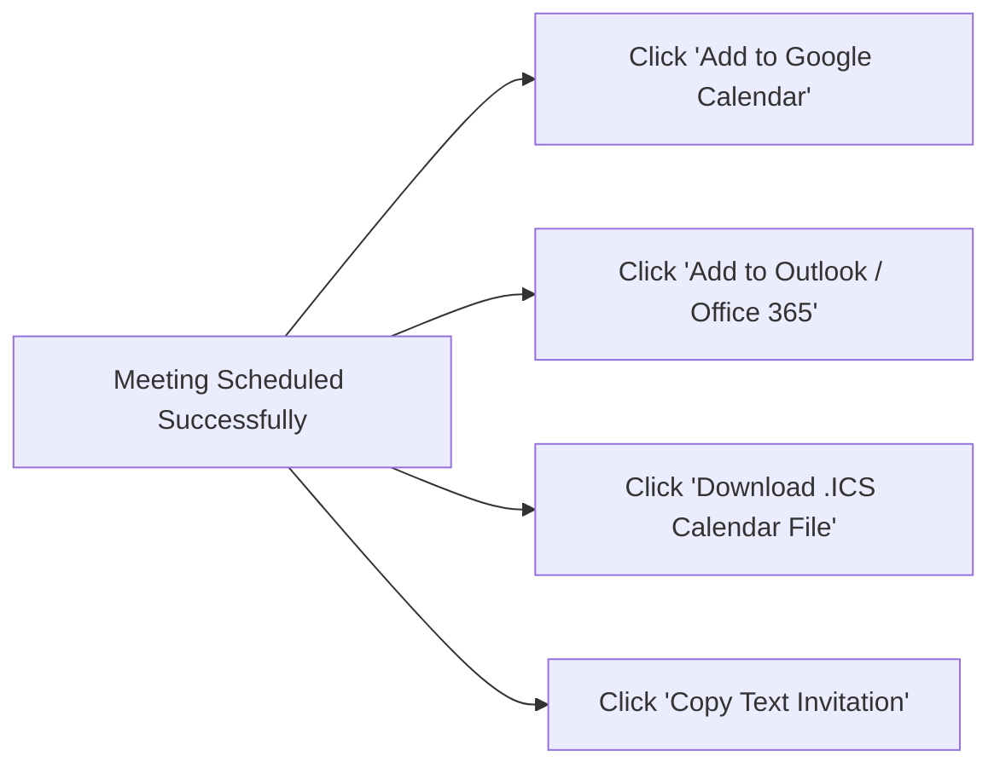

# Scheduling Meetings & Calendar Invites

HubMeet provides flexible scheduling options tailored to how modern teams communicate. You can launch an **Instant Meeting** with a single click when an urgent conversation is needed, or plan ahead by scheduling **Single and Recurring Meetings** synchronized directly with **Google Calendar** and **Microsoft Outlook**.

---

## 1. Instant Meetings vs. Scheduled Meetings



---

## 2. Launching an Instant Meeting (1-Click)

When you need to jump on a quick call with a colleague or client right now:



### Steps:
1. On your **HubMeet Dashboard**, click the prominent blue **Start Instant Meeting** button.
2. The meeting room launches immediately, and a modal displays your **Meeting Join URL**:
   `https://meet.srjhubnest.com/room/meet-782-941`
3. Click **Copy Link**.
4. Paste the link into Slack, Microsoft Teams, WhatsApp, or an email to your teammate.
5. They click the link and join your room instantly without any complex setup.

---

## 3. Scheduling a Meeting for Later

For planned webinars, client demos, or formal internal reviews:



### Step 1: Open the Scheduler Wizard
1. On your dashboard, click **+ Schedule Meeting**.
2. Complete the meeting details form:
   - **Meeting Topic:** e.g., *"Q4 Product Roadmap & Architecture Review"*.
   - **Description / Agenda:** Outline the key topics or link to preparatory reading.
   - **Date & Start Time:** Pick from the interactive calendar.
   - **Duration:** Select estimated duration (e.g., `30 mins`, `45 mins`, `1 hour`).
   - **Timezone:** Defaults to your computer's local timezone. Can be adjusted for cross-border coordination.

### Step 2: Set Recurrence (Optional)
If this is a recurring team ritual:
- Check **Recurring Meeting**.
- Choose repetition frequency:
  - **Daily:** Every business day.
  - **Weekly:** e.g., Every Monday at 10:00 AM.
  - **Bi-Weekly:** Every two weeks.
  - **Monthly:** e.g., First Thursday of every month.
- The same meeting URL and passcode remain active across all recurring instances so attendees never have to search for new links.

### Step 3: Security & Access Options
- **Require Passcode:** Check to generate an alphanumeric passcode (e.g., `HN-4928`) that guests must enter before joining.
- **Enable Waiting Room:** Place all attendees in a lobby until you admit them.
- **Mute Participants Upon Entry:** Recommended for webinars and large calls with 20+ attendees to prevent noisy entrance chimes.
- **Allow Join Before Host:** If enabled, colleagues can enter the room and chat before you arrive. If disabled, attendees wait in the lobby until you join.

---

## 4. Syncing with Google Calendar & Microsoft Outlook

Once you click **Save Meeting**, HubMeet provides direct 1-click calendar sync options:



- **Google Calendar:** Opens a new Google Calendar event in your browser with the meeting title, agenda, and 1-click join link pre-filled. Add your guests' email addresses and click Save.
- **Microsoft Outlook:** Downloads a standard `.ics` calendar appointment or opens Outlook Web directly.
- **Copy Text Invitation:** Copies a beautifully formatted email text block:

```text
You're invited to a HubMeet Video Meeting!

Topic: Q4 Product Roadmap & Architecture Review
Time: Oct 20, 2026 10:00 AM Eastern Time (US and Canada)

Join Meeting Link:
https://meet.srjhubnest.com/room/meet-782-941

Meeting ID: meet-782-941
Passcode: HN-4928
```

---

## 5. Editing or Canceling a Scheduled Meeting

If your plans change:
1. On your HubMeet Dashboard, navigate to the **Upcoming Meetings** tab.
2. Find the meeting card and click the **Three Dots Icon**.
3. Choose:
   - **Edit Meeting:** Update the date, time, or agenda.
   - **Copy Link:** Re-copy the invite link.
   - **Cancel / Delete Meeting:** Removes the meeting from your schedule and invalidates the room code.
